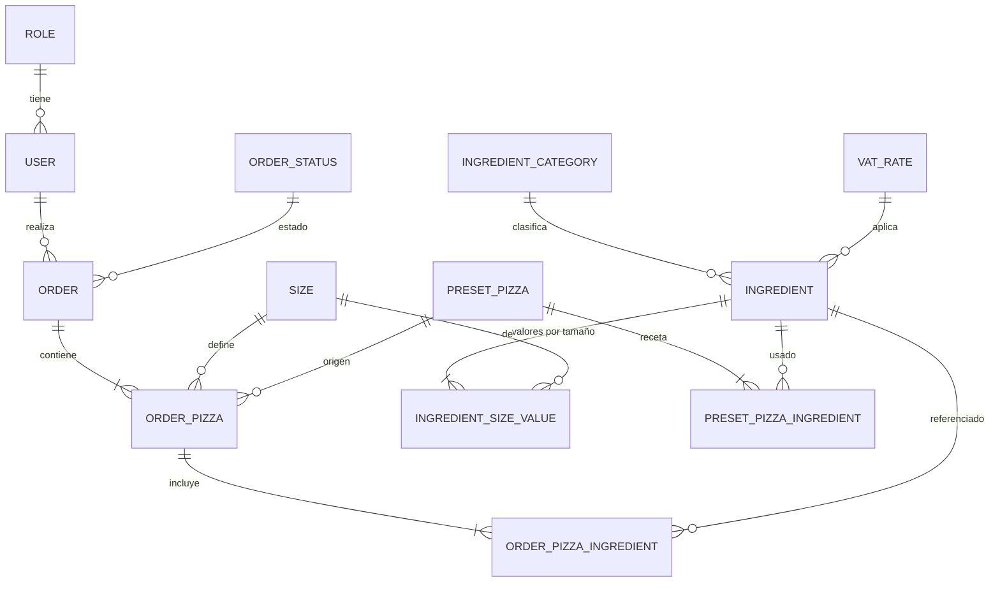

# Diagrama Entidad-Relación — Fase 1 (conceptual)

## Diccionario de datos (conceptual)

| Entidad                 | Atributos clave                                                                                                 | Descripción                                                    |
| ----------------------- | --------------------------------------------------------------------------------------------------------------- | -------------------------------------------------------------- |
| ROLE                    | nombre (Administrador, Cliente)                                                                                 | Rol de acceso                                                  |
| USER                    | nombre, email único, hash de contraseña (mínimo 8 caracteres en origen), rol                                    | Persona que usa el sistema                                     |
| SIZE                    | nombre (Individual, Mediana, Familiar)                                                                          | Tamaño de pizza                                                |
| INGREDIENT_CATEGORY     | nombre (masa, salsa, queso, carne, vegetal, otros)                                                              | Clasificación                                                  |
| VAT_RATE                | porcentaje (15 %, 0 %)                                                                                          | Tarifa de IVA                                                  |
| INGREDIENT              | código único, nombre, categoría, activo, stock, tarifa IVA                                                      | Catálogo, incluye masa y salsa; solo se desactiva, no se borra |
| INGREDIENT_SIZE_VALUE   | ingrediente, tamaño, calorías, precio (Decimal)                                                                 | Valores por tamaño                                             |
| PRESET_PIZZA            | nombre, activo (sin precio propio; el precio sale de la fórmula)                                                | Predefinida                                                    |
| PRESET_PIZZA_INGREDIENT | pizza, ingrediente, porciones                                                                                   | Receta                                                         |
| ORDER                   | número `GP-AAAAMMDD-0001`, cliente, estado, fecha (zona horaria del servidor), subtotales, IVA, total, calorías | Pedido                                                         |
| ORDER_PIZZA             | pedido, tamaño, masa, salsa, cantidad (1 a 20), precio y calorías (snapshot), predefinida de origen opcional    | Pizza del pedido                                               |
| ORDER_PIZZA_INGREDIENT  | pizza del pedido, ingrediente, porciones, precio, calorías y tarifa IVA (snapshot)                              | Ingrediente del pedido                                         |
| ORDER_STATUS            | Pendiente, En preparación, Entregado                                                                            | Estado                                                         |

## Reglas de integridad

- Código de ingrediente y email de usuario únicos.
- Cada ingrediente activo tiene valores para los 3 tamaños.
- Dinero con Decimal; nunca Float. IVA calculado sobre cada subtotal, redondeo half-up a 2 decimales.
- Porciones por ingrediente entre 1 y 3; stock no negativo; cantidad de pizzas por línea entre 1 y 20.
- Los ingredientes no se eliminan (solo se desactivan), por lo que las referencias históricas se conservan.
- Los snapshots del pedido son inmutables.
- No hay cancelación ni devolución de stock.
- Un cliente solo accede a sus pedidos.

## Cambios respecto a la fase anterior

- Primera fase; modelo conceptual. El ER lógico y físico se define en arquitectura y backend.
- v1.1: se aclara que las predefinidas no tienen precio propio, la cantidad por línea tiene tope 20 y los ingredientes no se borran.
