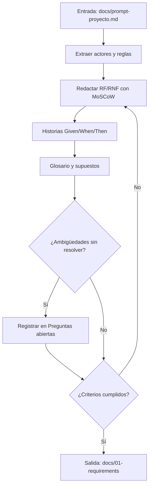
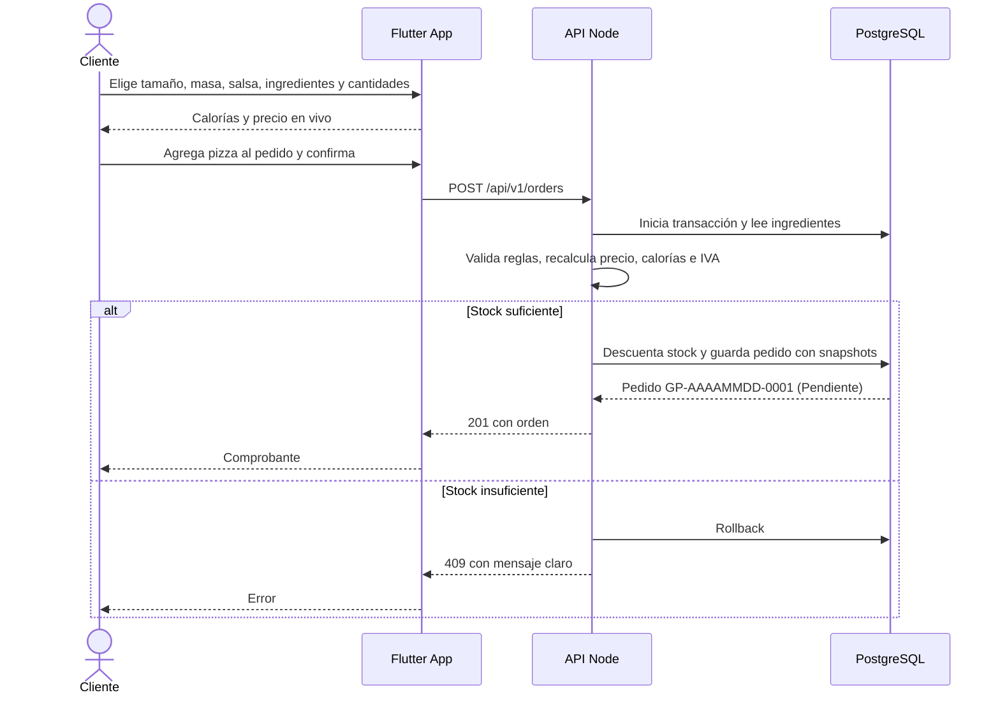
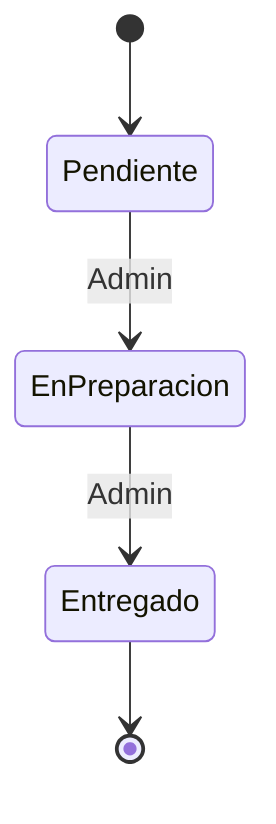

# Flujo — Fase 1: Requisitos

## Flujo de la fase (proceso)

## Flujo funcional del sistema (cliente: de la pizza a la orden)

## Estados del pedido

## Descripción paso a paso

1. El cliente se registra e inicia sesión.
2. Elige una predefinida o arma una pizza; la app valida reglas y muestra calorías y precio en vivo.
3. Agrega una o varias pizzas con cantidad y revisa el resumen con IVA desglosado.
4. Confirma; el servidor revalida, descuenta stock en transacción, guarda snapshots y numera la orden.
5. El administrador avanza el estado; el cliente lo consulta en "Mis pedidos".
