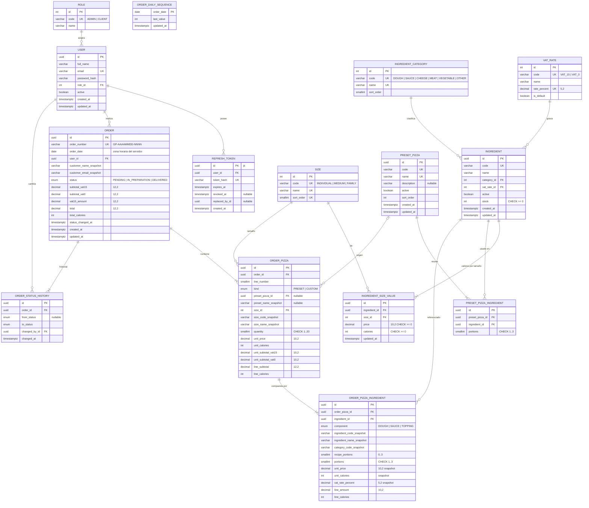

# Modelo de datos — Good Pizza

- **Fase:** 2 (Arquitectura) · **Versión:** 1.0 · **Fecha:** 2026-11-06
- **Base:** PostgreSQL 17, base `pizzeria` (ya existe; **no** se borra ni se recrea). Todo el modelo se crea con migraciones Prisma (`npm run db:migrate -- --name <accion>`).
- **Fuente:** ER conceptual de `docs/01-requirements/diagrama-er.md`; RF-04..RF-24; S-12..S-26.

## 1. Decisiones de modelado

| Decisión                       | Detalle                                                                                                                                                                                                     | ADR     |
| ------------------------------ | ----------------------------------------------------------------------------------------------------------------------------------------------------------------------------------------------------------- | ------- |
| Catálogos como tablas          | `roles`, `sizes`, `ingredient_categories`, `vat_rates` son tablas con `code` estable (lo pide el prompt: "usuarios y roles, tamaños, categorías, tarifas de IVA"). El código usa los `code`, nunca los ids. | ADR-009 |
| Estado del pedido como enum    | `OrderStatus { PENDING, IN_PREPARATION, DELIVERED }`: conjunto cerrado con transiciones fijas en código; se audita en `order_status_history`.                                                               | ADR-009 |
| Masa y salsa como ingredientes | Son filas de `ingredients` con categoría `DOUGH`/`SAUCE`. En recetas y pedidos se guardan como componentes con `portions = 1`; así la fórmula es uniforme: precio = Σ(precio(tamaño) × porciones).          | ADR-002 |
| Dinero                         | `Decimal(10,2)` para precios unitarios, `Decimal(12,2)` para totales; tarifa IVA `Decimal(5,2)`. Nunca `Float`. Calorías como `Int` (kcal).                                                                 | ADR-008 |
| Snapshots                      | `orders`, `order_pizzas` y `order_pizza_ingredients` copian nombres, códigos, precios, calorías y tarifa IVA al confirmar. Los pedidos no se recalculan nunca.                                              | ADR-003 |
| Baja lógica                    | `ingredients.active` y `preset_pizzas.active`: no hay borrado (S-23). Las FK desde pedidos usan `onDelete: Restrict`.                                                                                       | ADR-010 |
| Número de orden                | `orders.order_number` único `GP-AAAAMMDD-NNNN`; secuencia diaria en `order_daily_sequences` con upsert atómico.                                                                                             | ADR-004 |
| Ids                            | `uuid` en entidades de negocio; `Int` autoincremental en catálogos pequeños.                                                                                                                                | —       |
| Nombres                        | Modelos y campos en inglés camelCase; tablas/columnas en snake_case con `@@map`/`@map`.                                                                                                                     | —       |
| CHECK constraints              | Prisma no las modela: se agregan a mano en la migración inicial (`--create-only`, editar SQL, aplicar). Ver §5.                                                                                             | ADR-005 |

## 2. Entidades

| Entidad (modelo)      | Tabla                      | Propósito                                                                                                             |
| --------------------- | -------------------------- | --------------------------------------------------------------------------------------------------------------------- |
| Role                  | `roles`                    | `ADMIN`, `CLIENT`.                                                                                                    |
| User                  | `users`                    | Cuenta con email único, hash bcrypt y rol.                                                                            |
| RefreshToken          | `refresh_tokens`           | Hash de refresh tokens emitidos (rotación y revocación).                                                              |
| Size                  | `sizes`                    | `INDIVIDUAL` (Individual), `MEDIUM` (Mediana), `FAMILY` (Familiar).                                                   |
| IngredientCategory    | `ingredient_categories`    | `DOUGH` masa, `SAUCE` salsa, `CHEESE` queso, `MEAT` carne, `VEGETABLE` vegetal, `OTHER` otros.                        |
| VatRate               | `vat_rates`                | `VAT_15` (15.00, por defecto) y `VAT_0` (0.00).                                                                       |
| Ingredient            | `ingredients`              | Catálogo: código único, nombre, categoría, tarifa IVA, activo, stock (porciones).                                     |
| IngredientSizeValue   | `ingredient_size_values`   | Precio y calorías por porción para cada tamaño (3 filas por ingrediente).                                             |
| PresetPizza           | `preset_pizzas`            | Margarita, Pepperoni, Hawaiana, Vegetariana, 4 Quesos. Sin precio propio (S-18).                                      |
| PresetPizzaIngredient | `preset_pizza_ingredients` | Receta: 1 masa, 1 salsa y toppings con porciones (1..3).                                                              |
| Order                 | `orders`                   | Pedido: número, fecha de negocio, cliente (+ snapshot), estado y totales snapshot.                                    |
| OrderDailySequence    | `order_daily_sequences`    | Último correlativo usado por fecha de negocio.                                                                        |
| OrderStatusHistory    | `order_status_history`     | Auditoría de cambios de estado (quién y cuándo).                                                                      |
| OrderPizza            | `order_pizzas`             | Línea del pedido: tipo, predefinida de origen, tamaño, cantidad 1..20, importes unitarios y de línea snapshot.        |
| OrderPizzaIngredient  | `order_pizza_ingredients`  | Componente de la pizza del pedido (masa, salsa o topping) con porciones y snapshots de precio, calorías y tarifa IVA. |

## 3. Relaciones

| Relación                              | Cardinalidad           | onDelete | Comentario                                                  |
| ------------------------------------- | ---------------------- | -------- | ----------------------------------------------------------- |
| Role → User                           | 1:N                    | Restrict | No se borra un rol en uso.                                  |
| User → RefreshToken                   | 1:N                    | Cascade  | Tokens no tienen valor sin usuario.                         |
| User → Order                          | 1:N                    | Restrict | Los usuarios con pedidos no se borran.                      |
| User → OrderStatusHistory (changedBy) | 1:N                    | Restrict | Auditoría.                                                  |
| IngredientCategory → Ingredient       | 1:N                    | Restrict |                                                             |
| VatRate → Ingredient                  | 1:N                    | Restrict |                                                             |
| Ingredient → IngredientSizeValue      | 1:N (exactamente 3)    | Cascade  | El ingrediente nunca se borra; Cascade solo por coherencia. |
| Size → IngredientSizeValue            | 1:N                    | Restrict |                                                             |
| PresetPizza → PresetPizzaIngredient   | 1:N                    | Cascade  | Reemplazo de receta al editar.                              |
| Ingredient → PresetPizzaIngredient    | 1:N                    | Restrict |                                                             |
| Order → OrderPizza                    | 1:N (≥1)               | Cascade  | El pedido no se borra (no hay endpoint).                    |
| Order → OrderStatusHistory            | 1:N                    | Cascade  |                                                             |
| OrderPizza → OrderPizzaIngredient     | 1:N (≥2: masa + salsa) | Cascade  |                                                             |
| PresetPizza → OrderPizza              | 1:N (opcional)         | SetNull  | Se conserva `preset_name_snapshot`.                         |
| Size → OrderPizza                     | 1:N                    | Restrict | Además `size_code_snapshot`/`size_name_snapshot`.           |
| Ingredient → OrderPizzaIngredient     | 1:N                    | Restrict | Garantiza histórico; snapshots de código y nombre.          |

## 4. ERD



## 5. Esquema Prisma propuesto (`backend/prisma/schema.prisma`)

La fase backend lo implementa tal cual (o con ajustes menores documentados). Debe generar la migración inicial con `npm run db:migrate -- --name init --create-only`, añadir al final del SQL las restricciones CHECK de §5.1 y luego aplicar con `npm run db:migrate`.

```prisma
// Good Pizza — esquema Prisma (PostgreSQL, base `pizzeria`)
generator client {
  provider = "prisma-client-js"
}

datasource db {
  provider = "postgresql"
  url      = env("DATABASE_URL")
}

// ---------- Enums ----------

enum OrderStatus {
  PENDING
  IN_PREPARATION
  DELIVERED

  @@map("order_status")
}

enum PizzaKind {
  PRESET
  CUSTOM

  @@map("pizza_kind")
}

enum PizzaComponent {
  DOUGH
  SAUCE
  TOPPING

  @@map("pizza_component")
}

// ---------- Usuarios y seguridad ----------

model Role {
  id    Int    @id @default(autoincrement())
  code  String @unique @db.VarChar(20) // ADMIN | CLIENT
  name  String @db.VarChar(50)
  users User[]

  @@map("roles")
}

model User {
  id            String               @id @default(uuid()) @db.Uuid
  fullName      String               @map("full_name") @db.VarChar(120)
  email         String               @unique @db.VarChar(254) // guardado en minúsculas
  passwordHash  String               @map("password_hash") @db.VarChar(100)
  roleId        Int                  @map("role_id")
  role          Role                 @relation(fields: [roleId], references: [id], onDelete: Restrict, onUpdate: Cascade)
  active        Boolean              @default(true)
  createdAt     DateTime             @default(now()) @map("created_at") @db.Timestamptz(3)
  updatedAt     DateTime             @updatedAt @map("updated_at") @db.Timestamptz(3)
  orders        Order[]
  refreshTokens RefreshToken[]
  statusChanges OrderStatusHistory[]

  @@index([roleId])
  @@map("users")
}

model RefreshToken {
  id           String    @id @db.Uuid // = jti del JWT de refresh
  userId       String    @map("user_id") @db.Uuid
  user         User      @relation(fields: [userId], references: [id], onDelete: Cascade, onUpdate: Cascade)
  tokenHash    String    @unique @map("token_hash") @db.VarChar(128) // SHA-256 hex
  expiresAt    DateTime  @map("expires_at") @db.Timestamptz(3)
  revokedAt    DateTime? @map("revoked_at") @db.Timestamptz(3)
  replacedById String?   @map("replaced_by_id") @db.Uuid
  createdAt    DateTime  @default(now()) @map("created_at") @db.Timestamptz(3)

  @@index([userId])
  @@index([expiresAt])
  @@map("refresh_tokens")
}

// ---------- Catálogos ----------

model Size {
  id               Int                   @id @default(autoincrement())
  code             String                @unique @db.VarChar(20) // INDIVIDUAL | MEDIUM | FAMILY
  name             String                @unique @db.VarChar(40) // Individual | Mediana | Familiar
  sortOrder        Int                   @unique @map("sort_order") @db.SmallInt
  ingredientValues IngredientSizeValue[]
  orderPizzas      OrderPizza[]

  @@map("sizes")
}

model IngredientCategory {
  id          Int          @id @default(autoincrement())
  code        String       @unique @db.VarChar(20) // DOUGH | SAUCE | CHEESE | MEAT | VEGETABLE | OTHER
  name        String       @unique @db.VarChar(40) // Masa | Salsa | Queso | Carne | Vegetal | Otros
  sortOrder   Int          @map("sort_order") @db.SmallInt
  ingredients Ingredient[]

  @@map("ingredient_categories")
}

model VatRate {
  id          Int          @id @default(autoincrement())
  code        String       @unique @db.VarChar(20) // VAT_15 | VAT_0
  name        String       @db.VarChar(40) // "IVA 15 %" | "IVA 0 %"
  ratePercent Decimal      @unique @map("rate_percent") @db.Decimal(5, 2) // 15.00 | 0.00
  isDefault   Boolean      @default(false) @map("is_default")
  ingredients Ingredient[]

  @@map("vat_rates")
}

// ---------- Ingredientes ----------

model Ingredient {
  id                 String                  @id @default(uuid()) @db.Uuid
  code               String                  @unique @db.VarChar(20)
  name               String                  @db.VarChar(80)
  categoryId         Int                     @map("category_id")
  category           IngredientCategory      @relation(fields: [categoryId], references: [id], onDelete: Restrict, onUpdate: Cascade)
  vatRateId          Int                     @map("vat_rate_id")
  vatRate            VatRate                 @relation(fields: [vatRateId], references: [id], onDelete: Restrict, onUpdate: Cascade)
  active             Boolean                 @default(true)
  stock              Int                     @default(0) // porciones; CHECK (stock >= 0)
  createdAt          DateTime                @default(now()) @map("created_at") @db.Timestamptz(3)
  updatedAt          DateTime                @updatedAt @map("updated_at") @db.Timestamptz(3)
  sizeValues         IngredientSizeValue[]
  presetIngredients  PresetPizzaIngredient[]
  orderIngredients   OrderPizzaIngredient[]

  @@index([categoryId])
  @@index([vatRateId])
  @@index([active, categoryId])
  @@map("ingredients")
}

model IngredientSizeValue {
  id           String     @id @default(uuid()) @db.Uuid
  ingredientId String     @map("ingredient_id") @db.Uuid
  ingredient   Ingredient @relation(fields: [ingredientId], references: [id], onDelete: Cascade, onUpdate: Cascade)
  sizeId       Int        @map("size_id")
  size         Size       @relation(fields: [sizeId], references: [id], onDelete: Restrict, onUpdate: Cascade)
  price        Decimal    @db.Decimal(10, 2) // USD sin IVA por porción; CHECK (price >= 0)
  calories     Int        // kcal por porción; CHECK (calories >= 0)
  updatedAt    DateTime   @updatedAt @map("updated_at") @db.Timestamptz(3)

  @@unique([ingredientId, sizeId])
  @@index([sizeId])
  @@map("ingredient_size_values")
}

// ---------- Pizzas predefinidas ----------

model PresetPizza {
  id          String                  @id @default(uuid()) @db.Uuid
  code        String                  @unique @db.VarChar(30) // MARGHERITA, PEPPERONI, HAWAIIAN, VEGETARIAN, FOUR_CHEESE
  name        String                  @unique @db.VarChar(80)
  description String?                 @db.VarChar(300)
  active      Boolean                 @default(true)
  sortOrder   Int                     @default(0) @map("sort_order")
  createdAt   DateTime                @default(now()) @map("created_at") @db.Timestamptz(3)
  updatedAt   DateTime                @updatedAt @map("updated_at") @db.Timestamptz(3)
  ingredients PresetPizzaIngredient[]
  orderPizzas OrderPizza[]

  @@index([active, sortOrder])
  @@map("preset_pizzas")
}

model PresetPizzaIngredient {
  id            String      @id @default(uuid()) @db.Uuid
  presetPizzaId String      @map("preset_pizza_id") @db.Uuid
  presetPizza   PresetPizza @relation(fields: [presetPizzaId], references: [id], onDelete: Cascade, onUpdate: Cascade)
  ingredientId  String      @map("ingredient_id") @db.Uuid
  ingredient    Ingredient  @relation(fields: [ingredientId], references: [id], onDelete: Restrict, onUpdate: Cascade)
  portions      Int         @db.SmallInt // CHECK (portions BETWEEN 1 AND 3); masa y salsa = 1

  @@unique([presetPizzaId, ingredientId])
  @@index([ingredientId])
  @@map("preset_pizza_ingredients")
}

// ---------- Pedidos ----------

model Order {
  id                    String               @id @default(uuid()) @db.Uuid
  orderNumber           String               @unique @map("order_number") @db.VarChar(20) // GP-AAAAMMDD-NNNN
  orderDate             DateTime             @map("order_date") @db.Date // fecha de negocio (TZ del servidor)
  userId                String               @map("user_id") @db.Uuid
  user                  User                 @relation(fields: [userId], references: [id], onDelete: Restrict, onUpdate: Cascade)
  customerNameSnapshot  String               @map("customer_name_snapshot") @db.VarChar(120)
  customerEmailSnapshot String               @map("customer_email_snapshot") @db.VarChar(254)
  status                OrderStatus          @default(PENDING)
  subtotalVat15         Decimal              @map("subtotal_vat15") @db.Decimal(12, 2)
  subtotalVat0          Decimal              @map("subtotal_vat0") @db.Decimal(12, 2)
  vat15Amount           Decimal              @map("vat15_amount") @db.Decimal(12, 2)
  total                 Decimal              @db.Decimal(12, 2)
  totalCalories         Int                  @map("total_calories")
  statusChangedAt       DateTime             @default(now()) @map("status_changed_at") @db.Timestamptz(3)
  createdAt             DateTime             @default(now()) @map("created_at") @db.Timestamptz(3)
  updatedAt             DateTime             @updatedAt @map("updated_at") @db.Timestamptz(3)
  pizzas                OrderPizza[]
  statusHistory         OrderStatusHistory[]

  @@index([userId, createdAt(sort: Desc)])
  @@index([status, createdAt(sort: Desc)])
  @@index([orderDate])
  @@map("orders")
}

model OrderDailySequence {
  orderDate DateTime @id @map("order_date") @db.Date
  lastValue Int      @map("last_value")
  updatedAt DateTime @updatedAt @map("updated_at") @db.Timestamptz(3)

  @@map("order_daily_sequences")
}

model OrderStatusHistory {
  id          String       @id @default(uuid()) @db.Uuid
  orderId     String       @map("order_id") @db.Uuid
  order       Order        @relation(fields: [orderId], references: [id], onDelete: Cascade, onUpdate: Cascade)
  fromStatus  OrderStatus? @map("from_status") // null en la creación
  toStatus    OrderStatus  @map("to_status")
  changedById String       @map("changed_by_id") @db.Uuid
  changedBy   User         @relation(fields: [changedById], references: [id], onDelete: Restrict, onUpdate: Cascade)
  changedAt   DateTime     @default(now()) @map("changed_at") @db.Timestamptz(3)

  @@index([orderId, changedAt])
  @@index([changedById])
  @@map("order_status_history")
}

model OrderPizza {
  id                 String                 @id @default(uuid()) @db.Uuid
  orderId            String                 @map("order_id") @db.Uuid
  order              Order                  @relation(fields: [orderId], references: [id], onDelete: Cascade, onUpdate: Cascade)
  lineNumber         Int                    @map("line_number") @db.SmallInt
  kind               PizzaKind
  presetPizzaId      String?                @map("preset_pizza_id") @db.Uuid
  presetPizza        PresetPizza?           @relation(fields: [presetPizzaId], references: [id], onDelete: SetNull, onUpdate: Cascade)
  presetNameSnapshot String?                @map("preset_name_snapshot") @db.VarChar(80)
  sizeId             Int                    @map("size_id")
  size               Size                   @relation(fields: [sizeId], references: [id], onDelete: Restrict, onUpdate: Cascade)
  sizeCodeSnapshot   String                 @map("size_code_snapshot") @db.VarChar(20)
  sizeNameSnapshot   String                 @map("size_name_snapshot") @db.VarChar(40)
  quantity           Int                    @db.SmallInt // CHECK (quantity BETWEEN 1 AND 20)
  unitPrice          Decimal                @map("unit_price") @db.Decimal(10, 2) // sin IVA
  unitCalories       Int                    @map("unit_calories")
  unitSubtotalVat15  Decimal                @map("unit_subtotal_vat15") @db.Decimal(10, 2)
  unitSubtotalVat0   Decimal                @map("unit_subtotal_vat0") @db.Decimal(10, 2)
  lineSubtotal       Decimal                @map("line_subtotal") @db.Decimal(12, 2) // unitPrice × quantity
  lineCalories       Int                    @map("line_calories") // unitCalories × quantity
  ingredients        OrderPizzaIngredient[]

  @@unique([orderId, lineNumber])
  @@index([presetPizzaId])
  @@index([sizeId])
  @@map("order_pizzas")
}

model OrderPizzaIngredient {
  id                     String         @id @default(uuid()) @db.Uuid
  orderPizzaId           String         @map("order_pizza_id") @db.Uuid
  orderPizza             OrderPizza     @relation(fields: [orderPizzaId], references: [id], onDelete: Cascade, onUpdate: Cascade)
  ingredientId           String         @map("ingredient_id") @db.Uuid
  ingredient             Ingredient     @relation(fields: [ingredientId], references: [id], onDelete: Restrict, onUpdate: Cascade)
  component              PizzaComponent
  ingredientCodeSnapshot String         @map("ingredient_code_snapshot") @db.VarChar(20)
  ingredientNameSnapshot String         @map("ingredient_name_snapshot") @db.VarChar(80)
  categoryCodeSnapshot   String         @map("category_code_snapshot") @db.VarChar(20)
  recipePortions         Int            @default(0) @map("recipe_portions") @db.SmallInt // porciones que venían en la receta
  portions               Int            @db.SmallInt // total (receta + extra); CHECK 1..3
  unitPrice              Decimal        @map("unit_price") @db.Decimal(10, 2) // snapshot precio(tamaño)
  unitCalories           Int            @map("unit_calories") // snapshot calorías(tamaño)
  vatRatePercent         Decimal        @map("vat_rate_percent") @db.Decimal(5, 2) // snapshot 15.00 | 0.00
  lineAmount             Decimal        @map("line_amount") @db.Decimal(10, 2) // unitPrice × portions
  lineCalories           Int            @map("line_calories") // unitCalories × portions

  @@unique([orderPizzaId, ingredientId])
  @@index([ingredientId])
  @@map("order_pizza_ingredients")
}
```

### 5.1 Restricciones CHECK (SQL añadido a la migración inicial)

```sql
ALTER TABLE "ingredients"              ADD CONSTRAINT "ingredients_stock_nonneg"        CHECK ("stock" >= 0);
ALTER TABLE "ingredient_size_values"   ADD CONSTRAINT "isv_price_nonneg"               CHECK ("price" >= 0);
ALTER TABLE "ingredient_size_values"   ADD CONSTRAINT "isv_calories_nonneg"            CHECK ("calories" >= 0);
ALTER TABLE "vat_rates"                ADD CONSTRAINT "vat_rates_percent_range"        CHECK ("rate_percent" >= 0 AND "rate_percent" <= 100);
ALTER TABLE "preset_pizza_ingredients" ADD CONSTRAINT "ppi_portions_range"             CHECK ("portions" BETWEEN 1 AND 3);
ALTER TABLE "order_pizzas"             ADD CONSTRAINT "order_pizzas_quantity_range"    CHECK ("quantity" BETWEEN 1 AND 20);
ALTER TABLE "order_pizza_ingredients"  ADD CONSTRAINT "opi_portions_range"             CHECK ("portions" BETWEEN 1 AND 3);
ALTER TABLE "order_pizza_ingredients"  ADD CONSTRAINT "opi_recipe_portions_range"      CHECK ("recipe_portions" BETWEEN 0 AND "portions");
ALTER TABLE "orders"                   ADD CONSTRAINT "orders_total_consistent"        CHECK ("total" = "subtotal_vat15" + "subtotal_vat0" + "vat15_amount");
```

`CHECK (stock >= 0)` es la última defensa contra sobreventa (ADR-005): aunque un bug saltara la verificación del servicio, PostgreSQL abortaría la transacción.

## 6. Reglas de integridad que no cubre el esquema (las garantiza el servicio)

| Regla                                                                                                                                                   | Dónde                                                                            |
| ------------------------------------------------------------------------------------------------------------------------------------------------------- | -------------------------------------------------------------------------------- |
| Cada ingrediente tiene exactamente 3 `ingredient_size_values` (uno por tamaño).                                                                         | `ingredient.service` (crear/editar exigen los 3 tamaños; `MISSING_SIZE_VALUES`). |
| Receta de predefinida: exactamente 1 `DOUGH` y 1 `SAUCE` con `portions = 1`; toppings de otras categorías.                                              | `presetPizza.service` + motor.                                                   |
| Cada `order_pizza` tiene exactamente 1 componente `DOUGH` y 1 `SAUCE`.                                                                                  | Motor + `order.service`.                                                         |
| Una sola tarifa con `is_default = true`.                                                                                                                | Seed (no hay endpoint para modificar tarifas).                                   |
| No se cambia la categoría de un ingrediente usado en alguna receta si rompe la regla masa/salsa/topping.                                                | `ingredient.service` (`INGREDIENT_CATEGORY_LOCKED`).                             |
| Transiciones de estado solo PENDING → IN_PREPARATION → DELIVERED.                                                                                       | `order.service` (`INVALID_STATUS_TRANSITION`).                                   |
| Los registros de `orders`, `order_pizzas` y `order_pizza_ingredients` no se modifican tras crearse, salvo `status`, `status_changed_at` y `updated_at`. | No existe ningún endpoint de edición.                                            |
| `subtotal_vat15 + subtotal_vat0 = Σ line_subtotal`; `total_calories = Σ line_calories`.                                                                 | Motor (probado en unitarias).                                                    |

## 7. Datos de referencia y seed (datos de ejemplo, S-16)

`prisma/seed.js` es idempotente (`upsert` por `code`/`email`):

- `roles`: ADMIN "Administrador", CLIENT "Cliente".
- `sizes`: INDIVIDUAL "Individual" (1), MEDIUM "Mediana" (2), FAMILY "Familiar" (3).
- `ingredient_categories`: DOUGH Masa, SAUCE Salsa, CHEESE Queso, MEAT Carne, VEGETABLE Vegetal, OTHER Otros.
- `vat_rates`: VAT_15 "IVA 15 %" 15.00 (default), VAT_0 "IVA 0 %" 0.00.
- `users`: admin (`SEED_ADMIN_EMAIL`, `SEED_ADMIN_PASSWORD`) y cliente (`SEED_CLIENT_EMAIL`, `SEED_CLIENT_PASSWORD`); si falta la contraseña, se genera aleatoria (`crypto.randomBytes`) y se imprime una sola vez; si el usuario ya existe, el seed no cambia su contraseña.
- ~20 ingredientes de ejemplo (2-3 masas, 3 salsas, quesos, carnes, vegetales), con precio y calorías distintos por tamaño, stock inicial y la mayoría con IVA 15 % (algunos 0 %). **Son datos de ejemplo, no precios reales.**
- 5 predefinidas con su receta (Margarita, Pepperoni, Hawaiana, Vegetariana, 4 Quesos).

## 8. Consultas críticas

- **Bloqueo de stock al confirmar** (dentro de la transacción, ids ordenados para evitar interbloqueos):
  `SELECT id, stock, active FROM ingredients WHERE id = ANY($1::uuid[]) ORDER BY id FOR UPDATE;`
- **Descuento** (por ingrediente, tras validar): `UPDATE ingredients SET stock = stock - $n, updated_at = now() WHERE id = $id AND stock >= $n;` (se comprueba 1 fila afectada).
- **Siguiente número del día**:
  `INSERT INTO order_daily_sequences (order_date, last_value, updated_at) VALUES ($1, 1, now()) ON CONFLICT (order_date) DO UPDATE SET last_value = order_daily_sequences.last_value + 1, updated_at = now() RETURNING last_value;`
- **Mis pedidos**: `orders WHERE user_id = $me ORDER BY created_at DESC` (índice `[userId, createdAt desc]`), paginado.
