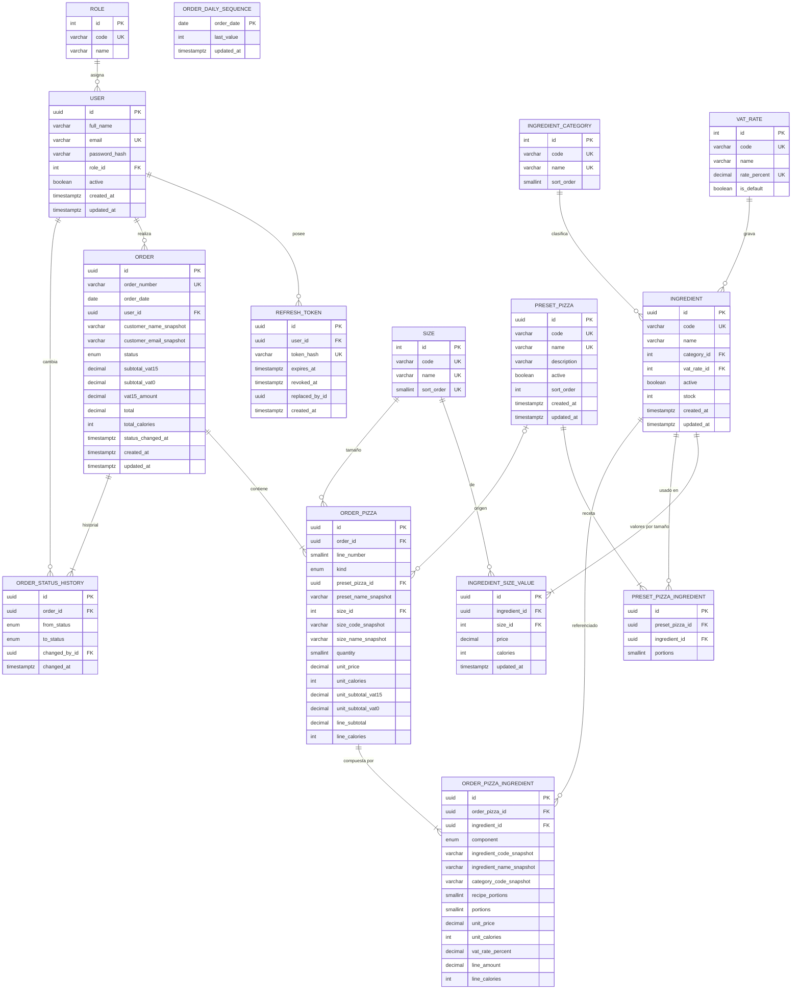

# Diagrama Entidad-Relación — Fase 2 (lógico)

Coherente con el esquema Prisma propuesto en `data-model.md` §5. Nombres de tabla/columna en snake_case (como quedarán en PostgreSQL vía `@@map`/`@map`).

Tablas: `roles`, `users`, `refresh_tokens`, `sizes`, `ingredient_categories`, `vat_rates`, `ingredients`, `ingredient_size_values`, `preset_pizzas`, `preset_pizza_ingredients`, `orders`, `order_daily_sequences`, `order_status_history`, `order_pizzas`, `order_pizza_ingredients`. Enums: `order_status` (PENDING, IN_PREPARATION, DELIVERED), `pizza_kind` (PRESET, CUSTOM), `pizza_component` (DOUGH, SAUCE, TOPPING).

## Diccionario de datos

| Entidad                  | Atributo                                                                     | Tipo            | Nulo | Restricciones                                   | Descripción                                               |
| ------------------------ | ---------------------------------------------------------------------------- | --------------- | ---- | ----------------------------------------------- | --------------------------------------------------------- |
| roles                    | id                                                                           | int             | no   | PK, autoincremental                             |                                                           |
| roles                    | code                                                                         | varchar(20)     | no   | UK                                              | `ADMIN`, `CLIENT`.                                        |
| roles                    | name                                                                         | varchar(50)     | no   |                                                 | Administrador, Cliente.                                   |
| users                    | id                                                                           | uuid            | no   | PK                                              |                                                           |
| users                    | full_name                                                                    | varchar(120)    | no   |                                                 | Nombre del cliente/admin.                                 |
| users                    | email                                                                        | varchar(254)    | no   | UK, minúsculas                                  | Usuario de acceso.                                        |
| users                    | password_hash                                                                | varchar(100)    | no   | bcrypt coste ≥ 12                               | Nunca la contraseña en claro.                             |
| users                    | role_id                                                                      | int             | no   | FK roles, Restrict, índice                      |                                                           |
| users                    | active                                                                       | boolean         | no   | def. true                                       | Usuario desactivado → 403.                                |
| users                    | created_at / updated_at                                                      | timestamptz     | no   |                                                 |                                                           |
| refresh_tokens           | id                                                                           | uuid            | no   | PK (= jti)                                      |                                                           |
| refresh_tokens           | user_id                                                                      | uuid            | no   | FK users, Cascade, índice                       |                                                           |
| refresh_tokens           | token_hash                                                                   | varchar(128)    | no   | UK                                              | SHA-256 del token.                                        |
| refresh_tokens           | expires_at                                                                   | timestamptz     | no   | índice                                          |                                                           |
| refresh_tokens           | revoked_at                                                                   | timestamptz     | sí   |                                                 | Revocado por rotación/logout.                             |
| refresh_tokens           | replaced_by_id                                                               | uuid            | sí   |                                                 | Token que lo sustituyó.                                   |
| sizes                    | id                                                                           | int             | no   | PK                                              |                                                           |
| sizes                    | code                                                                         | varchar(20)     | no   | UK                                              | `INDIVIDUAL`, `MEDIUM`, `FAMILY`.                         |
| sizes                    | name                                                                         | varchar(40)     | no   | UK                                              | Individual, Mediana, Familiar.                            |
| sizes                    | sort_order                                                                   | smallint        | no   | UK                                              | Orden de presentación.                                    |
| ingredient_categories    | code                                                                         | varchar(20)     | no   | UK                                              | `DOUGH`, `SAUCE`, `CHEESE`, `MEAT`, `VEGETABLE`, `OTHER`. |
| ingredient_categories    | name                                                                         | varchar(40)     | no   | UK                                              | Masa, Salsa, Queso, Carne, Vegetal, Otros.                |
| ingredient_categories    | sort_order                                                                   | smallint        | no   |                                                 |                                                           |
| vat_rates                | code                                                                         | varchar(20)     | no   | UK                                              | `VAT_15`, `VAT_0`.                                        |
| vat_rates                | name                                                                         | varchar(40)     | no   |                                                 | "IVA 15 %", "IVA 0 %".                                    |
| vat_rates                | rate_percent                                                                 | decimal(5,2)    | no   | UK, CHECK 0..100                                | 15.00 / 0.00.                                             |
| vat_rates                | is_default                                                                   | boolean         | no   | una sola en true                                | 15 % por defecto.                                         |
| ingredients              | id                                                                           | uuid            | no   | PK                                              |                                                           |
| ingredients              | code                                                                         | varchar(20)     | no   | UK, `^[A-Z0-9-]+$`                              | Código único.                                             |
| ingredients              | name                                                                         | varchar(80)     | no   |                                                 |                                                           |
| ingredients              | category_id                                                                  | int             | no   | FK, Restrict, índice                            |                                                           |
| ingredients              | vat_rate_id                                                                  | int             | no   | FK, Restrict, índice                            |                                                           |
| ingredients              | active                                                                       | boolean         | no   | def. true; índice (active, category_id)         | Baja lógica (S-23).                                       |
| ingredients              | stock                                                                        | int             | no   | def. 0, CHECK ≥ 0                               | En porciones.                                             |
| ingredient_size_values   | ingredient_id                                                                | uuid            | no   | FK Cascade; UK (ingredient_id, size_id)         |                                                           |
| ingredient_size_values   | size_id                                                                      | int             | no   | FK Restrict, índice                             |                                                           |
| ingredient_size_values   | price                                                                        | decimal(10,2)   | no   | CHECK ≥ 0                                       | USD por porción, sin IVA.                                 |
| ingredient_size_values   | calories                                                                     | int             | no   | CHECK ≥ 0                                       | kcal por porción.                                         |
| preset_pizzas            | code                                                                         | varchar(30)     | no   | UK                                              | MARGHERITA, PEPPERONI, HAWAIIAN, VEGETARIAN, FOUR_CHEESE. |
| preset_pizzas            | name                                                                         | varchar(80)     | no   | UK                                              |                                                           |
| preset_pizzas            | description                                                                  | varchar(300)    | sí   |                                                 |                                                           |
| preset_pizzas            | active                                                                       | boolean         | no   | def. true; índice (active, sort_order)          | Baja lógica. Sin columna de precio (S-18).                |
| preset_pizzas            | sort_order                                                                   | int             | no   | def. 0                                          |                                                           |
| preset_pizza_ingredients | preset_pizza_id                                                              | uuid            | no   | FK Cascade; UK (preset_pizza_id, ingredient_id) |                                                           |
| preset_pizza_ingredients | ingredient_id                                                                | uuid            | no   | FK Restrict, índice                             |                                                           |
| preset_pizza_ingredients | portions                                                                     | smallint        | no   | CHECK 1..3                                      | Masa y salsa = 1.                                         |
| orders                   | order_number                                                                 | varchar(20)     | no   | UK                                              | `GP-AAAAMMDD-NNNN`.                                       |
| orders                   | order_date                                                                   | date            | no   | índice                                          | Fecha de negocio (TZ del servidor).                       |
| orders                   | user_id                                                                      | uuid            | no   | FK Restrict; índice (user_id, created_at desc)  | Dueño del pedido.                                         |
| orders                   | customer_name_snapshot / customer_email_snapshot                             | varchar         | no   |                                                 | Datos del cliente al comprar.                             |
| orders                   | status                                                                       | order_status    | no   | def. PENDING; índice (status, created_at desc)  |                                                           |
| orders                   | subtotal_vat15 / subtotal_vat0                                               | decimal(12,2)   | no   |                                                 | Σ por tarifa.                                             |
| orders                   | vat15_amount                                                                 | decimal(12,2)   | no   |                                                 | round_half_up(subtotal_vat15 × 0.15, 2).                  |
| orders                   | total                                                                        | decimal(12,2)   | no   | CHECK = sub15 + sub0 + IVA                      |                                                           |
| orders                   | total_calories                                                               | int             | no   |                                                 | Σ line_calories.                                          |
| orders                   | status_changed_at                                                            | timestamptz     | no   |                                                 |                                                           |
| order_daily_sequences    | order_date                                                                   | date            | no   | PK                                              |                                                           |
| order_daily_sequences    | last_value                                                                   | int             | no   |                                                 | Último correlativo del día.                               |
| order_status_history     | order_id                                                                     | uuid            | no   | FK Cascade; índice (order_id, changed_at)       |                                                           |
| order_status_history     | from_status                                                                  | order_status    | sí   | null en la creación                             |                                                           |
| order_status_history     | to_status                                                                    | order_status    | no   |                                                 |                                                           |
| order_status_history     | changed_by_id                                                                | uuid            | no   | FK users Restrict                               |                                                           |
| order_pizzas             | order_id                                                                     | uuid            | no   | FK Cascade; UK (order_id, line_number)          |                                                           |
| order_pizzas             | line_number                                                                  | smallint        | no   |                                                 | 1..N.                                                     |
| order_pizzas             | kind                                                                         | pizza_kind      | no   |                                                 | PRESET / CUSTOM.                                          |
| order_pizzas             | preset_pizza_id                                                              | uuid            | sí   | FK SetNull, índice                              | Origen.                                                   |
| order_pizzas             | preset_name_snapshot                                                         | varchar(80)     | sí   |                                                 |                                                           |
| order_pizzas             | size_id                                                                      | int             | no   | FK Restrict, índice                             |                                                           |
| order_pizzas             | size_code_snapshot / size_name_snapshot                                      | varchar         | no   |                                                 |                                                           |
| order_pizzas             | quantity                                                                     | smallint        | no   | CHECK 1..20                                     | S-26.                                                     |
| order_pizzas             | unit_price                                                                   | decimal(10,2)   | no   |                                                 | Precio de 1 pizza sin IVA.                                |
| order_pizzas             | unit_calories                                                                | int             | no   |                                                 |                                                           |
| order_pizzas             | unit_subtotal_vat15 / unit_subtotal_vat0                                     | decimal(10,2)   | no   |                                                 | Desglose por tarifa de 1 pizza.                           |
| order_pizzas             | line_subtotal                                                                | decimal(12,2)   | no   |                                                 | unit_price × quantity.                                    |
| order_pizzas             | line_calories                                                                | int             | no   |                                                 | unit_calories × quantity.                                 |
| order_pizza_ingredients  | order_pizza_id                                                               | uuid            | no   | FK Cascade; UK (order_pizza_id, ingredient_id)  |                                                           |
| order_pizza_ingredients  | ingredient_id                                                                | uuid            | no   | FK Restrict, índice                             |                                                           |
| order_pizza_ingredients  | component                                                                    | pizza_component | no   |                                                 | DOUGH / SAUCE / TOPPING.                                  |
| order_pizza_ingredients  | ingredient_code_snapshot / ingredient_name_snapshot / category_code_snapshot | varchar         | no   |                                                 |                                                           |
| order_pizza_ingredients  | recipe_portions                                                              | smallint        | no   | def. 0, CHECK 0..portions                       | Porciones de la receta (predefinidas).                    |
| order_pizza_ingredients  | portions                                                                     | smallint        | no   | CHECK 1..3                                      | Total por pizza.                                          |
| order_pizza_ingredients  | unit_price                                                                   | decimal(10,2)   | no   |                                                 | Snapshot precio(tamaño).                                  |
| order_pizza_ingredients  | unit_calories                                                                | int             | no   |                                                 | Snapshot calorías(tamaño).                                |
| order_pizza_ingredients  | vat_rate_percent                                                             | decimal(5,2)    | no   |                                                 | Snapshot 15.00 / 0.00.                                    |
| order_pizza_ingredients  | line_amount                                                                  | decimal(10,2)   | no   |                                                 | unit_price × portions.                                    |
| order_pizza_ingredients  | line_calories                                                                | int             | no   |                                                 | unit_calories × portions.                                 |

## Reglas de integridad

- Email de usuario y código de ingrediente, predefinida, tamaño, categoría, tarifa y rol únicos.
- Cada ingrediente tiene exactamente 3 filas en `ingredient_size_values` (garantizado por el servicio; UK evita duplicados).
- Dinero en `decimal`, nunca `float`; IVA redondeado half-up a 2 decimales sobre el subtotal 15 % del pedido.
- Stock nunca negativo (CHECK + descuento condicional en transacción con `FOR UPDATE`).
- Porciones 1..3 en recetas y en pizzas del pedido; cantidad 1..20 por línea.
- Recetas y pizzas del pedido: exactamente 1 componente DOUGH y 1 SAUCE (servicio).
- Ingredientes y predefinidas no se borran (baja lógica); FK desde pedidos con Restrict (SetNull para la predefinida de origen, con snapshot de nombre).
- Snapshots inmutables: no hay operación de edición sobre pedidos salvo `status`.
- Transiciones de estado solo PENDING → IN_PREPARATION → DELIVERED, auditadas en `order_status_history`.
- Un cliente solo accede a pedidos con `user_id` propio.

## Cambios respecto a la fase anterior

- Se pasa del ER conceptual al lógico con tipos, claves, índices y `onDelete`.
- `ORDER_STATUS` (entidad conceptual) pasa a enum `order_status` + nueva tabla `order_status_history` (ADR-009).
- Nuevas entidades técnicas: `refresh_tokens` (ADR-006) y `order_daily_sequences` (ADR-004).
- Masa y salsa del pedido se modelan como filas de `order_pizza_ingredients` con `component` DOUGH/SAUCE (en vez de columnas en ORDER_PIZZA), para una fórmula uniforme (ADR-002).
- Snapshots ampliados: datos del cliente, nombres/códigos de ingrediente, tamaño y predefinida, desglose por tarifa (ADR-003).
