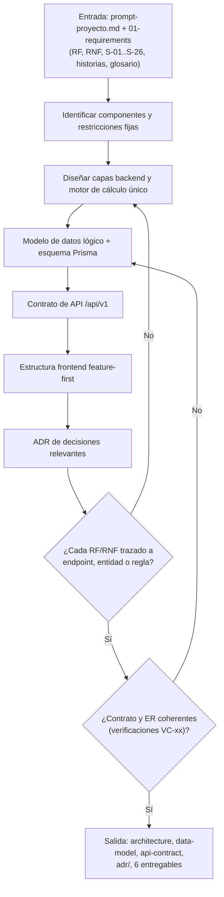
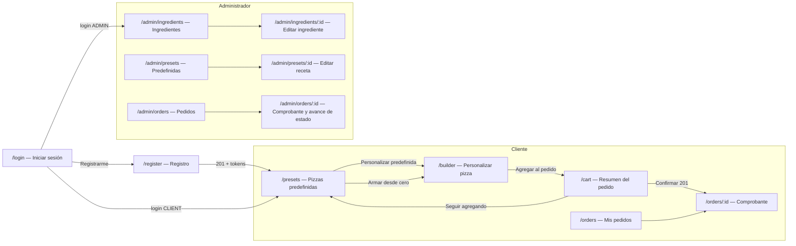
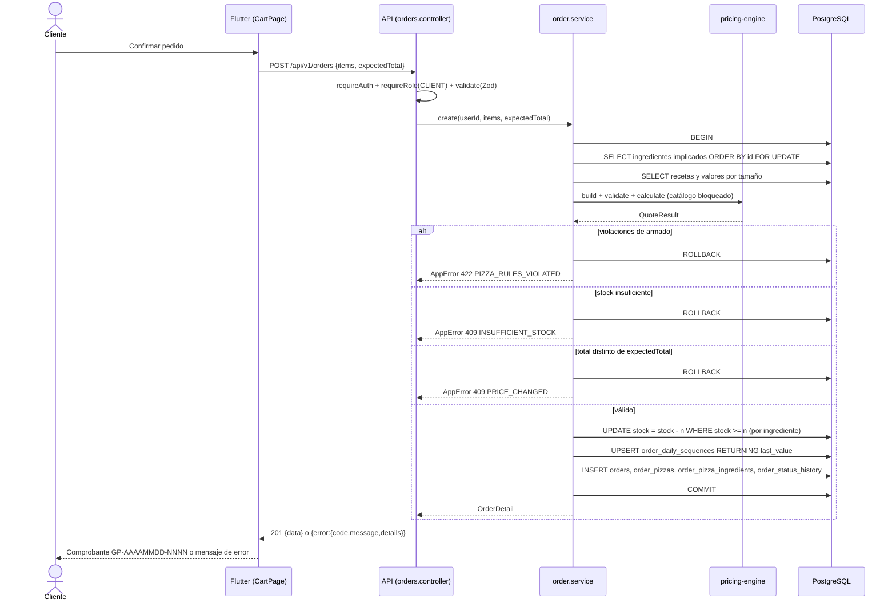
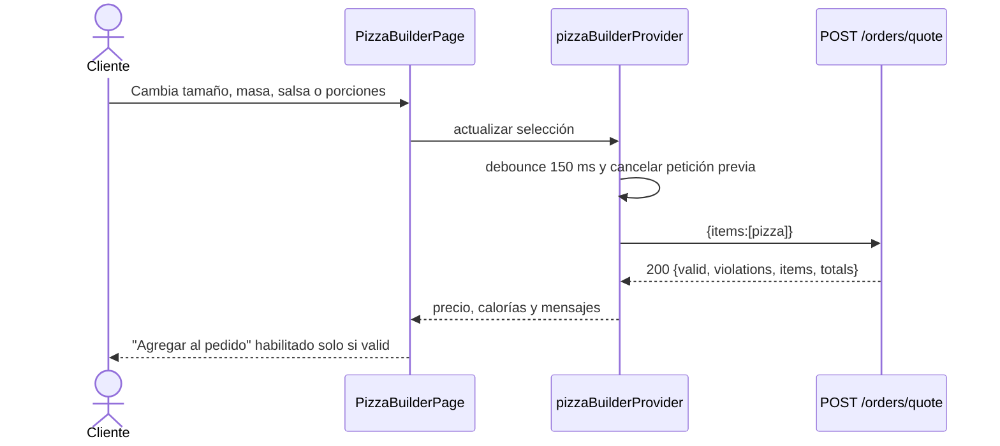
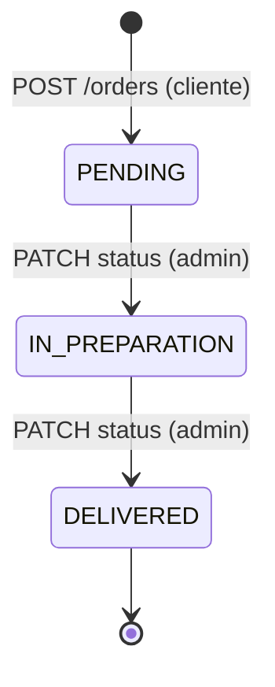

# Flujo — Fase 2: Arquitectura

## Flujo de la fase (proceso)

## Flujos de pantalla (cliente y administrador)

La navegación entre secciones de un mismo rol se hace con el `NavigationRail` (cliente: Predefinidas, Personalizar, Pedido, Mis pedidos; admin: Ingredientes, Predefinidas, Pedidos; ambos: Cerrar sesión).

## Flujo funcional del sistema: confirmar pedido

## Flujo funcional: cálculo en vivo

## Flujo funcional: avance de estado (admin)

Sin cancelación ni retroceso (S-07, S-20). Cualquier otra transición responde `422 INVALID_STATUS_TRANSITION`; un cliente recibe `403 FORBIDDEN`.

## Descripción paso a paso

1. El arquitecto toma el prompt (fuente que manda) y los requisitos de la fase 1.
2. Define el monolito y las capas del backend; centraliza las reglas en el motor de cálculo (ADR-001, ADR-002).
3. Deriva el modelo lógico desde el ER conceptual, añade snapshots, secuencia diaria, historial de estados y tokens de refresco; produce el esquema Prisma.
4. Diseña el contrato `/api/v1` (25 endpoints) con errores uniformes y matriz de permisos.
5. Define la estructura feature-first del frontend, su estado (Riverpod) y su navegación (go_router).
6. Registra 11 ADR y verifica la trazabilidad RF/RNF ↔ endpoint/entidad/regla (`pruebas-unitarias.md`).
7. En ejecución: el cliente arma una pizza con cotización en vivo, la agrega al carrito, confirma (transacción con stock, numeración y snapshots) y ve el comprobante; el admin avanza el estado.
