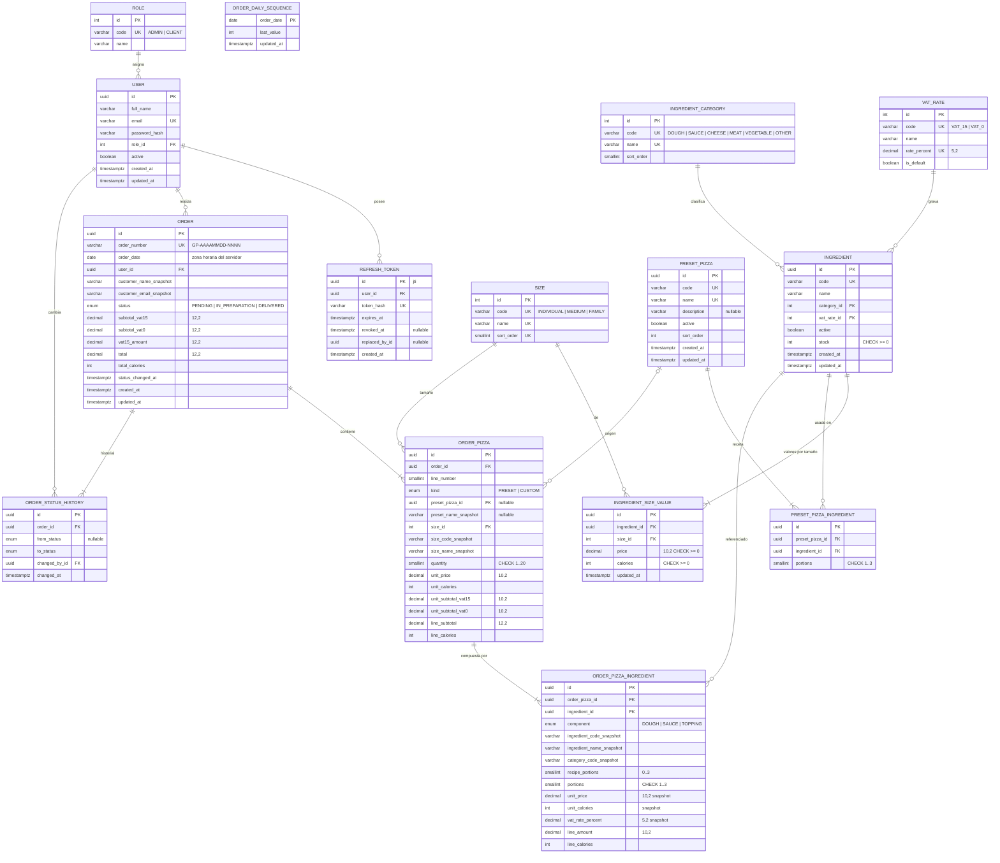
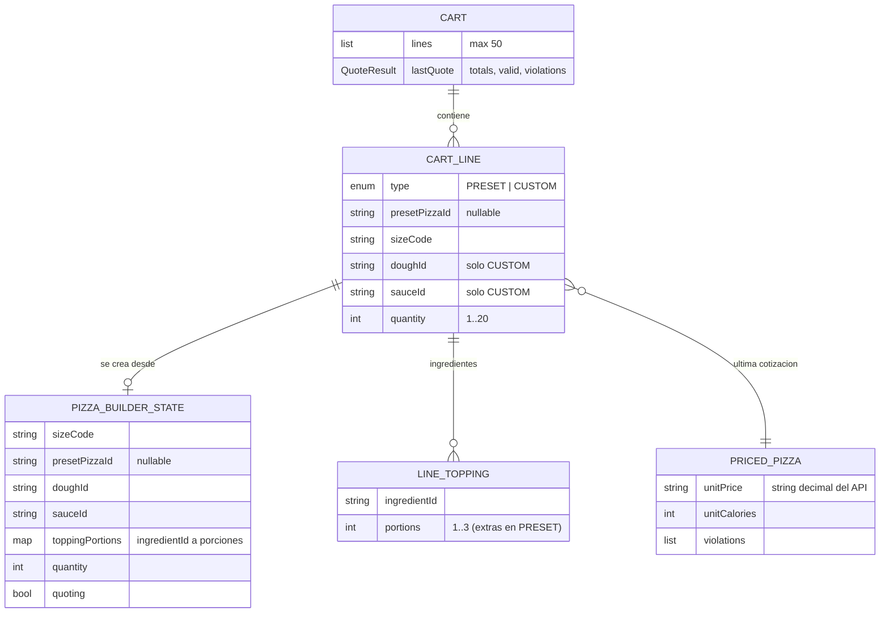

# Diagrama Entidad-Relación — Fase 3 (Diseño UX/UI)

- **Fuente de verdad:** `docs/02-architecture/data-model.md` (ER lógico y esquema Prisma propuesto). La fase de diseño **no modifica el modelo de datos**: **sin cambios** respecto a la fase 2. Este documento reproduce el ER para que cada pantalla se pueda trazar a sus entidades y añade el modelo de **estado de interfaz** (no persistido).

## 1. ER lógico (idéntico a la fase 2)

## 2. Trazabilidad pantalla → entidades

| Pantalla    | Entidades leídas / escritas (vía API)                                                                                                                          | Campos mostrados destacados                                                     |
| ----------- | -------------------------------------------------------------------------------------------------------------------------------------------------------------- | ------------------------------------------------------------------------------- |
| S-01 / S-02 | `USER`, `ROLE`, `REFRESH_TOKEN` (escritura)                                                                                                                    | `full_name`, `email`, rol                                                       |
| S-03        | `PRESET_PIZZA`, `PRESET_PIZZA_INGREDIENT`, `INGREDIENT`, `INGREDIENT_SIZE_VALUE`, `SIZE` (lectura)                                                             | receta, precio y calorías por tamaño (calculados), disponibilidad               |
| S-04        | `INGREDIENT` (+ `stock`), `INGREDIENT_CATEGORY`, `INGREDIENT_SIZE_VALUE`, `SIZE`, `PRESET_PIZZA_INGREDIENT`                                                    | `stock`, precio/calorías por porción del tamaño, categoría                      |
| S-05        | cotización (sin escritura); al confirmar: `ORDER`, `ORDER_PIZZA`, `ORDER_PIZZA_INGREDIENT`, `ORDER_STATUS_HISTORY`, `ORDER_DAILY_SEQUENCE`, `INGREDIENT.stock` | subtotales 15 % / 0 %, IVA, total, calorías                                     |
| S-06 / S-13 | `ORDER`, `ORDER_PIZZA`, `ORDER_PIZZA_INGREDIENT`, `ORDER_STATUS_HISTORY` (solo snapshots)                                                                      | `order_number`, `created_at`, `customer_*_snapshot`, `status`, totales          |
| S-07 / S-08 | `INGREDIENT`, `INGREDIENT_SIZE_VALUE`, `INGREDIENT_CATEGORY`, `VAT_RATE`, `SIZE`                                                                               | código, nombre, categoría, `active`, `stock`, IVA, precio y calorías por tamaño |
| S-09 / S-10 | `PRESET_PIZZA`, `PRESET_PIZZA_INGREDIENT`, `INGREDIENT`                                                                                                        | código, nombre, descripción, `sort_order`, receta                               |
| S-11 / S-12 | `ORDER` (todos), `ORDER_STATUS_HISTORY`, `USER` (cambió)                                                                                                       | cliente, estado, historial                                                      |

## 3. Estado de interfaz (no persistido, Riverpod)

Modelos en memoria del frontend; **no hay tablas nuevas**. Se envían al API como `PizzaItemInput` (`api-contract.md` §1.4).

## 4. Diccionario de datos

Sin cambios: ver `docs/02-architecture/data-model.md` §2 (entidades), §4 (ERD) y §5 (esquema Prisma). Los tipos de la UI (strings decimales para dinero, enteros para calorías) siguen `api-contract.md` §1.

## 5. Reglas de integridad relevantes para la UI

- Un ingrediente tiene exactamente 3 valores por tamaño: el formulario S-08 exige los tres.
- Masa y salsa son ingredientes (`DOUGH`/`SAUCE`) con porción fija 1: S-04 no los ofrece como ingredientes adicionales.
- Los pedidos y su comprobante se leen solo de snapshots; la UI nunca recalcula un pedido existente.
- Sin borrado de ingredientes, predefinidas ni pedidos: la UI solo ofrece desactivar (S-07, S-09).

## 6. Cambios respecto a la fase anterior

Ninguno en el modelo de datos. Se añade únicamente el modelo de estado de interfaz de §3 (no persistido).
