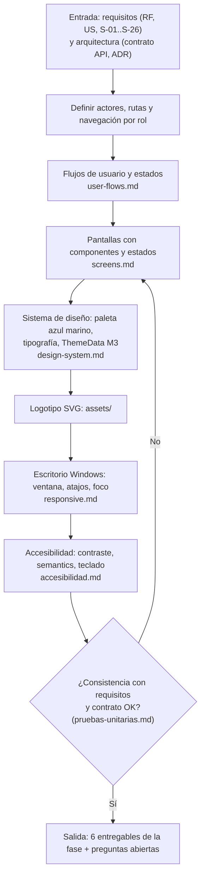

# Flujo — Fase 3: Diseño UX/UI

## Flujo de la fase (proceso)



## Flujo funcional del sistema (cálculo en vivo y confirmación)

```mermaid
sequenceDiagram
    actor U as Cliente
    participant F as Flutter App (S-04 / S-05)
    participant A as API Node /api/v1
    participant D as PostgreSQL
    U->>F: Marca queso x3 (checkbox + stepper)
    F->>F: Estado local inmediato (límite min(3 - receta, stock))
    F->>A: POST /orders/quote (debounce 150 ms, cancela la anterior)
    A->>D: Lee catálogo (sin bloqueo)
    D-->>A: Ingredientes, valores por tamaño, stock
    A-->>F: 200 {valid, violations, items, totals, stock}
    F-->>U: Calorías y precio en vivo; mensajes; Agregar habilitado o no
    U->>F: Agregar al pedido, luego Confirmar pedido
    F->>A: POST /orders {items[], expectedTotal}
    A->>D: Transacción: bloqueo, motor, descuento de stock, número, snapshots
    D-->>A: Pedido creado
    A-->>F: 201 OrderDetail (PENDING)
    F-->>U: Comprobante en pantalla (S-13)
```

## Descripción paso a paso

1. El diseñador lee los requisitos (RF-01..RF-29, RNF-05/06) y el contrato (`/orders/quote` con `valid` y `violations`, formato de error uniforme).
2. Define 13 pantallas (S-01..S-13) y la navegación con `NavigationRail` por rol (cliente: 4 destinos; admin: 3).
3. Documenta los flujos en Mermaid (`user-flows.md`): acceso, cliente de predefinidas a comprobante, armado en vivo, admin de ingredientes, predefinidas y pedidos con máquina de estados.
4. Diseña cada pantalla con maqueta, componentes, textos en español y estados cargando, vacío y error; mapea los 24 códigos de error del contrato y las violaciones de armado a mensajes (`screens.md` §6).
5. Define la paleta azul marino con contraste AA verificado, la tipografía, el espaciado y el `ThemeData` Material 3 (`design-system.md`), y crea el logotipo SVG (`assets/`).
6. Especifica el comportamiento de escritorio Windows (ventana mínima 1024 × 680, rail compacto/extendido, atajos, ratón, foco) y declara el móvil fuera de alcance (`responsive.md`).
7. Verifica la consistencia del diseño contra requisitos y contrato (`pruebas-unitarias.md`) y entrega las preguntas abiertas.

Los flujos de usuario detallados están en `user-flows.md`.
