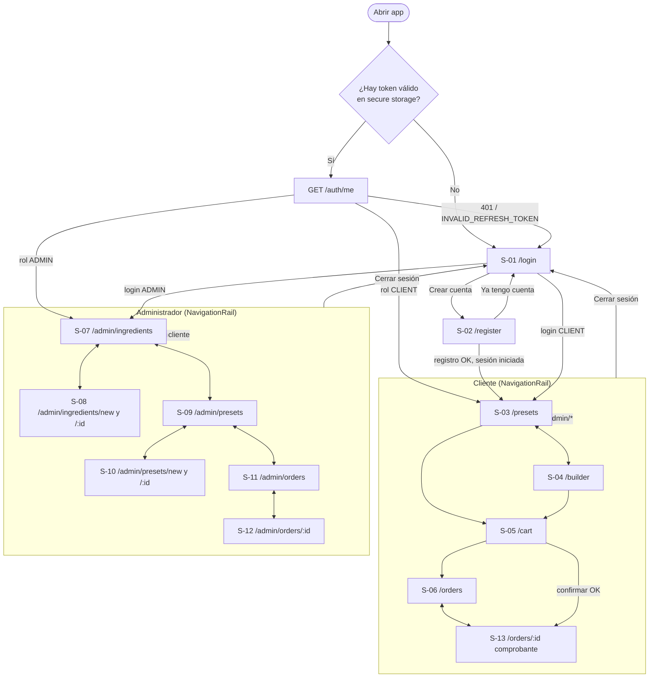
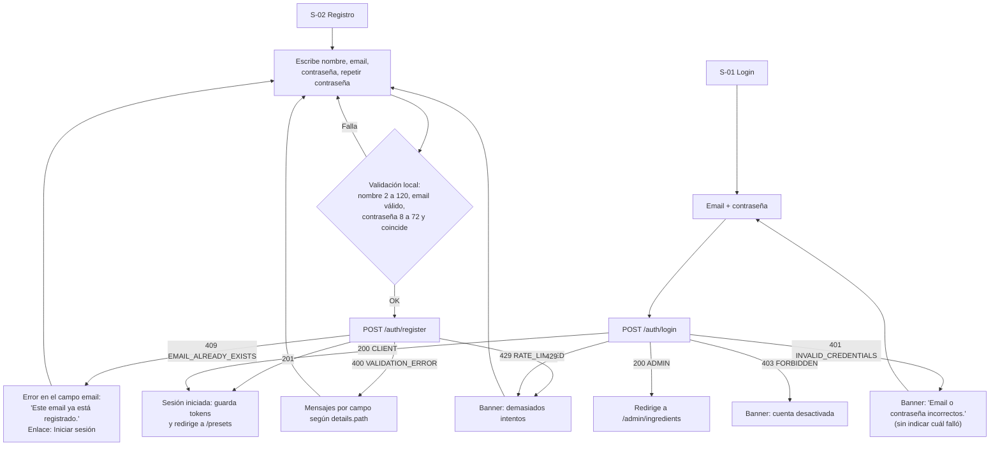
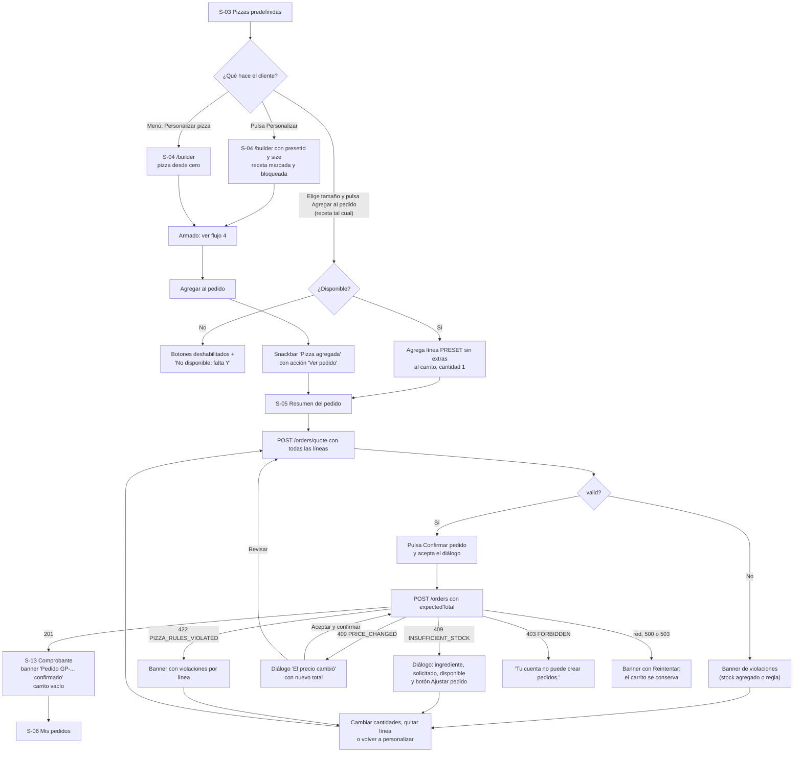
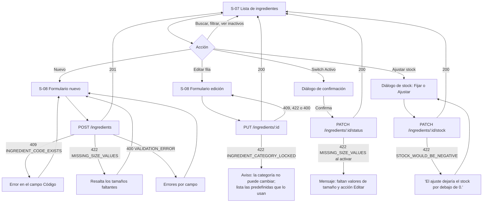
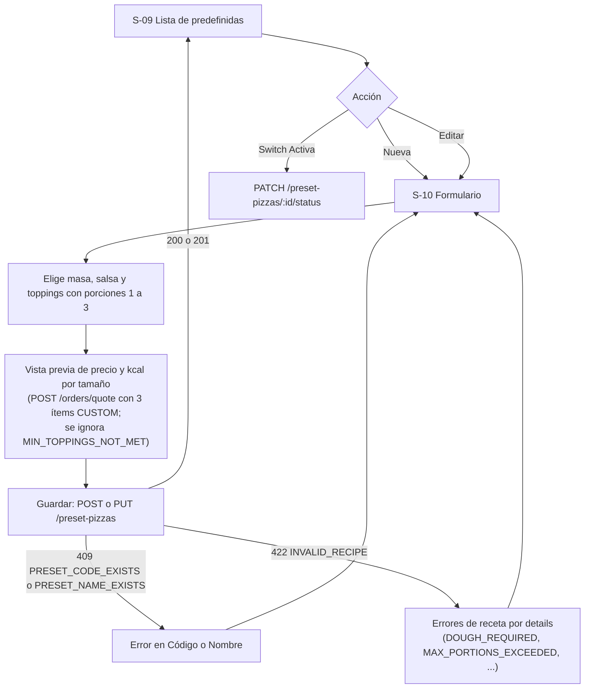
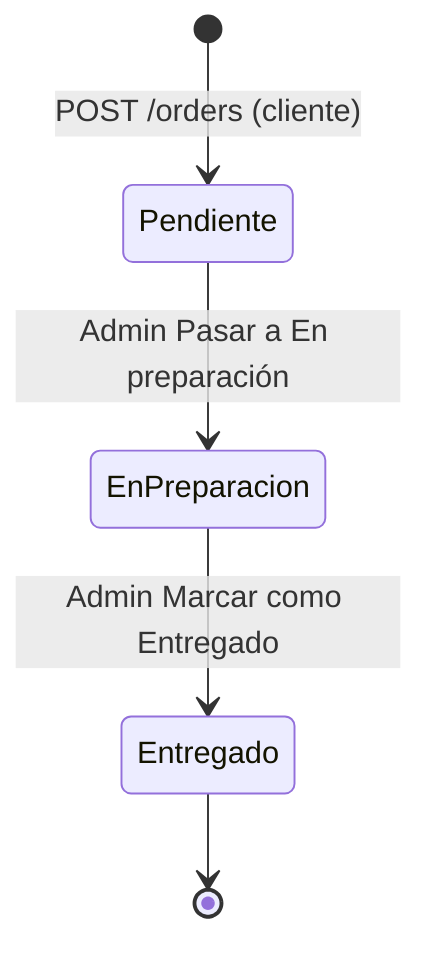
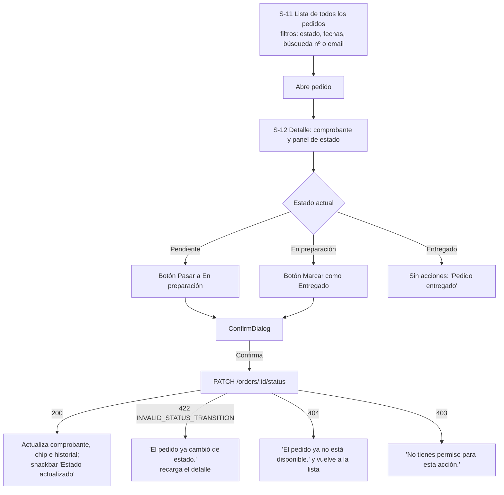
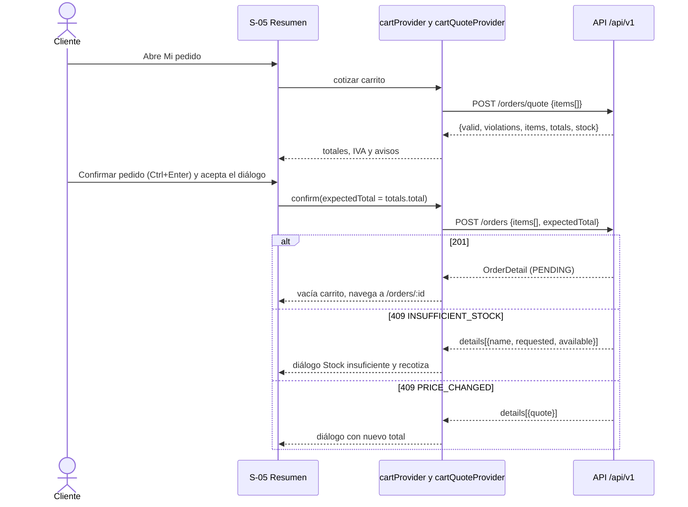

# Flujos de usuario — Good Pizza

- **Fase:** 3 (Diseño UX/UI) · **Versión:** 1.0 · **Fecha:** 2026-11-06
- Rutas de `docs/02-architecture/architecture.md` §3.4. Códigos de error del contrato `api-contract.md` §1.2/§1.3. Pantallas: ver `screens.md` (S-xx).

## 1. Mapa de navegación y redirecciones por sesión y rol

Regla: cualquier `401 TOKEN_EXPIRED` se resuelve en silencio con un único refresh (interceptor). Si falla (`INVALID_REFRESH_TOKEN`) se limpia la sesión, se muestra "Tu sesión expiró. Inicia sesión de nuevo." y se redirige a `/login`.

## 2. Registro e inicio de sesión

## 3. Cliente: de pizzas predefinidas a comprobante

## 4. Armado de la pizza con cálculo en vivo (S-04)

```mermaid
flowchart TD
    S([Entra a Personalizar pizza]) --> L[Carga GET /sizes y GET /ingredients\nsin page, lista completa con stock]
    L -- error --> LE[ErrorBanner + Reintentar]
    L -- OK --> INIT{¿Viene presetId?}
    INIT -- Sí --> PRE[GET /preset-pizzas/:id\nreceta marcada y bloqueada,\nporciones de receta = mínimo]
    INIT -- No --> EMPTY[Tamaño Mediana por defecto,\nnada marcado]
    PRE --> SEL
    EMPTY --> SEL
    SEL[Cliente cambia la selección] --> WHAT{¿Qué cambió?}
    WHAT -- Tamaño --> RECALC
    WHAT -- "Masa o salsa (exclusivo:\nmarcar otra desmarca la anterior)" --> RECALC
    WHAT -- "Marca o desmarca ingrediente" --> RECALC
    WHAT -- "Porciones 1 a 3" --> LIM{"¿Supera el límite local?\nmin de 3 menos receta y stock"}
    LIM -- Sí --> TIP["No avanza; mensaje:\n'Máximo 3 porciones por ingrediente'\no 'Stock disponible: N'"]
    LIM -- No --> RECALC
    WHAT -- "Cantidad de pizzas 1 a 20" --> RECALC
    RECALC["Estado local inmediato, luego\ndebounce 150 ms y POST /orders/quote\n(cancela la petición anterior)"] --> R{Respuesta}
    R -- "200 valid=true" --> OKP[Muestra calorías y precio;\nAgregar al pedido habilitado]
    R -- "200 valid=false" --> VIOL["Muestra importes parciales y mensajes\nde items[0].violations y violations raíz;\nAgregar deshabilitado con el motivo"]
    R -- "400 o error de red" --> ERRQ["Aviso 'No se pudo calcular' + Reintentar;\nAgregar deshabilitado"]
    OKP --> SEL
    VIOL --> SEL
    OKP --> ADD[Agregar al pedido: pasa al carrito]
```

Mensajes por violación (`code` a ubicación en la UI): ver `screens.md` §6.2.

## 5. Administrador: ingredientes

## 6. Administrador: pizzas predefinidas

Sin campo de precio: el precio de cada predefinida siempre se muestra calculado por fórmula (S-18).

## 7. Administrador: gestión de pedidos y estados

Sin cancelar, sin retroceder, sin saltar estados. Solo el administrador cambia el estado.

El cliente ve el cambio al refrescar "Mis pedidos" (botón "Actualizar", `F5`) o al volver a abrir el detalle (PA-UX-07).

## 8. Confirmación de pedido: secuencia cliente, UI y API

