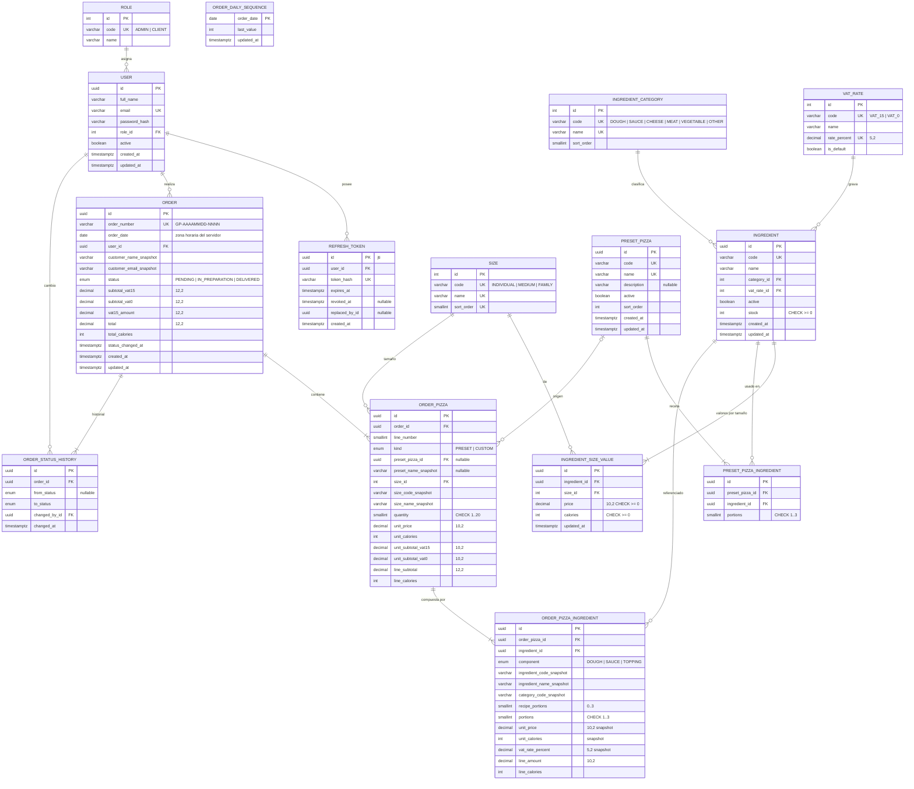

# Diagrama Entidad-Relación — Fase 4 (Backend, ER físico)

Es el modelo **realmente implementado** en `backend/prisma/schema.prisma` y aplicado a la base `pizzeria` (esquema `public`) con las migraciones de `backend/prisma/migrations/`. Coincide con el ER lógico de la fase 2 (`docs/02-architecture/data-model.md`): el esquema Prisma se implementó tal cual, sin ajustes.

## Diccionario de datos (resumen físico)

Convenciones: tablas y columnas en `snake_case`; ids `uuid` en entidades de negocio e `int` autoincremental en catálogos; fechas `timestamptz(3)`; dinero `numeric` (nunca `Float`); calorías `int`.

| Tabla                      | Columnas clave                                                                                                                                                                                                                                                      | Restricciones                                                                                                                                                                               |
| -------------------------- | ------------------------------------------------------------------------------------------------------------------------------------------------------------------------------------------------------------------------------------------------------------------- | ------------------------------------------------------------------------------------------------------------------------------------------------------------------------------------------- |
| `roles`                    | `id`, `code` (ADMIN/CLIENT), `name`                                                                                                                                                                                                                                 | `code` único                                                                                                                                                                                |
| `users`                    | `id`, `full_name`, `email`, `password_hash`, `role_id`, `active`                                                                                                                                                                                                    | `email` único (minúsculas); FK `role_id` Restrict; índice `role_id`                                                                                                                         |
| `refresh_tokens`           | `id` (= jti), `user_id`, `token_hash` (SHA-256), `expires_at`, `revoked_at`, `replaced_by_id`                                                                                                                                                                       | `token_hash` único; FK `user_id` Cascade; índices `user_id`, `expires_at`                                                                                                                   |
| `sizes`                    | `id`, `code`, `name`, `sort_order`                                                                                                                                                                                                                                  | `code`, `name`, `sort_order` únicos                                                                                                                                                         |
| `ingredient_categories`    | `id`, `code`, `name`, `sort_order`                                                                                                                                                                                                                                  | `code`, `name` únicos                                                                                                                                                                       |
| `vat_rates`                | `id`, `code`, `name`, `rate_percent numeric(5,2)`, `is_default`                                                                                                                                                                                                     | `code`, `rate_percent` únicos; CHECK `0..100`                                                                                                                                               |
| `ingredients`              | `id`, `code`, `name`, `category_id`, `vat_rate_id`, `active`, `stock`                                                                                                                                                                                               | `code` único; CHECK `stock >= 0`; FK Restrict; índices `category_id`, `vat_rate_id`, `(active, category_id)`                                                                                |
| `ingredient_size_values`   | `id`, `ingredient_id`, `size_id`, `price numeric(10,2)`, `calories`                                                                                                                                                                                                 | único `(ingredient_id, size_id)`; CHECK `price >= 0`, `calories >= 0`; FK ingrediente Cascade, tamaño Restrict                                                                              |
| `preset_pizzas`            | `id`, `code`, `name`, `description`, `active`, `sort_order`                                                                                                                                                                                                         | `code` y `name` únicos; índice `(active, sort_order)`; sin precio propio                                                                                                                    |
| `preset_pizza_ingredients` | `id`, `preset_pizza_id`, `ingredient_id`, `portions`                                                                                                                                                                                                                | único `(preset_pizza_id, ingredient_id)`; CHECK `portions 1..3`; FK receta Cascade, ingrediente Restrict                                                                                    |
| `orders`                   | `id`, `order_number`, `order_date date`, `user_id`, `customer_name_snapshot`, `customer_email_snapshot`, `status`, `subtotal_vat15`, `subtotal_vat0`, `vat15_amount`, `total` (`numeric(12,2)`), `total_calories`, `status_changed_at`                              | `order_number` único; CHECK `total = subtotal_vat15 + subtotal_vat0 + vat15_amount`; FK `user_id` Restrict; índices `(user_id, created_at desc)`, `(status, created_at desc)`, `order_date` |
| `order_daily_sequences`    | `order_date` (PK), `last_value`                                                                                                                                                                                                                                     | Una fila por fecha de negocio; upsert atómico                                                                                                                                               |
| `order_status_history`     | `id`, `order_id`, `from_status` (nullable), `to_status`, `changed_by_id`, `changed_at`                                                                                                                                                                              | FK pedido Cascade, usuario Restrict; índices `(order_id, changed_at)`, `changed_by_id`                                                                                                      |
| `order_pizzas`             | `id`, `order_id`, `line_number`, `kind`, `preset_pizza_id`, `preset_name_snapshot`, `size_id`, `size_code_snapshot`, `size_name_snapshot`, `quantity`, `unit_price`, `unit_calories`, `unit_subtotal_vat15`, `unit_subtotal_vat0`, `line_subtotal`, `line_calories` | único `(order_id, line_number)`; CHECK `quantity 1..20`; FK predefinida SetNull, tamaño Restrict                                                                                            |
| `order_pizza_ingredients`  | `id`, `order_pizza_id`, `ingredient_id`, `component`, `ingredient_code_snapshot`, `ingredient_name_snapshot`, `category_code_snapshot`, `recipe_portions`, `portions`, `unit_price`, `unit_calories`, `vat_rate_percent`, `line_amount`, `line_calories`            | único `(order_pizza_id, ingredient_id)`; CHECK `portions 1..3` y `recipe_portions 0..portions`; FK pizza Cascade, ingrediente Restrict                                                      |

Enums PostgreSQL: `order_status` (`PENDING`, `IN_PREPARATION`, `DELIVERED`), `pizza_kind` (`PRESET`, `CUSTOM`), `pizza_component` (`DOUGH`, `SAUCE`, `TOPPING`).

## Restricciones CHECK (migración `20261106190500_add_check_constraints`)

`ingredients_stock_nonneg`, `isv_price_nonneg`, `isv_calories_nonneg`, `vat_rates_percent_range`, `ppi_portions_range`, `order_pizzas_quantity_range`, `opi_portions_range`, `opi_recipe_portions_range`, `orders_total_consistent`. Verificadas en el esquema `public` (9 de 9) y en el esquema `test` (prueba de integración).

## Reglas de integridad

- Dinero siempre `Decimal`; en JSON viaja como string con 2 decimales.
- Snapshots: `orders`, `order_pizzas` y `order_pizza_ingredients` guardan nombres, códigos, precios, calorías y tarifa de IVA; el detalle del pedido se construye solo con ellos (salvo `presetPizza.code`, ver preguntas abiertas del entregable).
- Sin borrado de ingredientes ni predefinidas (baja lógica con `active`); FK desde pedidos `Restrict`.
- El servicio garantiza lo que el esquema no modela: 3 valores de tamaño por ingrediente, receta con 1 masa y 1 salsa, 1 masa y 1 salsa por pizza del pedido, transiciones de estado válidas.

## Cambios respecto a la fase anterior

- Sin cambios en el modelo: el esquema Prisma coincide con `data-model.md` §5.
- Los CHECK se añadieron en una segunda migración (la inicial ya estaba aplicada); resultado equivalente en BD.
