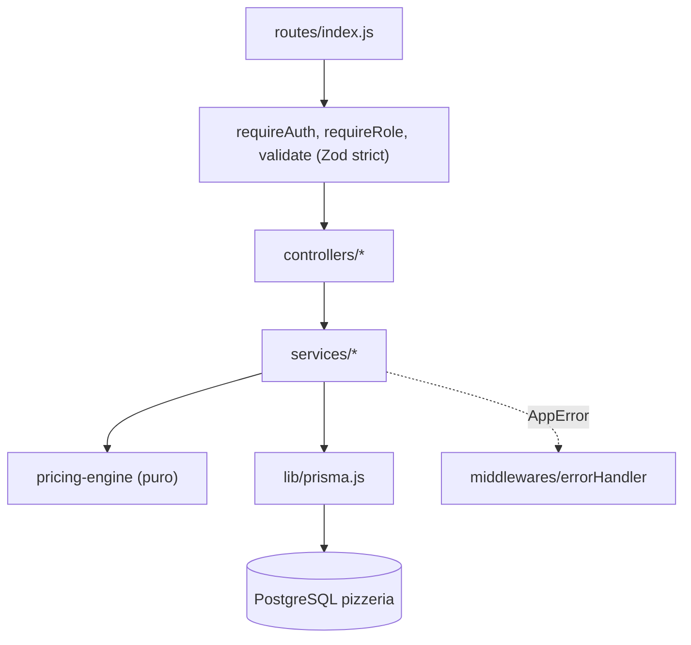

# Documentación técnica — Fase 4 (Backend)

## 1. Visión técnica

API REST monolítica en Node.js (ESM) con capas estrictas `routes -> controllers -> services -> Prisma`. Toda la lógica de precio, IVA y reglas de armado vive en un único motor puro (`pricing-engine`), usado por la cotización, la confirmación y el catálogo de predefinidas (ADR-002). El servidor no confía en el cliente: recalcula y guarda snapshots (ADR-003).

## 2. Arquitectura y componentes



| Componente                                                                                | Responsabilidad                                                                                                                      |
| ----------------------------------------------------------------------------------------- | ------------------------------------------------------------------------------------------------------------------------------------ |
| `app.js` / `server.js`                                                                    | `createApp(env)` (testeable con Supertest) / arranque con validación previa del entorno y cierre ordenado.                           |
| `config/env.js`                                                                           | Valida variables con Zod; el error nombra la variable, nunca el valor. En producción exige secretos >= 32 y distintos.               |
| `config/constants.js`                                                                     | Reglas fijas: 3 porciones, 3 toppings distintos, 20 por línea, 50 líneas, 30 extras, transiciones de estado.                         |
| `middlewares/`                                                                            | `requireAuth`, `requireRole`, `validate`, `rateLimiters`, `notFound`, `errorHandler`, `requestLogger`.                               |
| `schemas/`                                                                                | Esquemas Zod `strict()` de body/query/params; mensajes en español (`config/zodErrorMap.js`).                                         |
| `services/auth.service.js`, `token.service.js`                                            | Registro, login, refresh rotativo con detección de reutilización, logout idempotente.                                                |
| `services/ingredient.service.js`                                                          | CRUD sin borrado, stock atómico (`SET`/`ADD`), activación, `INGREDIENT_CATEGORY_LOCKED`.                                             |
| `services/presetPizza.service.js`                                                         | CRUD, validación de receta con el motor, precios por tamaño y disponibilidad.                                                        |
| `services/catalogLoader.service.js`                                                       | Convierte filas Prisma al `catalog` del motor; bloqueo `FOR UPDATE` opcional.                                                        |
| `services/quote.service.js`                                                               | Cotización sin escritura.                                                                                                            |
| `services/order.service.js`, `stock.service.js`, `orderNumber.service.js`, `orderView.js` | Confirmación transaccional, descuento de stock, número diario, listado, detalle por dueño, cambio de estado, vistas desde snapshots. |
| `services/pricing-engine/`                                                                | `buildPizza`, `validatePizza`, `calculatePizza`, `calculateOrder`, `stockRequirements`, `recipe`, `index.quoteOrder`.                |
| `utils/`                                                                                  | `AppError`, `asyncHandler`, `money` (decimal.js, half-up), `dates`, `orderNumber`.                                                   |

### Motor de cálculo

Entrada: `items[]` (CUSTOM/PRESET) y un `catalog` ya cargado (`ingredients: Map`, `presets: Map`, `sizes`). Salida de `quoteOrder`: `{ valid, violations, items (PricedPizza), totals, stock, requirements }`.

- Precio y calorías = Σ valor(tamaño) × porciones de masa, salsa y toppings; un componente inexistente, inactivo o sin valores del tamaño no suma (cálculo parcial en vivo).
- Subtotales: tarifa 0 % -> `subtotalVat0`; el resto -> `subtotalVat15`. `vat15 = round_half_up(subtotalVat15 × 15 / 100, 2)` aplicado **una vez** sobre el pedido; `total = sub15 + sub0 + vat15`.
- Reglas: masa y salsa obligatorias (`DOUGH_REQUIRED`, `SAUCE_REQUIRED`, `INVALID_DOUGH`, `INVALID_SAUCE`); toppings/extras no pueden ser masa o salsa; sin repetidos; máx. 3 porciones (receta + extras); mínimo 3 toppings distintos solo en CUSTOM; ingrediente inexistente/inactivo/sin tamaño; predefinida inexistente/inactiva/no disponible; stock agregado por ingrediente entre líneas.

### Confirmación de pedido (ADR-004/005)

Una transacción interactiva (timeout 10 s): usuario activo -> ids de ingredientes (ítems + recetas) -> `SELECT id … ORDER BY id FOR UPDATE` -> catálogo bloqueado -> motor -> violaciones (422) -> stock (409) -> `expectedTotal` (409) -> `UPDATE … WHERE id AND stock >= n` por ingrediente (1 fila afectada) -> `INSERT … ON CONFLICT … RETURNING last_value` -> creación anidada de pedido, pizzas, componentes con snapshots e historial. `PUT /ingredients/:id` siempre actualiza la fila del ingrediente para serializar con las confirmaciones. La violación del CHECK `stock >= 0` se traduce a 409.

## 3. Tecnologías y versiones

| Componente    | Tecnología                       | Versión                   |
| ------------- | -------------------------------- | ------------------------- |
| Runtime       | Node.js (ESM)                    | >= 20 (probado con 24.13) |
| Web           | Express                          | 4.x                       |
| ORM           | Prisma / `@prisma/client`        | 6.19.3                    |
| Base de datos | PostgreSQL                       | 17                        |
| Validación    | Zod                              | 3.x                       |
| Autenticación | jsonwebtoken, bcryptjs           | 9.x, 2.x                  |
| Seguridad     | helmet, cors, express-rate-limit | 8.x, 2.x, 7.x             |
| Logging       | pino                             | 9.x                       |
| Decimales     | decimal.js                       | 10.6                      |
| Pruebas       | Vitest, Supertest                | 2.1.9, 7.x                |
| Calidad       | ESLint, Prettier                 | 9.x, 3.x                  |

## 4. Estructura de carpetas

```
backend/
├── env.template  vitest.config.js  eslint.config.js  package.json
├── prisma/  schema.prisma  seed.js  seed-lib.js  migrations/
├── scripts/ db-test-migrate.js
├── src/  app.js  server.js  config/  lib/  middlewares/  routes/  controllers/  schemas/  services/(pricing-engine/)  utils/
└── tests/ unit/  api/  integration/  helpers/
```

## 5. Configuración y variables de entorno

Ver tabla en `docs/04-backend/README.md` y `backend/env.template`. Los scripts npm cargan `backend/.env.local` con `dotenv-cli`; el repositorio nunca contiene valores reales. Las pruebas fijan secretos de prueba en `vitest.config.js` (no son reales) y `tests/helpers/setup.js` fuerza `DATABASE_URL` a `DATABASE_URL_TEST` (o a una URL inválida) para que ninguna prueba toque `public`.

## 6. API / Interfaces

Contrato completo en `docs/02-architecture/api-contract.md` (implementado sin desviaciones; ver preguntas abiertas PA-B1..B5 en `entregable.md`). Resumen de rutas, roles y errores específicos:

| Método | Ruta                                   | Auth          | Request                                    | Response                                | Errores                                           |
| ------ | -------------------------------------- | ------------- | ------------------------------------------ | --------------------------------------- | ------------------------------------------------- |
| GET    | `/health`                              | Pública       | —                                          | 200 `{status, database, version, time}` | 503                                               |
| POST   | `/auth/register`                       | Pública       | `{fullName,email,password}`                | 201 `{user, tokens}`                    | 400, 409 `EMAIL_ALREADY_EXISTS`, 429              |
| POST   | `/auth/login`                          | Pública       | `{email,password}`                         | 200 `{user, tokens}`                    | 400, 401, 403, 429                                |
| POST   | `/auth/refresh`                        | Pública       | `{refreshToken}`                           | 200 nuevos tokens                       | 400, 401 `INVALID_REFRESH_TOKEN`                  |
| POST   | `/auth/logout`                         | Pública       | `{refreshToken}`                           | 204                                     | 400                                               |
| GET    | `/auth/me`                             | Auth          | —                                          | 200 usuario                             | 401                                               |
| GET    | `/sizes`, `/ingredient-categories`     | Auth          | —                                          | 200 lista                               | 401                                               |
| GET    | `/vat-rates`                           | ADMIN         | —                                          | 200 lista                               | 401, 403                                          |
| GET    | `/ingredients`                         | Auth          | query                                      | 200 lista (paginada si hay `page`)      | 400                                               |
| GET    | `/ingredients/:id`                     | Auth          | —                                          | 200                                     | 400, 404                                          |
| POST   | `/ingredients`                         | ADMIN         | datos + `sizeValues`                       | 201                                     | 400, 409, 422                                     |
| PUT    | `/ingredients/:id`                     | ADMIN         | datos + `sizeValues`                       | 200                                     | 400, 404, 409, 422 (`INGREDIENT_CATEGORY_LOCKED`) |
| PATCH  | `/ingredients/:id/stock`               | ADMIN         | `{operation,value}`                        | 200                                     | 400, 404, 422 `STOCK_WOULD_BE_NEGATIVE`           |
| PATCH  | `/ingredients/:id/status`              | ADMIN         | `{active}`                                 | 200                                     | 400, 404, 422                                     |
| GET    | `/preset-pizzas`, `/preset-pizzas/:id` | Auth          | query                                      | 200                                     | 400, 404                                          |
| POST   | `/preset-pizzas`                       | ADMIN         | datos + `recipe`                           | 201                                     | 400, 409, 422 `INVALID_RECIPE`                    |
| PUT    | `/preset-pizzas/:id`                   | ADMIN         | datos + `recipe`                           | 200                                     | 400, 404, 409, 422                                |
| PATCH  | `/preset-pizzas/:id/status`            | ADMIN         | `{active}`                                 | 200                                     | 400, 404                                          |
| POST   | `/orders/quote`                        | Auth          | `{items}`                                  | 200 cotización                          | 400                                               |
| POST   | `/orders`                              | CLIENT        | `{items, expectedTotal?}`                  | 201 `OrderDetail` + `Location`          | 400, 403, 409, 422                                |
| GET    | `/orders`                              | Auth          | `status, from, to, search, page, pageSize` | 200 paginada                            | 400                                               |
| GET    | `/orders/:id`                          | dueño o ADMIN | —                                          | 200 `OrderDetail`                       | 400, 404                                          |
| PATCH  | `/orders/:id/status`                   | ADMIN         | `{status}`                                 | 200 `OrderDetail`                       | 400, 403, 404, 422                                |

Cualquier otra ruta/método: `404 ROUTE_NOT_FOUND`. Errores: `{ "error": { "code", "message", "details" } }` con los 24 códigos del contrato.

## 7. Base de datos

Esquema `backend/prisma/schema.prisma` (idéntico a `data-model.md` §5) y ER en `diagrama-er.md`. Migraciones: `init` (modelo), una migración vacía generada por Prisma y `add_check_constraints` (9 CHECK). Aplicadas con `npm run db:migrate` sobre `pizzeria`/`public`; el esquema de pruebas `test` se migra con `npm run db:test:migrate` (`prisma migrate deploy` con `DATABASE_URL_TEST`, se niega si la URL no tiene `?schema=test`). Seed: `prisma/seed.js` (idempotente, datos de ejemplo).

## 8. Instalación y ejecución

```
cd backend
npm install
npm run db:migrate
npm run db:seed
npm run dev        # o npm start
```

## 9. Pruebas

`npm test` y `npm run lint`. Detalle y salida real en `pruebas-unitarias.md`: 289 pruebas en la fase 6 (267 pasan sin BD; 22 de integración solo en el esquema `test`, que se omiten sin `DATABASE_URL_TEST`).

## 10. Seguridad

- Contraseñas con bcryptjs (coste >= 12 fuera de pruebas), 8..72 caracteres; comparación contra hash ficticio si el usuario no existe (igualar tiempos); mensaje genérico `INVALID_CREDENTIALS`.
- JWT HS256: access (sub, role, type) y refresh con `jti`; en BD solo el SHA-256 del refresh; rotación, detección de reutilización y purga de caducados al iniciar sesión.
- Autorización por rol (`requireRole`) y por dueño (filtro por `userId` en el servicio; pedido ajeno -> 404). El rol del registro no se acepta del cliente.
- Zod `strict()` en todo input, límite de body 100 KB, helmet, cors con lista blanca, rate limit global y de autenticación.
- Prisma parametrizado; las consultas `$queryRaw` usan plantillas etiquetadas (ids y fechas como parámetros).
- pino redacta `authorization`, contraseñas y tokens; no se registran cuerpos; errores 500 sin stack al cliente.
- Variables validadas al arrancar sin imprimir valores; sin secretos en el repositorio.
- Pendiente para la fase 7: revisión de seguridad completa.

## 11. Despliegue y operación

Un solo proceso Node en la PC del local; `npm start`. Zona horaria: la del sistema operativo (define `orderDate` y el número de orden). Cerrar con SIGINT/SIGTERM desconecta Prisma. Servir `frontend/build/web` no aplica (frontend de escritorio).

## 12. Decisiones (ADR) y deuda técnica

ADR 001-011 de `docs/02-architecture/adr/` aplicados. Deuda y pendientes: cobertura porcentual sin medir; medir rendimiento de `/orders/quote` bajo carga; `presetPizza.code` e `id` del detalle del pedido salen de la relación viva (PA-B2); limpiar el esquema `test` cuando se decida (`DROP SCHEMA test CASCADE`, no ejecutado); la migración vacía `…185930_init` se conserva por estar aplicada.
