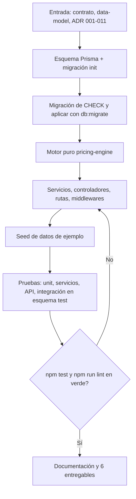
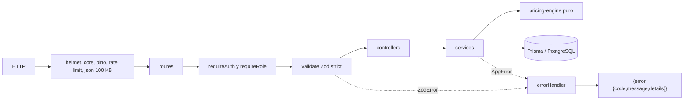
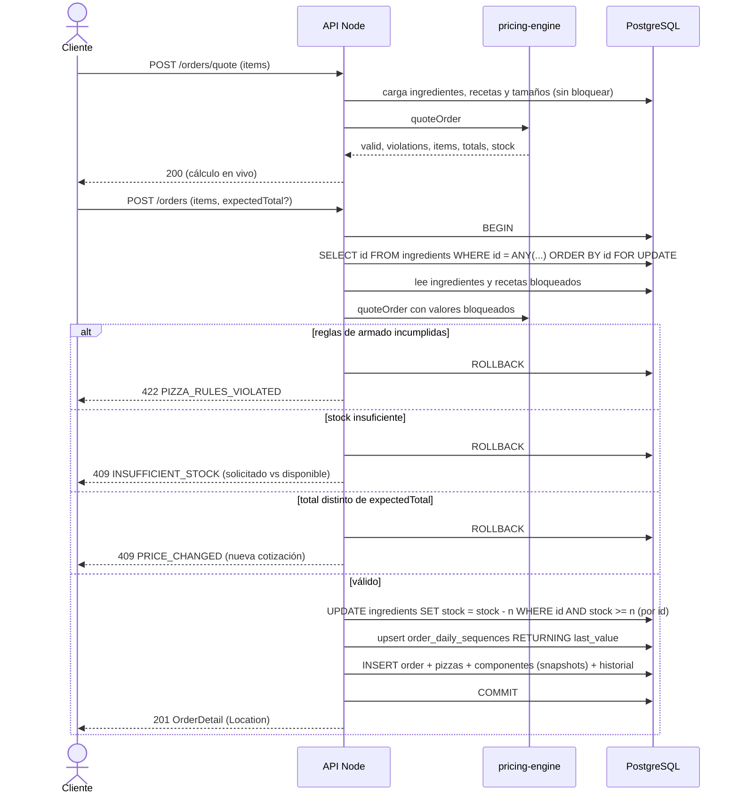
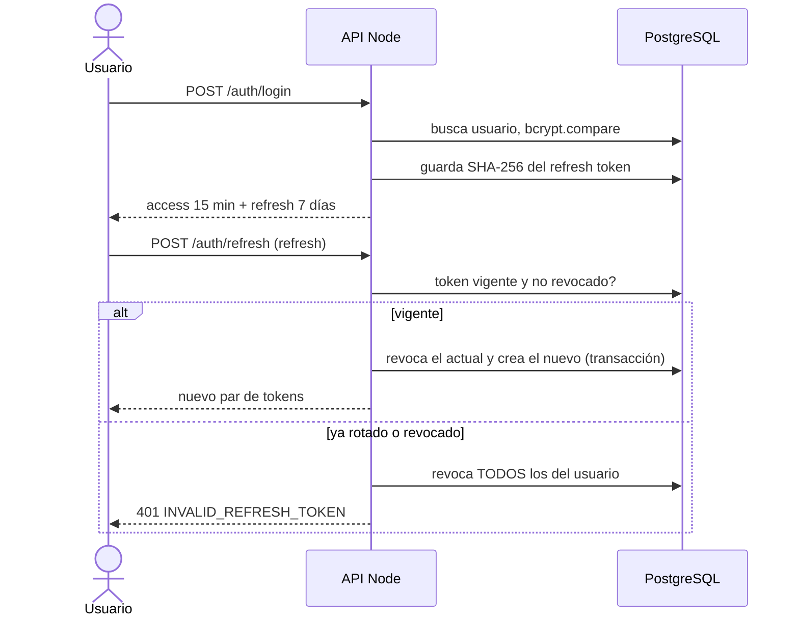
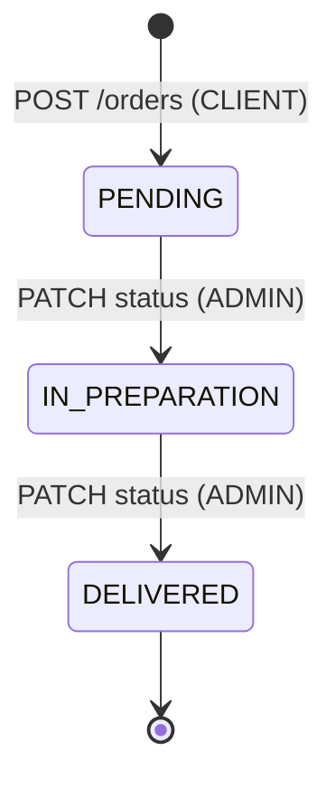

# Flujo — Fase 4: Backend

## Flujo de la fase (proceso)

## Flujo funcional: capas y errores

## Flujo funcional: cotización y confirmación de pedido

## Flujo funcional: autenticación con refresh rotativo

## Flujo funcional: estados del pedido

## Descripción paso a paso

1. El cliente consulta catálogo y predefinidas (con precio por tamaño calculado por el motor y `available`).
2. Mientras arma la pizza, el frontend llama a `/orders/quote`; el servidor devuelve precio, calorías, IVA y violaciones sin escribir nada.
3. Al confirmar, `POST /orders` repite el cálculo dentro de una transacción con los ingredientes bloqueados, descuenta stock, asigna el número del día y guarda snapshots; ante cualquier fallo no queda ningún cambio.
4. El cliente solo consulta sus pedidos (el ajeno responde 404). El administrador cambia el estado en orden y cada cambio queda en `order_status_history`.
5. Cambiar precios o stock después no altera pedidos existentes: el detalle sale únicamente de los snapshots.
