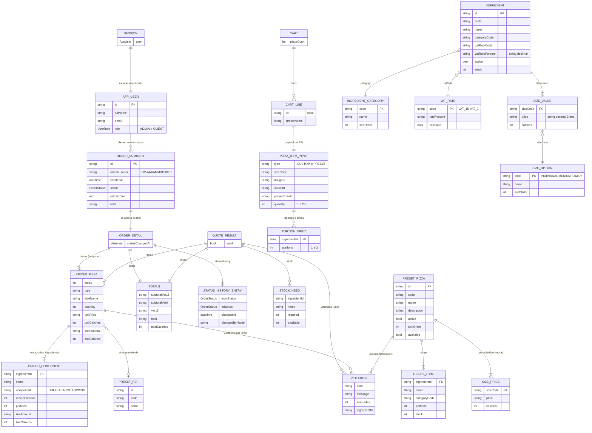

# Diagrama Entidad-Relación — Fase 5 (Frontend)

El frontend **no tiene base de datos propia**: no guarda datos de negocio (los tokens van en `flutter_secure_storage` y el carrito vive en memoria). El ER físico es el de la base `pizzeria` y no cambia en esta fase: ver `docs/04-backend/diagrama-er.md` (igual a `backend/prisma/schema.prisma`).

Este documento muestra el **modelo de datos del cliente**: las clases inmutables de `frontend/lib/features/*/domain/` que representan los recursos del API y cómo se relacionan. Cada clase se construye con `fromJson` a partir de las respuestas del contrato (`api-contract.md` §1.4).

## Diccionario de datos (clases del cliente)

| Entidad (clase Dart)                                                                                                                                                                      | Archivo                                   | Origen en el API                                                 | Notas                                                            |
| ----------------------------------------------------------------------------------------------------------------------------------------------------------------------------------------- | ----------------------------------------- | ---------------------------------------------------------------- | ---------------------------------------------------------------- |
| `AppUser`, `Session`, `UserRole`                                                                                                                                                          | `auth/domain/auth_models.dart`            | `/auth/login`, `/auth/register`, `/auth/me`                      | Solo en memoria; los tokens van en `TokenStorage`                |
| `SizeOption`, `IngredientCategory`, `VatRate`, `SizeValue`, `Ingredient`, `IngredientDraft`, `PageResult`                                                                                 | `catalog/domain/catalog_models.dart`      | `/sizes`, `/ingredient-categories`, `/vat-rates`, `/ingredients` | Los importes se conservan como `String` decimal (nunca `double`) |
| `PresetPizza`, `RecipeItem`, `SizePrice`, `PresetDraft`                                                                                                                                   | `preset_pizzas/domain/preset_models.dart` | `/preset-pizzas`                                                 | `pricesBySize` y `available` los calcula el servidor             |
| `PizzaItemInput`, `PortionInput`, `Violation`, `PricedPizza`, `PricedComponent`, `Totals`, `StockNeed`, `QuoteResult`, `OrderSummary`, `OrderDetail`, `StatusHistoryEntry`, `OrderStatus` | `orders/domain/order_models.dart`         | `/orders/quote`, `/orders`, `/orders/:id`                        | `OrderDetail` sale solo de snapshots                             |
| `BuilderState`                                                                                                                                                                            | `pizza_builder/domain/builder_state.dart` | (estado de UI)                                                   | Solo la selección; el precio es `QuoteResult`                    |
| `CartLine`, `CartState`                                                                                                                                                                   | `cart/domain/cart_state.dart`             | (estado de UI)                                                   | En memoria, no persistido; se vacía al confirmar o cerrar sesión |

## Reglas de integridad (del lado del cliente)

- Dinero siempre `String` con 2 decimales; solo se formatea (`$ 7.50`), nunca se suma ni se redondea en Dart.
- Límites de entrada (no reglas de negocio): porciones 1..3 y no más que el stock; cantidad de pizzas 1..20; en predefinidas, porciones ≥ las de la receta (solo agregar).
- Un ítem `PRESET` nunca envía masa, salsa ni receta; solo `extras` con las porciones **adicionales**.

## Cambios respecto a la fase anterior

- El ER físico (`backend/prisma/schema.prisma`) **no cambia**: sin cambios.
- Se agrega este modelo de datos del cliente.
