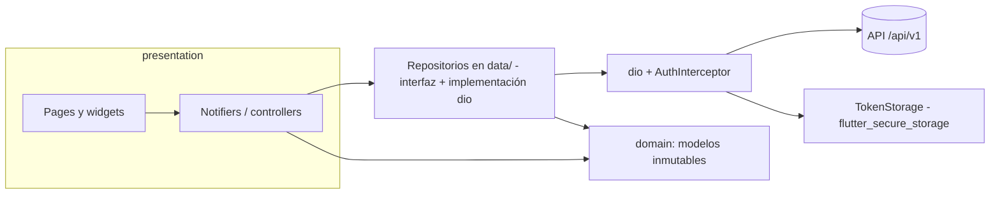

# Documentación técnica — Fase 5 (Frontend Flutter, Windows)

## 1. Visión técnica

Aplicación de escritorio Windows (Flutter, Material 3 claro, español) que consume la API REST `/api/v1` del monolito. Principios (ADR-002, ADR-007): el cálculo de precio, calorías, IVA y reglas de armado lo hace **siempre el backend**; el frontend solo mantiene la selección, pide `POST /orders/quote` con debounce y muestra el resultado; los widgets nunca usan `dio` (lo hacen los repositorios); toda pantalla con datos remotos maneja `AsyncValue` (cargando, vacío, error con "Reintentar").

## 2. Arquitectura y componentes



| Capa                        | Contenido                                                                                                                                                                                                                                                                                      |
| --------------------------- | ---------------------------------------------------------------------------------------------------------------------------------------------------------------------------------------------------------------------------------------------------------------------------------------------- |
| `core/api`                  | `dio_provider.dart` (Dio con baseUrl, timeouts y `AuthInterceptor`), `auth_interceptor.dart` (Bearer, refresh serializado y rotativo, reintento, cierre de sesión), `api_exception.dart` (normaliza `{error:{code,message,details}}`, 24 códigos → mensajes en español)                        |
| `core/config`               | `app_config.dart`: `API_URL` por `--dart-define`                                                                                                                                                                                                                                               |
| `core/storage`              | `token_storage.dart`: `SecureTokenStorage` (Credential Manager) e `InMemoryTokenStorage` (pruebas)                                                                                                                                                                                             |
| `core/theme`                | `app_colors.dart` (`ColorScheme` + `AppSemanticColors` como `ThemeExtension`, tokens de espaciado), `app_theme.dart` (`buildLightTheme`), `contrast.dart` (razón WCAG, usada por WT-01)                                                                                                        |
| `core/router`               | `app_router.dart`: `appRedirect` (función pura), `routerProvider` (go_router + `ShellRoute`)                                                                                                                                                                                                   |
| `core/widgets`              | `AppShell` (NavigationRail por rol, atajos globales), `GoodPizzaLogo`, `AsyncValueView`, `ErrorBanner`, `NoticeBanner`, `EmptyState`, `MoneyText`, `OrderStatusChip`, `AvailabilityChip`, `StockBadge`, `PortionStepper`/`QuantityStepper`, diálogos, `PageFrame`, `HoverRow`, `PaginationBar` |
| `core/utils`, `core/layout` | `money_format.dart` (único punto de formato monetario), `debouncer.dart`, `breakpoints.dart` (1024 / 1280 / 1600)                                                                                                                                                                              |
| `features/auth`             | `AuthRepository`, `SessionNotifier` (`sessionProvider`), login y registro                                                                                                                                                                                                                      |
| `features/catalog`          | `CatalogRepository` (tamaños, categorías, IVA, ingredientes cliente y admin)                                                                                                                                                                                                                   |
| `features/preset_pizzas`    | `PresetRepository`, S-03                                                                                                                                                                                                                                                                       |
| `features/pizza_builder`    | `BuilderState`, `PizzaBuilderController` (cotización en vivo), S-04                                                                                                                                                                                                                            |
| `features/cart`             | `CartNotifier`, `cartQuoteProvider`, S-05                                                                                                                                                                                                                                                      |
| `features/orders`           | `OrdersRepository`, modelos, `ReceiptView`, S-06 y S-13                                                                                                                                                                                                                                        |
| `features/admin`            | S-07..S-12 (ingredientes, predefinidas, pedidos) y `StockDialog`                                                                                                                                                                                                                               |

### Estado (Riverpod 3)

| Provider                                                                               | Tipo                                     | Contenido                                                        |
| -------------------------------------------------------------------------------------- | ---------------------------------------- | ---------------------------------------------------------------- |
| `sessionProvider`                                                                      | `AsyncNotifier<Session?>`                | Usuario y rol; login, registro, logout, expiración               |
| `sessionExpiredNoticeProvider`                                                         | `Notifier<bool>`                         | Aviso de sesión expirada para el login                           |
| `sizesProvider`, `categoriesProvider`, `vatRatesProvider`, `activeIngredientsProvider` | `FutureProvider`                         | Catálogos                                                        |
| `presetPizzasProvider`, `presetPizzaProvider(id)`                                      | `FutureProvider(.family)`                | Predefinidas                                                     |
| `pizzaBuilderProvider`                                                                 | `NotifierProvider.autoDispose`           | Selección + último `QuoteResult` + estado de cotización          |
| `cartProvider`, `cartQuoteProvider`                                                    | `Notifier`, `FutureProvider.autoDispose` | Líneas del carrito y cotización del carrito completo             |
| `ordersListProvider(query)`, `orderDetailProvider(id)`                                 | `FutureProvider.autoDispose.family`      | Historial y comprobante                                          |
| `adminIngredientsProvider(filter)`, `adminPresetsProvider(includeInactive)`            | `FutureProvider.autoDispose.family`      | Listas admin                                                     |
| `refreshTickProvider`                                                                  | `Notifier<int>`                          | F5 / Ctrl+R / "Actualizar": las pantallas lo escuchan y recargan |
| `quoteDebounceProvider`                                                                | `Provider<Duration>`                     | 150 ms (sobrescribible en pruebas)                               |

`ProviderScope(retry: (_, _) => null)`: sin reintentos automáticos (Riverpod 3 reintenta por defecto).

### Cotización en vivo

`PizzaBuilderController` cambia el estado local al instante (`quoting=true`), cancela el `CancelToken` anterior y, tras 150 ms, llama `quote([item])`. Descarta respuestas obsoletas con un número de secuencia. `canAdd` exige cotización vigente y `valid==true`. En modo predefinida solo se envían `extras` = porciones − porciones de receta. Límites de entrada: porciones `min(3, stock)` (nunca menos que la receta) y cantidad 1..20.

### Navegación y guards

`routerProvider` usa `refreshListenable` ligado a `sessionProvider`; `appRedirect` aplica: cargando → `/splash`; sin sesión → `/login`; CLIENT en `/admin/*` → `/presets`; ADMIN fuera de `/admin/*` → `/admin/ingredients`. Las rutas hijas (`/orders/:id`, `/admin/*/new`, `/admin/*/:id`) se apilan sobre su lista.

### Layout adaptativo (escritorio)

| Ancho de ventana | Rail                               | Predefinidas | Panel resumen (S-04/S-05/S-12)                          |
| ---------------- | ---------------------------------- | ------------ | ------------------------------------------------------- |
| 1024–1279        | compacto (80 px, icono + etiqueta) | 2 columnas   | barra inferior                                          |
| 1280–1599        | extendido (240 px)                 | 3            | lateral de 320 px                                       |
| ≥ 1600           | extendido                          | 4            | lateral de 320 px, contenido máx. 1440 centrado         |
| < 1024           | compacto                           | —            | `MinWindowSize` activa scroll (mínimo solo recomendado) |

## 3. Tecnologías y versiones

| Componente   | Tecnología                                                       | Versión (pubspec.lock) |
| ------------ | ---------------------------------------------------------------- | ---------------------- |
| Framework    | Flutter / Dart                                                   | 3.47.9 / 3.13.7        |
| Estado       | flutter_riverpod                                                 | 3.5.0                  |
| Navegación   | go_router                                                        | 18.1.3                 |
| HTTP         | dio                                                              | 5.11.1                 |
| Tokens       | flutter_secure_storage (Windows: flutter_secure_storage_windows) | 11.2.0 (4.2.2)         |
| Logotipo     | flutter_svg                                                      | 2.3.2                  |
| Localización | intl + flutter_localizations                                     | 0.20.3 / SDK           |
| Pruebas      | flutter_test, flutter_lints                                      | SDK / 6.0.0            |

No se usan `freezed`, `build_runner` ni `window_manager`; los modelos son clases inmutables escritas a mano. El importe nunca se convierte a `double`.

## 4. Estructura de carpetas

```
frontend/
├── assets/brand/                      logotipos SVG
├── lib/
│   ├── main.dart, app.dart
│   ├── core/{api,config,layout,router,storage,theme,utils,widgets}
│   └── features/
│       ├── auth/{data,domain,presentation}
│       ├── catalog/{data,domain}
│       ├── preset_pizzas/{data,domain,presentation}
│       ├── pizza_builder/{domain,presentation}
│       ├── cart/{domain,presentation}
│       ├── orders/{data,domain,presentation}
│       └── admin/presentation
├── test/{core,features,flows,helpers}
└── windows/                           runner (título "Good Pizza", ventana 1280x800)
```

## 5. Configuración y variables de entorno

| Variable  | Dónde                                          | Propósito                          | Por defecto                    |
| --------- | ---------------------------------------------- | ---------------------------------- | ------------------------------ |
| `API_URL` | `--dart-define=API_URL=…` al compilar/ejecutar | URL base de la API (con `/api/v1`) | `http://localhost:3000/api/v1` |

El frontend no lee `.env*` ni variables del backend, ni contiene secretos. Los tokens se guardan en `flutter_secure_storage`; nunca en `shared_preferences`.

## 6. API / Interfaces consumidas

Los 25 endpoints del contrato (`api-contract.md`); el frontend consume:

| Método         | Ruta                                                          | Auth       | Dónde se usa                                                 | Errores tratados                                                                   |
| -------------- | ------------------------------------------------------------- | ---------- | ------------------------------------------------------------ | ---------------------------------------------------------------------------------- |
| POST           | `/auth/register`, `/auth/login`                               | Pública    | S-02, S-01                                                   | 400 (por campo), 401, 403, 409, 429                                                |
| POST           | `/auth/refresh`, `/auth/logout`                               | Pública    | Interceptor, cerrar sesión                                   | `INVALID_REFRESH_TOKEN`                                                            |
| GET            | `/auth/me`                                                    | Auth       | Arranque                                                     | 401                                                                                |
| GET            | `/sizes`, `/ingredient-categories`                            | Auth       | S-03, S-04, S-07, S-08, S-10                                 | genérico                                                                           |
| GET            | `/vat-rates`                                                  | ADMIN      | S-08                                                         | genérico                                                                           |
| GET            | `/ingredients[?includeInactive=true&category&search]`         | Auth       | S-04 (activos), S-07/S-10 (admin con `includeInactive=true`) | genérico                                                                           |
| GET/POST/PUT   | `/ingredients/:id`, `/ingredients`                            | Auth/ADMIN | S-08                                                         | 409, 422 (`MISSING_SIZE_VALUES`, `INVALID_VAT_RATE`, `INGREDIENT_CATEGORY_LOCKED`) |
| PATCH          | `/ingredients/:id/stock`, `/ingredients/:id/status`           | ADMIN      | S-07, S-08                                                   | `STOCK_WOULD_BE_NEGATIVE`, `MISSING_SIZE_VALUES`                                   |
| GET            | `/preset-pizzas[?includeInactive=true]`, `/preset-pizzas/:id` | Auth       | S-03, S-04, S-09, S-10                                       | 404                                                                                |
| POST/PUT/PATCH | `/preset-pizzas`, `/preset-pizzas/:id`, `…/status`            | ADMIN      | S-09, S-10                                                   | 409, `INVALID_RECIPE`                                                              |
| POST           | `/orders/quote`                                               | Auth       | S-04, S-05, S-10 (vista previa)                              | genérico (con cancelación)                                                         |
| POST           | `/orders`                                                     | CLIENT     | S-05 (con `expectedTotal`)                                   | 409 `INSUFFICIENT_STOCK`/`PRICE_CHANGED`, 422, 403                                 |
| GET            | `/orders`, `/orders/:id`                                      | Auth       | S-06, S-11, S-12, S-13                                       | 404                                                                                |
| PATCH          | `/orders/:id/status`                                          | ADMIN      | S-12                                                         | `INVALID_STATUS_TRANSITION`, 404, 403                                              |

Mapeo de errores: `ApiException.userMessage` decide **por `code`** (24 códigos del §1.2 + red + desconocido → genérico); las 15 violaciones de armado usan el `message` del servidor con respaldo por código (`violation_text.dart`). Nunca se muestra el código ni el stack.

## 7. Base de datos

No aplica al frontend (sin base de datos local). El modelo de datos del cliente está en `diagrama-er.md`; el ER físico es el del backend, sin cambios.

## 8. Instalación y ejecución

Ver `README.md` de esta carpeta: `flutter pub get`, `flutter run -d windows --dart-define=API_URL=…`, `flutter build windows`. Requiere Visual Studio con C++ y **ATL**, y Modo desarrollador de Windows.

## 9. Pruebas

225 pruebas (`flutter test`) en la fase 6 (221 en la fase 5), cobertura de líneas 93,3 %, `flutter analyze` sin incidencias, y 1 prueba de `integration_test` en Windows. Estrategia: repositorios falsos + `ProviderScope(overrides)`; la app completa (router, tema, guards) se levanta en cada prueba de pantalla (`test/helpers/pump_app.dart`); un adaptador HTTP falso cubre el interceptor y los repositorios `dio`. Detalle en `pruebas-unitarias.md`.

## 10. Seguridad

- Tokens (access y refresh rotativo) solo en `flutter_secure_storage`; el refresh se serializa para no invalidar el token rotativo por carreras; si el servidor lo rechaza se borran y se pide iniciar sesión; un fallo de red no cierra la sesión.
- Sin secretos ni credenciales en el código; las contraseñas no se registran ni persisten.
- Rutas protegidas por rol en el cliente (`appRedirect`) **como ayuda de UX**: la autorización real es del backend (CLIENT recibe 403/404 en recursos ajenos).
- Los mensajes de error no exponen códigos internos ni trazas; el login usa un mensaje único.
- Entrada validada en la UI como espejo del contrato (la validación definitiva es del servidor).

## 11. Despliegue y operación

Distribución como carpeta de `flutter build windows --release` (ejecutable `good_pizza.exe` con sus DLL). La URL de la API se fija al compilar con `--dart-define`. El equipo del local necesita acceso de red al backend. Fuera de alcance de esta fase: instalador, firmado y auto-actualización (fase 8 omitida).

## 12. Decisiones (ADR) y deuda técnica

Decisiones: ver `entregable.md` §4 (D-F1..D-F7) y ADR-007 (`docs/02-architecture/adr/`).

Deuda técnica / pendientes:

- Ejecutar el `.exe` contra el backend real con datos del seed (la compilación funciona con ATL instalado; verificado en la fase 6).
- `FocusRing` propio, `F6`, botón ☰ del rail, menú contextual y `Esc` en el buscador (opcionales del diseño).
- Tablas admin con `ListView` perezoso: con catálogos muy grandes convendría paginar (hoy `GET /ingredients` sin `page` devuelve la lista completa, ~20 elementos).
- Revisión visual con fuente y escala reales de Windows (las pruebas usan Ahem a 0,6).
