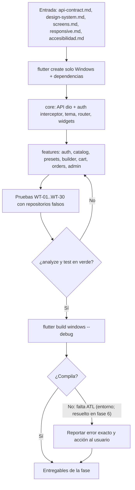
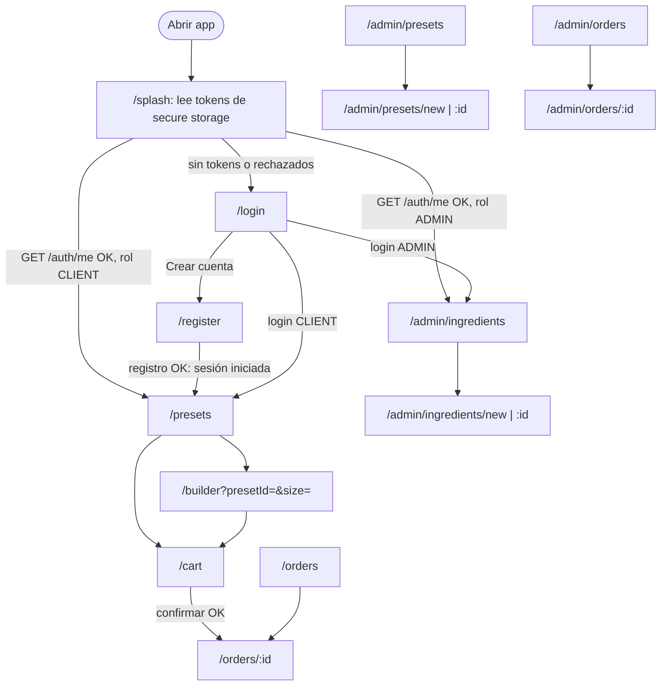

# Flujo — Fase 5: Frontend (Flutter, Windows)

## Flujo de la fase (proceso)



## Navegación y guards por rol



Reglas de `appRedirect` (probadas en `router_test.dart`): sin sesión → `/login`; CLIENT en `/admin/*` → `/presets`; ADMIN fuera de `/admin/*` → `/admin/ingredients`; con sesión en `/login`, `/register`, `/` o `/splash` → inicio del rol.

## Flujo funcional: personalizar pizza hasta generar la orden

```mermaid
sequenceDiagram
    actor C as Cliente
    participant UI as PizzaBuilderPage
    participant N as PizzaBuilderController
    participant R as OrdersRepository (dio)
    participant API as API /api/v1
    participant K as CartNotifier / CartPage
    C->>UI: marca masa, salsa y queso x3
    UI->>N: selectDough / selectSauce / setPortions
    N->>N: estado inmediato, quoting=true
    N->>R: quote([item]) tras 150 ms (cancela la anterior)
    R->>API: POST /orders/quote
    API-->>R: { valid, violations, items, totals }
    R-->>N: QuoteResult
    N-->>UI: calorías y precio (unitCalories / unitPrice), mensajes
    C->>UI: Agregar al pedido (Ctrl+Enter)
    UI->>K: add(PizzaItemInput)
    C->>K: Ver pedido
    K->>API: POST /orders/quote (todas las líneas)
    API-->>K: totals (Subtotal 15 %, Subtotal 0 %, IVA 15 %, Total)
    C->>K: Confirmar pedido (diálogo)
    K->>API: POST /orders { items, expectedTotal }
    alt 201
        API-->>K: OrderDetail (PENDING)
        K-->>C: carrito vacío, comprobante con banner de éxito
    else 409 INSUFFICIENT_STOCK
        API-->>K: details[{name, requested, available}]
        K-->>C: diálogo "Stock insuficiente", recotiza
    else 409 PRICE_CHANGED
        API-->>K: details[{quote}]
        K-->>C: diálogo con nuevo total; "Aceptar y confirmar" reenvía con el nuevo expectedTotal
    else 422 PIZZA_RULES_VIOLATED
        API-->>K: details[violaciones]
        K-->>C: banner por línea
    end
```

## Flujo funcional: renovación de token

```mermaid
sequenceDiagram
    participant UI as Pantalla
    participant I as AuthInterceptor
    participant API as API /api/v1
    participant S as flutter_secure_storage
    UI->>I: petición autenticada
    I->>S: lee access token
    I->>API: GET con Bearer
    API-->>I: 401 TOKEN_EXPIRED
    I->>API: POST /auth/refresh (un solo refresh aunque haya varias peticiones)
    alt 200
        API-->>I: nuevos access y refresh (rotativo)
        I->>S: guarda ambos
        I->>API: reintenta la petición original
        API-->>UI: respuesta
    else 401 INVALID_REFRESH_TOKEN
        I->>S: borra tokens
        I-->>UI: sesión expirada: diálogo y /login
    else fallo de red
        I-->>UI: error de red; la sesión se conserva
    end
```

## Descripción paso a paso

1. Al abrir la app, `sessionProvider` lee los tokens; si existen consulta `GET /auth/me` y el router redirige por rol.
2. El cliente ve las predefinidas (`GET /preset-pizzas` + `GET /sizes`), las agrega al pedido o las personaliza solo agregando ingredientes (`extras`).
3. En "Personalizar pizza" cada cambio actualiza el estado local al instante y, tras 150 ms, pide la cotización; la UI nunca calcula precios.
4. El resumen cotiza todas las líneas y muestra Calorías totales, Subtotal 15 %, Subtotal 0 %, IVA 15 % y TOTAL tal como los devuelve el API.
5. Al confirmar se envía `expectedTotal`; los conflictos 409 y 422 se resuelven con diálogos/banners y el carrito se conserva.
6. El comprobante se construye solo desde `OrderDetail` (snapshots) y no ofrece imprimir ni exportar.
7. El administrador gestiona ingredientes (con `includeInactive=true`), predefinidas y el estado de los pedidos (Pendiente → En preparación → Entregado, con confirmación).
