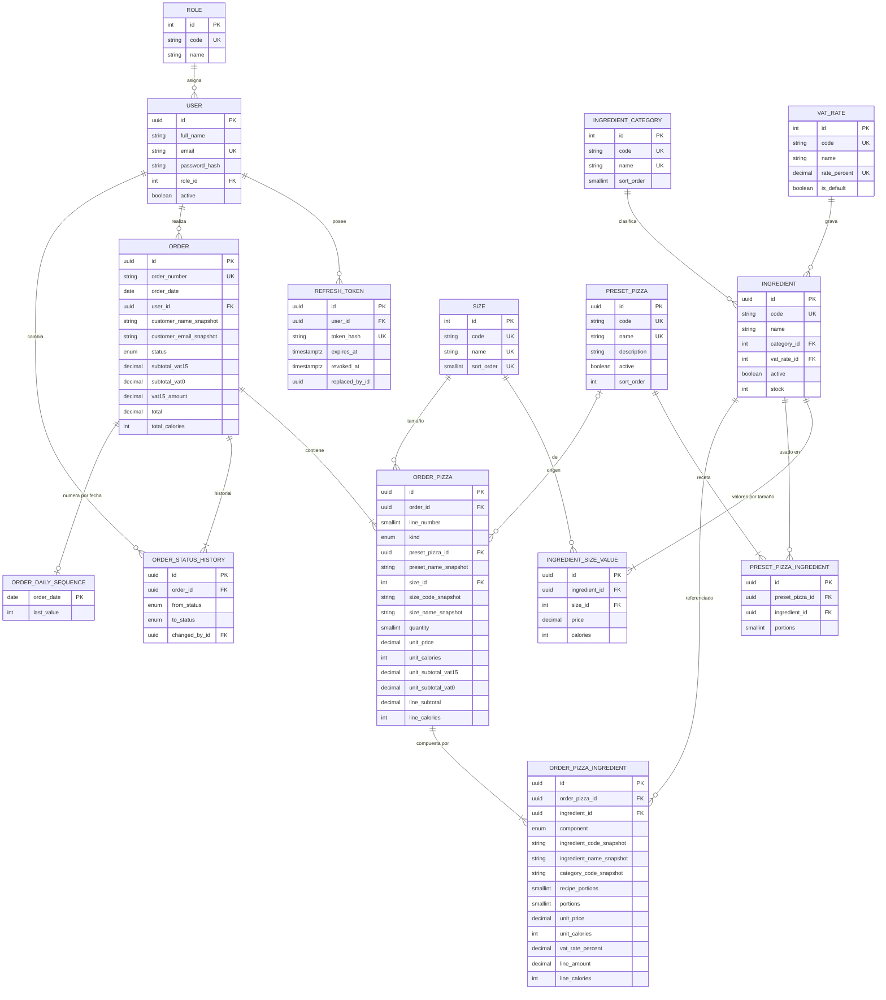

# Diagrama Entidad-Relación — Fase 6 (QA, consolidado)

Consolidado a partir de `backend/prisma/schema.prisma` (15 modelos, 3 enums) y la migración `20261106190500_add_check_constraints` (9 CHECK). Es idéntico al ER físico de `docs/04-backend/diagrama-er.md`; QA verificó a nivel de entidades que los 15 modelos coinciden y no encontró diferencias. Los ER de las fases 1 a 3 y 5 son vistas conceptuales o parciales por diseño.

La relación `ORDER ↔ ORDER_DAILY_SEQUENCE` es lógica (misma fecha `order_date`), no hay clave foránea.

## Diccionario de datos (resumen; tipos completos en `schema.prisma`)

| Entidad (tabla)                                 | Atributos clave                                                                                       | Restricciones                                                                                   | Descripción                                                              |
| ----------------------------------------------- | ----------------------------------------------------------------------------------------------------- | ----------------------------------------------------------------------------------------------- | ------------------------------------------------------------------------ |
| `roles`                                         | `code` ADMIN/CLIENT                                                                                   | `code` único                                                                                    | Roles del sistema                                                        |
| `users`                                         | `email` (minúsculas), `password_hash` bcrypt, `active`                                                | `email` único; FK `role_id` RESTRICT                                                            | Usuarios; el registro público crea solo CLIENT                           |
| `refresh_tokens`                                | `token_hash` SHA-256, `revoked_at`, `replaced_by_id`                                                  | `token_hash` único; FK `user_id` CASCADE                                                        | Refresh rotativo con detección de reutilización                          |
| `sizes`                                         | INDIVIDUAL, MEDIUM, FAMILY                                                                            | `code`, `name`, `sort_order` únicos                                                             | Tamaños                                                                  |
| `ingredient_categories`                         | DOUGH, SAUCE, CHEESE, MEAT, VEGETABLE, OTHER                                                          | `code`, `name` únicos                                                                           | Categorías                                                               |
| `vat_rates`                                     | `rate_percent` Decimal(5,2), `is_default`                                                             | CHECK 0..100; `rate_percent` único                                                              | Tarifas VAT_15 (defecto) y VAT_0                                         |
| `ingredients`                                   | `stock` (porciones), `active`, FK categoría y tarifa                                                  | `code` único; **CHECK `stock >= 0`**; FK RESTRICT                                               | Catálogo (incluye masas y salsas); nunca se borra, solo se desactiva     |
| `ingredient_size_values`                        | `price` Decimal(10,2) sin IVA, `calories`                                                             | único (`ingredient_id`, `size_id`); CHECK `price >= 0`, `calories >= 0`                          | Precio y calorías por porción y por tamaño                               |
| `preset_pizzas`                                 | `code`, `name`, `active`, `sort_order`                                                                | `code` y `name` únicos                                                                          | Predefinidas; sin campo de precio (el precio sale de la fórmula)         |
| `preset_pizza_ingredients`                      | `portions`                                                                                            | único (pizza, ingrediente); CHECK `portions` 1..3                                               | Receta                                                                   |
| `orders`                                        | totales Decimal(12,2), `order_number` `GP-AAAAMMDD-NNNN`, `status`, snapshots de cliente              | `order_number` único; **CHECK `total = subtotal_vat15 + subtotal_vat0 + vat15_amount`**         | Pedido                                                                   |
| `order_daily_sequences`                         | `order_date` PK, `last_value`                                                                         | —                                                                                               | Contador diario sin huecos (dentro de la transacción de confirmación)    |
| `order_status_history`                          | `from_status` (nulo al crear), `to_status`, `changed_by_id`                                           | FK pedido CASCADE; FK usuario RESTRICT                                                          | Historial de estados                                                     |
| `order_pizzas`                                  | `kind`, `quantity`, precios/calorías unitarios y de línea, snapshots de tamaño y de nombre            | único (pedido, `line_number`); **CHECK `quantity` 1..20**; FK `preset_pizza_id` SET NULL        | Línea del pedido (copia inmutable)                                       |
| `order_pizza_ingredients`                       | `component`, `recipe_portions`, `portions`, `unit_price`, `unit_calories`, `vat_rate_percent`         | único (línea, ingrediente); CHECK `portions` 1..3 y `recipe_portions` 0..`portions`              | Snapshot por componente (precio, calorías e IVA al comprar)              |

## Reglas de integridad

- Dinero siempre `Decimal` (nunca `Float`); redondeo half-up a 2 decimales en el motor, verificado con 20 001 casos (QA-01).
- Sin sobreventa: `stock >= 0` por CHECK y descuento condicionado (`UPDATE … WHERE stock >= n`) tras `SELECT … FOR UPDATE` ordenado por id. La verificación con BD real está en pruebas omitidas sin `DATABASE_URL_TEST`.
- Snapshots: el pedido no referencia precios del catálogo vigentes; cambiar precio, calorías, tarifa o nombre no altera pedidos antiguos (QA-11, en proceso).
- Borrado: ingredientes y predefinidas solo se desactivan (no hay endpoint DELETE); las FK hacia ingredientes son RESTRICT.
- Límites validados dos veces (Zod/motor y CHECK): porciones 1..3, cantidad 1..20.

## Cambios respecto a la fase anterior

Sin cambios. La fase 4 es la fuente; QA no modificó `schema.prisma` ni migraciones.
