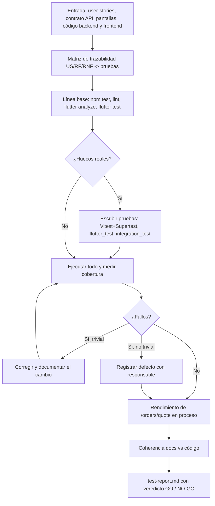

# Flujo — Fase 6: Aseguramiento de calidad (QA)

## Flujo de la fase (proceso)



## Flujo funcional verificado por las pruebas de extremo a extremo

```mermaid
sequenceDiagram
    actor C as Cliente
    actor A as Administrador
    participant F as App Flutter (Windows)
    participant S as API Node
    participant D as PostgreSQL
    C->>F: Registro / inicio de sesión
    F->>S: POST /auth/register, /auth/login
    C->>F: Personalizar triple queso
    F->>S: POST /orders/quote (debounce 150 ms, cancela la anterior)
    S-->>F: Precio, calorías, IVA y violaciones (el servidor recalcula)
    C->>F: Confirmar pedido
    F->>S: POST /orders (expectedTotal)
    S->>D: Transacción: bloqueo, stock, número, snapshots
    S-->>F: 201 comprobante GP-AAAAMMDD-0001 (Pendiente)
    A->>F: Cambia precio y stock de un ingrediente
    F->>S: PUT /ingredients/:id, PATCH /ingredients/:id/stock
    A->>F: Avanza el pedido
    F->>S: PATCH /orders/:id/status (En preparación, Entregado)
    C->>F: Mis pedidos
    F->>S: GET /orders (solo propios; el ajeno devuelve 404)
```

Qué prueba cada tramo: QA-10..QA-16 (`flows.inprocess.test.js`) recorre S con servicios reales y doble de Prisma; `journeys_flow_test.dart` (QA-F01..F04) y `app_flow_test.dart` (IT-F01) recorren F con repositorios falsos; el tramo contra D real lo cubren `db.test.js` (omitido sin `DATABASE_URL_TEST`).

## Descripción paso a paso

1. Leer historias, contrato y código; construir la matriz (`test-plan.md`).
2. Ejecutar la línea base y medir la cobertura inicial (servicios 73.17 %).
3. Cerrar huecos: motor (half-up exhaustivo, límites), servicios, flujos HTTP, permisos, seed, flujos de UI y E2E de escritorio.
4. Medir rendimiento de `POST /orders/quote` con 200 muestras en proceso.
5. Ejecutar todo (`npm test`, `npm run lint`, `flutter analyze`, `flutter test`, `integration_test`) y pegar la salida real.
6. Revisar coherencia (endpoints, códigos de error, ER, conteos) y registrar defectos con responsable.
7. Emitir veredicto: GO condicionado (ver `test-report.md`).
