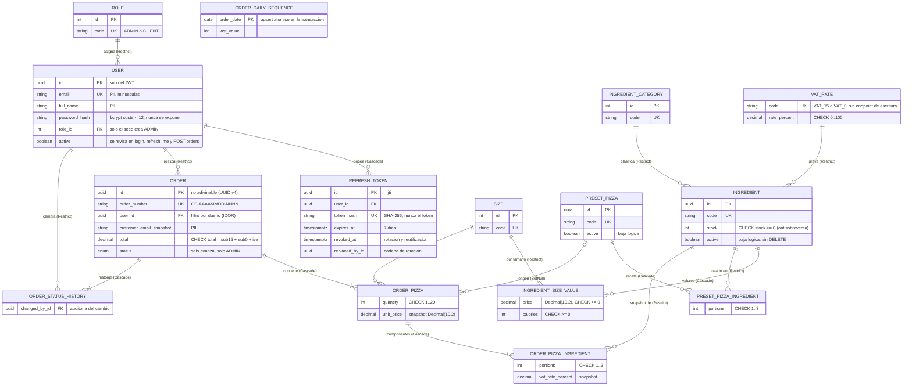

# Diagrama Entidad-Relación — Fase 7 (anotaciones de seguridad)

Esquema **sin cambios** respecto a la fase 4. La fuente de verdad es `backend/prisma/schema.prisma` y el diccionario completo está en `docs/04-backend/diagrama-er.md`. Aquí se repite el modelo físico con anotaciones de seguridad: datos sensibles, restricciones que protegen la integridad y comportamiento de borrado.

## Diccionario de datos (solo atributos relevantes para la seguridad)

| Entidad                 | Atributo                                            | Tipo          | Nulo | Restricciones           | Clasificación / control                                                                   |
| ----------------------- | --------------------------------------------------- | ------------- | ---- | ----------------------- | ----------------------------------------------------------------------------------------- |
| users                   | `email`                                             | varchar(254)  | No   | UNIQUE                  | PII. Se normaliza a minúsculas. Lo revela el 409 de registro (S-11)                       |
| users                   | `full_name`                                         | varchar(120)  | No   | —                       | PII                                                                                       |
| users                   | `password_hash`                                     | varchar(100)  | No   | —                       | Secreto. bcrypt, nunca sale de `auth.service`                                             |
| users                   | `active`                                            | boolean       | No   | def. true               | Bloquea login, refresh, `/auth/me` y `POST /orders`; no se revisa en cada petición (S-07) |
| refresh_tokens          | `token_hash`                                        | varchar(128)  | No   | UNIQUE                  | Secreto derivado (SHA-256). El token en claro solo lo tiene el cliente                    |
| refresh_tokens          | `revoked_at`                                        | timestamptz   | Sí   | —                       | Rotación y detección de reutilización                                                     |
| orders                  | `customer_name_snapshot`, `customer_email_snapshot` | varchar       | No   | —                       | PII congelada en el pedido. Solo la ven el dueño y el ADMIN                               |
| orders                  | `total` y subtotales                                | decimal(12,2) | No   | CHECK de consistencia   | Integridad del dinero                                                                     |
| ingredients             | `stock`                                             | int           | No   | CHECK `>= 0`            | Última defensa contra la sobreventa                                                       |
| order_pizzas            | `quantity`                                          | smallint      | No   | CHECK 1..20             | Límite de abuso en la BD                                                                  |
| order_pizza_ingredients | `portions`, `recipe_portions`                       | smallint      | No   | CHECK 1..3, 0..portions | Límite de abuso en la BD                                                                  |

## Reglas de integridad con impacto en seguridad

- **Borrado:** `Restrict` impide borrar usuarios con pedidos o historial, ingredientes usados en pedidos o recetas, y catálogos en uso. `Cascade` solo aplica a los hijos del propio agregado (líneas del pedido, valores por tamaño, receta) y a los refresh tokens del usuario. `SetNull` en `order_pizzas.preset_pizza_id`: el nombre queda en el snapshot.
- **No hay DELETE expuesto en la API** (baja lógica), así que las cascadas solo se activarían con SQL directo.
- **Snapshots inmutables:** ningún endpoint actualiza las líneas de un pedido. Solo cambian `status` y `status_changed_at`.
- **Esquema `test`:** mismas tablas en un esquema aparte. El aislamiento depende de controles en el código, no de privilegios (S-17).
- **Privilegios recomendados (no verificados):** rol de migraciones con DDL, rol de la app con solo DML sobre `public`, y rol de pruebas con acceso solo a `test`.

## Cambios respecto a la fase anterior

- Sin cambios de esquema. Solo se añaden anotaciones de seguridad.
