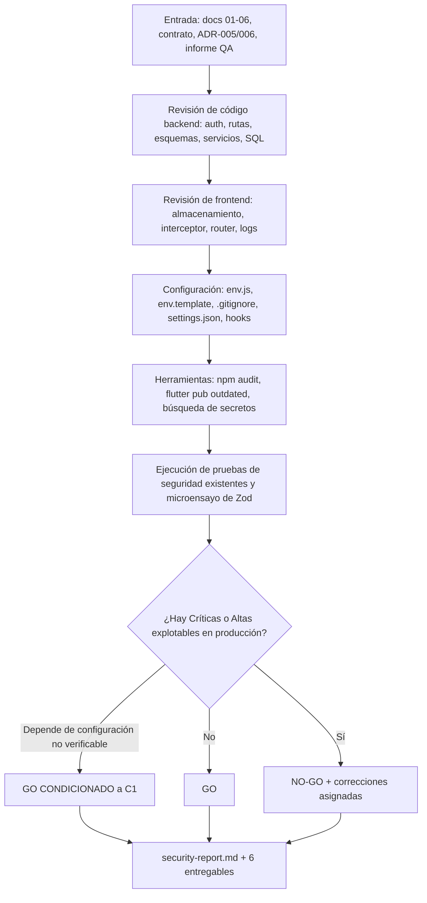
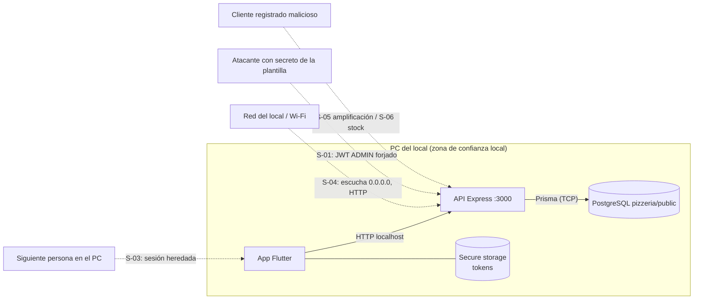

# Flujo — Fase 7: Seguridad

## Flujo de la fase (proceso de revisión)



## Flujo funcional: autenticación y autorización (con puntos de control)

```mermaid
sequenceDiagram
    actor U as Usuario
    participant F as Flutter App
    participant S as Secure Storage (Windows)
    participant A as API Node
    participant D as PostgreSQL
    U->>F: email + contraseña
    F->>A: POST /auth/login (skipAuth)
    Note over A: rate limit auth (10/15 min por IP)<br/>Zod strict (email, 1..128)
    A->>D: findUnique(user by email)
    Note over A: bcrypt.compare contra hash real o de relleno<br/>401 genérico / 403 si inactivo
    A->>D: INSERT refresh_tokens (solo SHA-256)
    A-->>F: accessToken (15 min, HS256, sub/role/type) + refreshToken (7 d, jti)
    F->>S: guarda ambos tokens
    U->>F: acción (p. ej. ver pedido)
    F->>A: GET /orders/:id + Bearer access
    Note over A: requireAuth: firma HS256 + type=access<br/>(sin consultar BD, D-03/S-07)<br/>requireRole por ruta
    A->>D: findFirst({id, userId}) si CLIENT
    A-->>F: 200 o 404 (no revela pedidos ajenos)
    F->>A: petición con access caducado
    A-->>F: 401 TOKEN_EXPIRED
    F->>A: POST /auth/refresh (un solo refresh serializado)
    A->>D: busca hash; si ya revocado: revoca TODOS (reutilización)
    A->>D: updateMany(revokedAt null -> now) + INSERT nuevo (transacción)
    A-->>F: nuevo par de tokens
    F->>S: reemplaza tokens y reintenta una vez
    U->>F: Cerrar sesión
    F->>A: POST /auth/logout (revoca refresh)
    F->>S: borra tokens
```

## Modelo de amenazas (STRIDE resumido)



| STRIDE                       | Amenaza                                            | Control existente                                                                    | Brecha                                                                                                          |
| ---------------------------- | -------------------------------------------------- | ------------------------------------------------------------------------------------ | --------------------------------------------------------------------------------------------------------------- |
| Suplantación (S)             | Forjar o robar tokens; fuerza bruta de login       | HS256 con algoritmo fijado, `type`, bcrypt, hash de relleno, rate limit              | S-01 (secretos por defecto fuera de prod), S-02 (límite por IP compartido), S-03 (PC compartido)                |
| Manipulación (T)             | Alterar precios o totales desde el cliente         | El servidor recalcula; Zod strict; `expectedTotal` solo detecta cambios; CHECK en BD | Ninguna relevante                                                                                               |
| Repudio (R)                  | Negar un cambio de estado                          | `order_status_history` con `changed_by_id` y fecha                                   | No hay auditoría de cambios de catálogo (precio/stock) por usuario                                              |
| Divulgación (I)              | Ver pedidos ajenos, stack traces, secretos en logs | Filtro por dueño → 404; 500 genérico; redacción en pino; `.gitignore`                | S-04 (HTTP en claro si es remoto), S-12 (mensajes de Prisma en el log), S-15 (nombre del administrador visible) |
| Denegación de servicio (D)   | Saturar la API o el inventario                     | Body de 100 KB, rate limit, límites de esquema                                       | S-02, S-05, S-06                                                                                                |
| Elevación de privilegios (E) | Cliente que actúa como admin                       | `requireRole` en cada ruta; el registro solo crea CLIENT; `role` en el body da 400   | S-01, S-03                                                                                                      |

## Descripción paso a paso

1. **Login y registro:** pasan por el limitador de autenticación y por Zod strict. El registro siempre crea un CLIENT. El login compara siempre contra un hash bcrypt (real o de relleno) y responde con un mensaje genérico.
2. **Emisión:** access JWT de 15 minutos con `sub`, `role` y `type=access`; refresh JWT de 7 días con `jti`. En la BD solo se guarda el SHA-256 del refresh.
3. **Cada petición:** `requireAuth` verifica la firma, el algoritmo y el tipo; `requireRole` filtra por rol; los servicios aplican el filtro por dueño (pedidos) y por estado activo (catálogo).
4. **Renovación:** el interceptor de Dio hace un solo refresh ante `TOKEN_EXPIRED`. El servidor rota el token de forma atómica; si recibe uno ya usado, revoca todos los del usuario.
5. **Cierre:** el logout revoca el refresh en el servidor y borra el almacenamiento seguro. El access token emitido sigue siendo válido hasta 15 minutos (ADR-006).
6. **Confirmar un pedido:** solo CLIENT activo, todo en una transacción con `FOR UPDATE`. El motor recalcula y el stock se descuenta con `WHERE stock >= n`. Se guardan snapshots.
