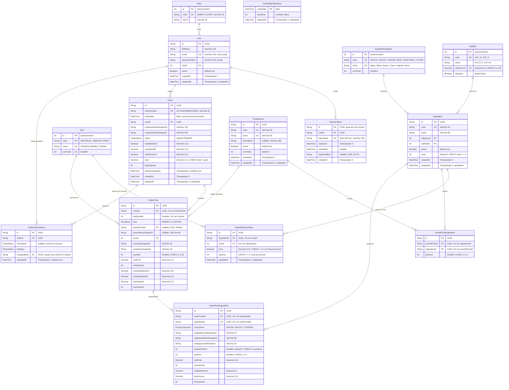

# Diagrama Entidad-Relación — Fase 9 (consolidado final)

- **Fuente de verdad:** `backend/prisma/schema.prisma` (15 modelos, 3 enums) y `backend/prisma/migrations/` (3 migraciones, incluidas 9 restricciones CHECK).
- **Verificación:** coincidencia con el esquema comprobada por `Grep` sobre `schema.prisma` y sobre `20261106185922_init/migration.sql` (tipos SQL). El ER de la fase 4 y el de esta fase son el mismo modelo físico.
- **Notación:** los nombres de entidad son los de Prisma (PascalCase); la columna de la base de datos está en el diccionario. Mermaid no admite precisión entre paréntesis en los tipos, por lo que `Decimal` se detalla en el diccionario.

## Diagrama

`OrderDailySequence` no tiene relaciones: es el contador transaccional del número de orden por fecha (ADR-004).

## Enums (no representados en Mermaid)

| Enum Prisma      | Tabla o tipo SQL  | Valores                                  |
| ---------------- | ----------------- | ---------------------------------------- |
| `OrderStatus`    | `order_status`    | `PENDING`, `IN_PREPARATION`, `DELIVERED` |
| `PizzaKind`      | `pizza_kind`      | `PRESET`, `CUSTOM`                       |
| `PizzaComponent` | `pizza_component` | `DOUGH`, `SAUCE`, `TOPPING`              |

## Diccionario de datos

Columnas según la migración `20261106185922_init` y `20261106190500_add_check_constraints`. "Nulo" indica si admite `NULL`. "FK" incluye la acción de borrado.

### Role → `roles`

| Atributo | Columna | Tipo BD          | Nulo | Clave / restricción | Descripción             |
| -------- | ------- | ---------------- | ---- | ------------------- | ----------------------- |
| id       | id      | INTEGER (SERIAL) | No   | PK                  | Identificador.          |
| code     | code    | VARCHAR(20)      | No   | UK                  | `ADMIN` o `CLIENT`.     |
| name     | name    | VARCHAR(50)      | No   |                     | Nombre visible del rol. |

### User → `users`

| Atributo     | Columna       | Tipo BD        | Nulo | Clave / restricción                               | Descripción                                |
| ------------ | ------------- | -------------- | ---- | ------------------------------------------------- | ------------------------------------------ |
| id           | id            | UUID           | No   | PK                                                | Identificador.                             |
| fullName     | full_name     | VARCHAR(120)   | No   |                                                   | Nombre completo.                           |
| email        | email         | VARCHAR(254)   | No   | UK                                                | Guardado en minúsculas.                    |
| passwordHash | password_hash | VARCHAR(100)   | No   |                                                   | Hash bcrypt. Nunca se devuelve por la API. |
| roleId       | role_id       | INTEGER        | No   | FK → `roles.id`, RESTRICT, UPDATE CASCADE; índice | Rol del usuario.                           |
| active       | active        | BOOLEAN        | No   | default `true`                                    | Baja lógica del usuario.                   |
| createdAt    | created_at    | TIMESTAMPTZ(3) | No   | default now                                       | Alta.                                      |
| updatedAt    | updated_at    | TIMESTAMPTZ(3) | No   | `@updatedAt`                                      | Última modificación.                       |

### RefreshToken → `refresh_tokens`

| Atributo     | Columna        | Tipo BD        | Nulo | Clave / restricción              | Descripción                                                                      |
| ------------ | -------------- | -------------- | ---- | -------------------------------- | -------------------------------------------------------------------------------- |
| id           | id             | UUID           | No   | PK                               | Igual al `jti` del refresh JWT.                                                  |
| userId       | user_id        | UUID           | No   | FK → `users.id`, CASCADE; índice | Dueño del token.                                                                 |
| tokenHash    | token_hash     | VARCHAR(128)   | No   | UK                               | SHA-256 hex del token. Nunca el token en claro.                                  |
| expiresAt    | expires_at     | TIMESTAMPTZ(3) | No   | índice                           | Caducidad (7 días por defecto).                                                  |
| revokedAt    | revoked_at     | TIMESTAMPTZ(3) | Sí   |                                  | Fecha de revocación (rotación o logout).                                         |
| replacedById | replaced_by_id | UUID           | Sí   | sin FK                           | Token que lo sustituyó. No tiene clave foránea en el esquema (ver backlog N-03). |
| createdAt    | created_at     | TIMESTAMPTZ(3) | No   | default now                      | Alta.                                                                            |

### Size → `sizes`

| Atributo  | Columna    | Tipo BD          | Nulo | Clave / restricción | Descripción                          |
| --------- | ---------- | ---------------- | ---- | ------------------- | ------------------------------------ |
| id        | id         | INTEGER (SERIAL) | No   | PK                  | Identificador.                       |
| code      | code       | VARCHAR(20)      | No   | UK                  | `INDIVIDUAL`, `MEDIUM`, `FAMILY`.    |
| name      | name       | VARCHAR(40)      | No   | UK                  | `Individual`, `Mediana`, `Familiar`. |
| sortOrder | sort_order | SMALLINT         | No   | UK                  | Orden de presentación.               |

### IngredientCategory → `ingredient_categories`

| Atributo  | Columna    | Tipo BD          | Nulo | Clave / restricción | Descripción                                               |
| --------- | ---------- | ---------------- | ---- | ------------------- | --------------------------------------------------------- |
| id        | id         | INTEGER (SERIAL) | No   | PK                  | Identificador.                                            |
| code      | code       | VARCHAR(20)      | No   | UK                  | `DOUGH`, `SAUCE`, `CHEESE`, `MEAT`, `VEGETABLE`, `OTHER`. |
| name      | name       | VARCHAR(40)      | No   | UK                  | `Masa`, `Salsa`, `Queso`, `Carne`, `Vegetal`, `Otros`.    |
| sortOrder | sort_order | SMALLINT         | No   |                     | Orden de presentación.                                    |

### VatRate → `vat_rates`

| Atributo    | Columna      | Tipo BD          | Nulo | Clave / restricción                                 | Descripción                    |
| ----------- | ------------ | ---------------- | ---- | --------------------------------------------------- | ------------------------------ |
| id          | id           | INTEGER (SERIAL) | No   | PK                                                  | Identificador.                 |
| code        | code         | VARCHAR(20)      | No   | UK                                                  | `VAT_15` o `VAT_0`.            |
| name        | name         | VARCHAR(40)      | No   |                                                     | `IVA 15 %` o `IVA 0 %`.        |
| ratePercent | rate_percent | DECIMAL(5,2)     | No   | UK; CHECK entre 0 y 100 (`vat_rates_percent_range`) | Porcentaje (15.00 o 0.00).     |
| isDefault   | is_default   | BOOLEAN          | No   | default `false`                                     | Tarifa por defecto (IVA 15 %). |

### Ingredient → `ingredients`

| Atributo   | Columna     | Tipo BD        | Nulo | Clave / restricción                                               | Descripción                  |
| ---------- | ----------- | -------------- | ---- | ----------------------------------------------------------------- | ---------------------------- |
| id         | id          | UUID           | No   | PK                                                                | Identificador.               |
| code       | code        | VARCHAR(20)    | No   | UK                                                                | Código único.                |
| name       | name        | VARCHAR(80)    | No   |                                                                   | Nombre.                      |
| categoryId | category_id | INTEGER        | No   | FK → `ingredient_categories.id`, RESTRICT, UPDATE CASCADE; índice | Categoría.                   |
| vatRateId  | vat_rate_id | INTEGER        | No   | FK → `vat_rates.id`, RESTRICT, UPDATE CASCADE; índice             | Tarifa de IVA.               |
| active     | active      | BOOLEAN        | No   | default `true`; índice compuesto `(active, category_id)`          | Activo o baja lógica (S-23). |
| stock      | stock       | INTEGER        | No   | default 0; CHECK `stock >= 0` (`ingredients_stock_nonneg`)        | Porciones disponibles.       |
| createdAt  | created_at  | TIMESTAMPTZ(3) | No   | default now                                                       | Alta.                        |
| updatedAt  | updated_at  | TIMESTAMPTZ(3) | No   | `@updatedAt`                                                      | Última modificación.         |

### IngredientSizeValue → `ingredient_size_values`

| Atributo     | Columna       | Tipo BD        | Nulo | Clave / restricción                                                       | Descripción                          |
| ------------ | ------------- | -------------- | ---- | ------------------------------------------------------------------------- | ------------------------------------ |
| id           | id            | UUID           | No   | PK                                                                        | Identificador.                       |
| ingredientId | ingredient_id | UUID           | No   | FK → `ingredients.id`, CASCADE; UK con `size_id`                          | Ingrediente.                         |
| sizeId       | size_id       | INTEGER        | No   | FK → `sizes.id`, RESTRICT, UPDATE CASCADE; UK con `ingredient_id`; índice | Tamaño.                              |
| price        | price         | DECIMAL(10,2)  | No   | CHECK `price >= 0` (`isv_price_nonneg`)                                   | Precio por porción, sin IVA, en USD. |
| calories     | calories      | INTEGER        | No   | CHECK `calories >= 0` (`isv_calories_nonneg`)                             | Kcal por porción.                    |
| updatedAt    | updated_at    | TIMESTAMPTZ(3) | No   | `@updatedAt`                                                              | Última modificación del valor.       |

### PresetPizza → `preset_pizzas`

| Atributo    | Columna     | Tipo BD        | Nulo | Clave / restricción                           | Descripción                                                                    |
| ----------- | ----------- | -------------- | ---- | --------------------------------------------- | ------------------------------------------------------------------------------ |
| id          | id          | UUID           | No   | PK                                            | Identificador.                                                                 |
| code        | code        | VARCHAR(30)    | No   | UK                                            | `MARGHERITA`, `PEPPERONI`, `HAWAIIAN`, `VEGETARIAN`, `FOUR_CHEESE` en el seed. |
| name        | name        | VARCHAR(80)    | No   | UK                                            | Nombre visible.                                                                |
| description | description | VARCHAR(300)   | Sí   |                                               | Descripción.                                                                   |
| active      | active      | BOOLEAN        | No   | default `true`; índice `(active, sort_order)` | Baja lógica (ADR-010).                                                         |
| sortOrder   | sort_order  | INTEGER        | No   | default 0                                     | Orden en el catálogo.                                                          |
| createdAt   | created_at  | TIMESTAMPTZ(3) | No   | default now                                   | Alta.                                                                          |
| updatedAt   | updated_at  | TIMESTAMPTZ(3) | No   | `@updatedAt`                                  | Última modificación.                                                           |

### PresetPizzaIngredient → `preset_pizza_ingredients`

| Atributo      | Columna         | Tipo BD  | Nulo | Clave / restricción                                                               | Descripción                                   |
| ------------- | --------------- | -------- | ---- | --------------------------------------------------------------------------------- | --------------------------------------------- |
| id            | id              | UUID     | No   | PK                                                                                | Identificador.                                |
| presetPizzaId | preset_pizza_id | UUID     | No   | FK → `preset_pizzas.id`, CASCADE; UK con `ingredient_id`                          | Predefinida.                                  |
| ingredientId  | ingredient_id   | UUID     | No   | FK → `ingredients.id`, RESTRICT, UPDATE CASCADE; UK con `preset_pizza_id`; índice | Ingrediente de la receta.                     |
| portions      | portions        | SMALLINT | No   | CHECK entre 1 y 3 (`ppi_portions_range`)                                          | Porciones de la receta. Masa y salsa valen 1. |

### Order → `orders`

| Atributo              | Columna                 | Tipo BD        | Nulo | Clave / restricción                                                                       | Descripción                                         |
| --------------------- | ----------------------- | -------------- | ---- | ----------------------------------------------------------------------------------------- | --------------------------------------------------- |
| id                    | id                      | UUID           | No   | PK                                                                                        | Identificador.                                      |
| orderNumber           | order_number            | VARCHAR(20)    | No   | UK                                                                                        | Formato `GP-AAAAMMDD-NNNN`.                         |
| orderDate             | order_date              | DATE           | No   | índice                                                                                    | Fecha de negocio (zona horaria del servidor, S-24). |
| userId                | user_id                 | UUID           | No   | FK → `users.id`, RESTRICT, UPDATE CASCADE; índice `(user_id, created_at DESC)`            | Cliente.                                            |
| customerNameSnapshot  | customer_name_snapshot  | VARCHAR(120)   | No   |                                                                                           | Snapshot del nombre al comprar.                     |
| customerEmailSnapshot | customer_email_snapshot | VARCHAR(254)   | No   |                                                                                           | Snapshot del email al comprar.                      |
| status                | status                  | `order_status` | No   | default `PENDING`; índice `(status, created_at DESC)`                                     | Estado actual.                                      |
| subtotalVat15         | subtotal_vat15          | DECIMAL(12,2)  | No   |                                                                                           | Subtotal con IVA 15 %.                              |
| subtotalVat0          | subtotal_vat0           | DECIMAL(12,2)  | No   |                                                                                           | Subtotal con IVA 0 %.                               |
| vat15Amount           | vat15_amount            | DECIMAL(12,2)  | No   |                                                                                           | IVA 15 % (half-up sobre el subtotal 15 %).          |
| total                 | total                   | DECIMAL(12,2)  | No   | CHECK `total = subtotal_vat15 + subtotal_vat0 + vat15_amount` (`orders_total_consistent`) | Total en USD.                                       |
| totalCalories         | total_calories          | INTEGER        | No   |                                                                                           | Calorías totales.                                   |
| statusChangedAt       | status_changed_at       | TIMESTAMPTZ(3) | No   | default now                                                                               | Último cambio de estado.                            |
| createdAt             | created_at              | TIMESTAMPTZ(3) | No   | default now                                                                               | Alta del pedido.                                    |
| updatedAt             | updated_at              | TIMESTAMPTZ(3) | No   | `@updatedAt`                                                                              | Última modificación.                                |

### OrderDailySequence → `order_daily_sequences`

| Atributo  | Columna    | Tipo BD        | Nulo | Clave / restricción | Descripción                                                                            |
| --------- | ---------- | -------------- | ---- | ------------------- | -------------------------------------------------------------------------------------- |
| orderDate | order_date | DATE           | No   | PK                  | Fecha de negocio.                                                                      |
| lastValue | last_value | INTEGER        | No   |                     | Último correlativo emitido ese día. Se incrementa dentro de la transacción del pedido. |
| updatedAt | updated_at | TIMESTAMPTZ(3) | No   | `@updatedAt`        | Última modificación.                                                                   |

### OrderStatusHistory → `order_status_history`

| Atributo    | Columna       | Tipo BD        | Nulo | Clave / restricción                                        | Descripción                           |
| ----------- | ------------- | -------------- | ---- | ---------------------------------------------------------- | ------------------------------------- |
| id          | id            | UUID           | No   | PK                                                         | Identificador.                        |
| orderId     | order_id      | UUID           | No   | FK → `orders.id`, CASCADE; índice `(order_id, changed_at)` | Pedido.                               |
| fromStatus  | from_status   | `order_status` | Sí   |                                                            | Estado anterior; nulo en la creación. |
| toStatus    | to_status     | `order_status` | No   |                                                            | Estado nuevo.                         |
| changedById | changed_by_id | UUID           | No   | FK → `users.id`, RESTRICT, UPDATE CASCADE; índice          | Usuario que hizo el cambio.           |
| changedAt   | changed_at    | TIMESTAMPTZ(3) | No   | default now                                                | Momento del cambio.                   |

### OrderPizza → `order_pizzas`

| Atributo           | Columna              | Tipo BD       | Nulo | Clave / restricción                                       | Descripción                                                |
| ------------------ | -------------------- | ------------- | ---- | --------------------------------------------------------- | ---------------------------------------------------------- |
| id                 | id                   | UUID          | No   | PK                                                        | Identificador.                                             |
| orderId            | order_id             | UUID          | No   | FK → `orders.id`, CASCADE; UK con `line_number`           | Pedido.                                                    |
| lineNumber         | line_number          | SMALLINT      | No   | UK con `order_id`                                         | Número de línea dentro del pedido.                         |
| kind               | kind                 | `pizza_kind`  | No   |                                                           | `PRESET` o `CUSTOM`.                                       |
| presetPizzaId      | preset_pizza_id      | UUID          | Sí   | FK → `preset_pizzas.id`, SET NULL, UPDATE CASCADE; índice | Origen opcional. Si la predefinida desaparece, queda nulo. |
| presetNameSnapshot | preset_name_snapshot | VARCHAR(80)   | Sí   |                                                           | Nombre de la predefinida en el momento de la compra.       |
| sizeId             | size_id              | INTEGER       | No   | FK → `sizes.id`, RESTRICT, UPDATE CASCADE; índice         | Tamaño.                                                    |
| sizeCodeSnapshot   | size_code_snapshot   | VARCHAR(20)   | No   |                                                           | Snapshot del código de tamaño.                             |
| sizeNameSnapshot   | size_name_snapshot   | VARCHAR(40)   | No   |                                                           | Snapshot del nombre de tamaño.                             |
| quantity           | quantity             | SMALLINT      | No   | CHECK entre 1 y 20 (`order_pizzas_quantity_range`)        | Cantidad de pizzas en la línea (S-26).                     |
| unitPrice          | unit_price           | DECIMAL(10,2) | No   |                                                           | Precio unitario sin IVA.                                   |
| unitCalories       | unit_calories        | INTEGER       | No   |                                                           | Calorías unitarias.                                        |
| unitSubtotalVat15  | unit_subtotal_vat15  | DECIMAL(10,2) | No   |                                                           | Parte del precio unitario gravada al 15 %.                 |
| unitSubtotalVat0   | unit_subtotal_vat0   | DECIMAL(10,2) | No   |                                                           | Parte del precio unitario gravada al 0 %.                  |
| lineSubtotal       | line_subtotal        | DECIMAL(12,2) | No   |                                                           | `unitPrice × quantity`.                                    |
| lineCalories       | line_calories        | INTEGER       | No   |                                                           | `unitCalories × quantity`.                                 |

### OrderPizzaIngredient → `order_pizza_ingredients`

| Atributo               | Columna                  | Tipo BD           | Nulo | Clave / restricción                                                              | Descripción                                     |
| ---------------------- | ------------------------ | ----------------- | ---- | -------------------------------------------------------------------------------- | ----------------------------------------------- |
| id                     | id                       | UUID              | No   | PK                                                                               | Identificador.                                  |
| orderPizzaId           | order_pizza_id           | UUID              | No   | FK → `order_pizzas.id`, CASCADE; UK con `ingredient_id`                          | Pizza de la línea.                              |
| ingredientId           | ingredient_id            | UUID              | No   | FK → `ingredients.id`, RESTRICT, UPDATE CASCADE; UK con `order_pizza_id`; índice | Ingrediente.                                    |
| component              | component                | `pizza_component` | No   |                                                                                  | `DOUGH`, `SAUCE` o `TOPPING`.                   |
| ingredientCodeSnapshot | ingredient_code_snapshot | VARCHAR(20)       | No   |                                                                                  | Snapshot del código.                            |
| ingredientNameSnapshot | ingredient_name_snapshot | VARCHAR(80)       | No   |                                                                                  | Snapshot del nombre.                            |
| categoryCodeSnapshot   | category_code_snapshot   | VARCHAR(20)       | No   |                                                                                  | Snapshot de la categoría.                       |
| recipePortions         | recipe_portions          | SMALLINT          | No   | default 0; CHECK entre 0 y `portions` (`opi_recipe_portions_range`)              | Porciones que venían de la receta.              |
| portions               | portions                 | SMALLINT          | No   | CHECK entre 1 y 3 (`opi_portions_range`)                                         | Porciones totales (receta más extra).           |
| unitPrice              | unit_price               | DECIMAL(10,2)     | No   |                                                                                  | Snapshot del precio por porción para el tamaño. |
| unitCalories           | unit_calories            | INTEGER           | No   |                                                                                  | Snapshot de las kcal por porción.               |
| vatRatePercent         | vat_rate_percent         | DECIMAL(5,2)      | No   |                                                                                  | Snapshot de la tarifa (15.00 o 0.00).           |
| lineAmount             | line_amount              | DECIMAL(10,2)     | No   |                                                                                  | `unitPrice × portions`.                         |
| lineCalories           | line_calories            | INTEGER           | No   |                                                                                  | `unitCalories × portions`.                      |

## Restricciones CHECK (9)

| Nombre                        | Tabla                      | Regla                                                   |
| ----------------------------- | -------------------------- | ------------------------------------------------------- |
| `ingredients_stock_nonneg`    | `ingredients`              | `stock >= 0`                                            |
| `isv_price_nonneg`            | `ingredient_size_values`   | `price >= 0`                                            |
| `isv_calories_nonneg`         | `ingredient_size_values`   | `calories >= 0`                                         |
| `vat_rates_percent_range`     | `vat_rates`                | `rate_percent` entre 0 y 100                            |
| `ppi_portions_range`          | `preset_pizza_ingredients` | `portions` entre 1 y 3                                  |
| `order_pizzas_quantity_range` | `order_pizzas`             | `quantity` entre 1 y 20                                 |
| `opi_portions_range`          | `order_pizza_ingredients`  | `portions` entre 1 y 3                                  |
| `opi_recipe_portions_range`   | `order_pizza_ingredients`  | `recipe_portions` entre 0 y `portions`                  |
| `orders_total_consistent`     | `orders`                   | `total = subtotal_vat15 + subtotal_vat0 + vat15_amount` |

## Reglas de integridad

- **Dinero:** todas las columnas de importe son `DECIMAL`; nunca `FLOAT`. Los importes se calculan con `decimal.js` y el único redondeo es el IVA (half-up).
- **Snapshots (RNF-10):** `order_pizzas` y `order_pizza_ingredients` guardan precio, calorías, tarifa de IVA, nombres y códigos en el momento de la compra. Cambios posteriores en el catálogo no alteran pedidos antiguos.
- **Borrado:** no hay `DELETE` de ingredientes ni de predefinidas (baja lógica con `active`). Las claves a catálogos usan RESTRICT; las dependencias de un pedido caen con él (CASCADE).
- **Concurrencia de stock:** `ingredients.stock` tiene CHECK `>= 0`. La reserva usa `SELECT … FOR UPDATE` en orden de id y un `UPDATE … WHERE stock >= n`.
- **Número de orden:** `order_number` es único; la secuencia diaria se guarda en `order_daily_sequences` y se incrementa dentro de la transacción del pedido.
- **Refresh tokens:** solo se guarda el hash SHA-256 (`token_hash`). La reutilización de un token revoca todos los del usuario.
- **Pruebas:** las pruebas de integración solo escriben en el esquema `test` (ver runbook, sección 8). El esquema `public` no se modifica por las pruebas.

## Cambios respecto a la fase anterior

- **Fase 2 (lógico) → fase 4 (físico):** las entidades coinciden (15 modelos). Se añaden tipos físicos, índices, claves únicas y las 9 restricciones CHECK.
- **Migración de CHECK:** se añadieron en `20261106190500_add_check_constraints` porque la migración inicial ya estaba aplicada (ver `docs/04-backend/README.md`).
- **Sin cambios de esquema en las fases 5, 6, 7 y 9:** el esquema no se ha modificado desde la fase 4.
- **Pendiente (backlog):** `refresh_tokens.replaced_by_id` sin clave foránea (N-03); snapshot del código de predefinida (PA-B2).
