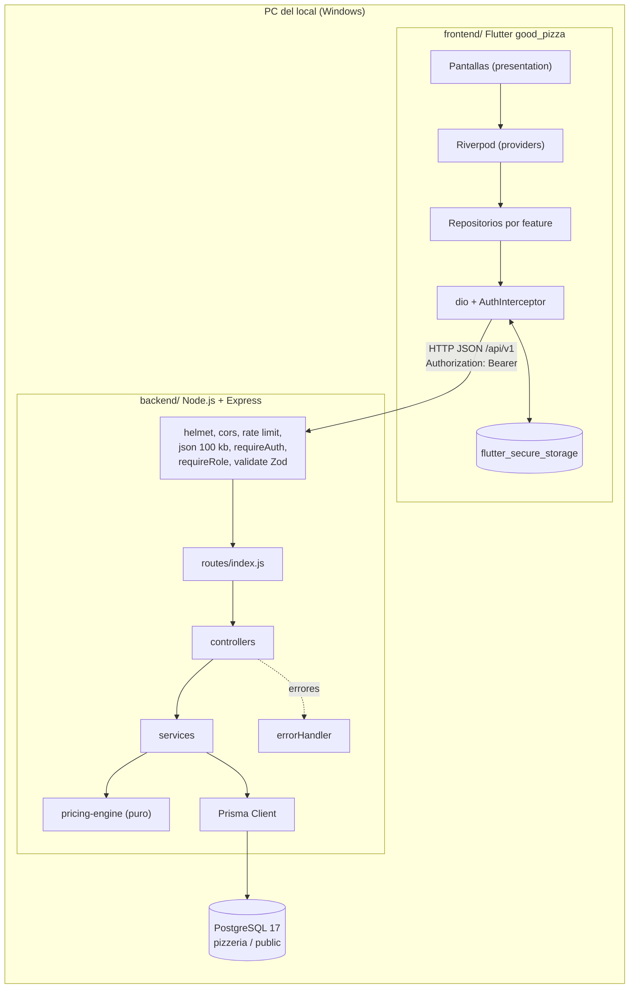

# Documentación técnica consolidada — Good Pizza

- **Versión:** 0.1.0 (backend) · frontend `1.0.0+1` · **Fecha:** 2026-11-06 · **Rama:** `testHarness`
- **Alcance:** describe el código tal como está en el repositorio. Es el consolidado de las fases 2 (arquitectura), 4 (backend), 5 (frontend), 6 (QA) y 7 (seguridad). Cuando un documento de fase difiere del código, prevalece el código (ver la sección 14 y `correcciones-pendientes.md`).
- **Fuera de alcance:** DevOps, Docker y CI (fase 8 omitida).

## 1. Visión general

Monolito con dos piezas en el mismo PC del local:

- **API REST** `/api/v1` en Node.js 20+ con Express 4, Prisma 6 y PostgreSQL 17 (base `pizzeria`, esquema `public`).
- **Aplicación de escritorio** para Windows en Flutter 3.47 (Material 3, español), que consume la API por HTTP JSON con token Bearer.

Principios de diseño:

1. **Una sola fuente de verdad para las reglas de negocio**: el motor de cálculo del backend (`services/pricing-engine`, ADR-002). El frontend no reimplementa precios, IVA ni reglas: consulta `POST /orders/quote`.
2. **El servidor no confía en el cliente**: al confirmar, recalcula todo desde el catálogo y guarda snapshots (ADR-003).
3. **Integridad transaccional** del stock y del número de orden (ADR-004, ADR-005).
4. **Capas estrictas** en el backend y **feature-first** en el frontend (ADR-001, ADR-007).



## 2. Decisiones de arquitectura (ADR)

| ADR | Decisión                                                                                           |
| --- | -------------------------------------------------------------------------------------------------- |
| 001 | Monolito y capas en el backend: `routes → controllers → services → Prisma`.                        |
| 002 | Motor de cálculo único (puro) y cotización `POST /orders/quote` sin efectos.                       |
| 003 | Snapshots de precio, calorías, IVA y nombres en el pedido.                                         |
| 004 | Secuencia diaria del número de orden, transaccional (`GP-AAAAMMDD-NNNN`).                          |
| 005 | Concurrencia de stock: bloqueo `FOR UPDATE` ordenado, `UPDATE` condicional y `CHECK (stock >= 0)`. |
| 006 | JWT de acceso (15 min) y refresh rotativo con hash SHA-256 en base de datos.                       |
| 007 | Frontend con Riverpod, go_router, dio y almacenamiento seguro; feature-first.                      |
| 008 | Dinero en `Decimal`; importes como cadenas decimales en JSON; IVA con half-up.                     |
| 009 | Catálogos como tablas y estado de pedido como enum con historial.                                  |
| 010 | Baja lógica de ingredientes y predefinidas (sin borrado).                                          |
| 011 | Pruebas sin escribir en `pizzeria`: las de integración solo usan el esquema `test`.                |

## 3. Stack y versiones

### 3.1 Backend (`backend/package.json`, instaladas según la auditoría de seguridad)

| Componente                          | Rango declarado | Versión instalada | Uso                                      |
| ----------------------------------- | --------------- | ----------------- | ---------------------------------------- |
| Node.js                             | `>=20`          | 24.13.1 (probado) | Runtime, ESM (`"type": "module"`)        |
| Express                             | `^4.21.0`       | 4.22.3            | Servidor HTTP                            |
| Prisma (`prisma`, `@prisma/client`) | `^6.0.0`        | 6.19.3            | ORM y migraciones                        |
| PostgreSQL                          | —               | 17                | Base de datos                            |
| Zod                                 | `^3.23.8`       | 3.25.76           | Validación de entradas (estricta)        |
| jsonwebtoken                        | `^9.0.2`        | 9.0.3             | JWT HS256                                |
| bcryptjs                            | `^2.4.3`        | 2.4.3             | Hash de contraseñas                      |
| helmet                              | `^8.0.0`        | 8.3.0             | Cabeceras de seguridad                   |
| cors                                | `^2.8.5`        | 2.8.6             | Lista blanca de orígenes                 |
| express-rate-limit                  | `^7.4.0`        | 7.5.1             | Límites global y de autenticación        |
| pino                                | `^9.5.0`        | 9.14.0            | Logs estructurados con redacción         |
| decimal.js                          | `^10.6.0`       | —                 | Aritmética decimal                       |
| dotenv-cli                          | `^7.4.2`        | —                 | Carga de `.env.local` en los scripts npm |
| Vitest                              | `^2.1.4`        | 2.1.9             | Pruebas                                  |
| @vitest/coverage-v8                 | `^2.1.9`        | —                 | Cobertura                                |
| Supertest                           | `^7.0.0`        | —                 | Pruebas HTTP                             |
| ESLint                              | `^9.14.0`       | —                 | Lint (`eslint.config.js`)                |

### 3.2 Frontend (`frontend/pubspec.yaml`)

| Componente             | Versión                          | Uso                                            |
| ---------------------- | -------------------------------- | ---------------------------------------------- |
| Flutter / Dart         | 3.47.9 / 3.13.7 (`sdk: ^3.13.7`) | SDK                                            |
| flutter_riverpod       | `^3.5.0`                         | Estado y providers                             |
| go_router              | `^18.1.3`                        | Rutas y guardas por rol                        |
| dio                    | `^5.11.1`                        | Cliente HTTP con interceptores                 |
| flutter_secure_storage | `^11.2.0` (plugin Windows 4.2.2) | Tokens (Credential Manager)                    |
| flutter_svg            | `^2.3.2`                         | Logotipo SVG                                   |
| intl                   | `^0.20.3`                        | Formato (con `flutter_localizations`, español) |
| integration_test       | SDK                              | Prueba de escritorio                           |
| flutter_lints          | `^6.0.0`                         | Reglas de análisis                             |

### 3.3 Herramientas de sistema

Visual Studio 2022 o Build Tools con "Desarrollo para el escritorio con C++" y el componente **C++ ATL para las últimas herramientas de compilación v143 (x86 y x64)**. Modo desarrollador de Windows para los enlaces de plugins.

## 4. Estructura real del repositorio

```
backend/
  src/
    app.js                 createApp(env): helmet, cors, requestLogger, limitador global, json 100 kb, /api/v1, 404, errorHandler
    server.js              arranque: getEnv(), listen(PORT), cierre ordenado con SIGINT/SIGTERM
    config/                env.js (Zod + reglas de producción), constants.js, zodErrorMap.js
    lib/                   prisma.js (cliente único), logger.js (pino con redact)
    middlewares/           requireAuth, requireRole, validate, rateLimiters, notFound, errorHandler, requestLogger
    routes/index.js        25 rutas y su cadena de middlewares
    controllers/           auth, health, catalog, ingredients, presetPizzas, orders
    schemas/               auth, ingredient, preset, order, common (Zod strict)
    services/              auth, token, catalog, catalogLoader, ingredient, presetPizza, quote,
                           order, orderView, stock, orderNumber, health
      pricing-engine/      buildPizza, validatePizza, calculatePizza, calculateOrder,
                           stockRequirements, recipe, violations, index (quoteOrder)
    utils/                 AppError, asyncHandler, money (Decimal, half-up), dates, orderNumber
  prisma/
    schema.prisma          15 modelos, 3 enums
    migrations/            20261106185922_init, 20261106185930_init (vacía), 20261106190500_add_check_constraints
    seed.js, seed-lib.js   datos de ejemplo idempotentes
  scripts/db-test-migrate.js
  tests/                   unit/, api/, integration/, helpers/
  env.template, package.json, vitest.config.js, eslint.config.js

frontend/
  lib/
    main.dart, app.dart
    core/                  api (dio_provider, auth_interceptor, api_exception), config (app_config),
                           storage (token_storage), theme (app_colors, app_theme, contrast),
                           router (app_router), widgets (app_shell, page_widgets, dialogs, steppers,
                           display_widgets, feedback_widgets, good_pizza_logo), utils (money_format,
                           debouncer), layout (breakpoints)
    features/              auth, catalog, preset_pizzas, pizza_builder, cart, orders, admin
                           (cada una con data/, domain/ y presentation/ según aplique)
  assets/brand/            good_pizza_logo.svg (y variantes)
  test/                    core/, features/, flows/, helpers/
  integration_test/        app_flow_test.dart
  windows/                 runner nativo (ventana inicial 1280 x 800)

docs/                      01..07 entregables de fase; 08-devops (sin entregables); 09-maintenance (esta fase)
scripts/setup.js           verifica herramientas, instala dependencias y crea backend/.env.local
```

## 5. Configuración

### 5.1 Variables de entorno del backend

Las valida `backend/src/config/env.js` al arrancar. Si una variable falta o no es válida, el proceso termina mostrando **solo los nombres**. Los valores no se registran.

| Variable                 | Tipo y regla                                                                  | Valor por defecto |
| ------------------------ | ----------------------------------------------------------------------------- | ----------------- |
| `NODE_ENV`               | `development`, `test` o `production`                                          | `development`     |
| `PORT`                   | entero 0..65535                                                               | `3000`            |
| `DATABASE_URL`           | texto obligatorio (Prisma)                                                    | —                 |
| `JWT_SECRET`             | texto obligatorio; en `production` ≥ 32 caracteres                            | —                 |
| `JWT_REFRESH_SECRET`     | texto obligatorio; en `production` ≥ 32 caracteres y distinto de `JWT_SECRET` | —                 |
| `JWT_ACCESS_EXPIRES_IN`  | texto ≥ 2 caracteres                                                          | `15m`             |
| `JWT_REFRESH_EXPIRES_IN` | texto ≥ 2 caracteres                                                          | `7d`              |
| `BCRYPT_COST`            | entero 12..15 (4..15 en `test`)                                               | `12`              |
| `CORS_ORIGINS`           | lista separada por comas                                                      | vacío             |
| `RATE_LIMIT_WINDOW_MS`   | entero positivo                                                               | `900000`          |
| `RATE_LIMIT_MAX`         | entero positivo                                                               | `300`             |
| `AUTH_RATE_LIMIT_MAX`    | entero positivo                                                               | `10`              |
| `LOG_LEVEL`              | `fatal`, `error`, `warn`, `info`, `debug`, `trace`, `silent`                  | `info`            |

Otras variables que usa el proceso fuera de `env.js`: `DATABASE_URL_TEST` (pruebas de integración), `SEED_ADMIN_EMAIL`, `SEED_ADMIN_PASSWORD`, `SEED_CLIENT_EMAIL`, `SEED_CLIENT_PASSWORD` (seed). Las variables `DB_*` son informativas.

**Advertencia de seguridad (S-01):** las reglas de longitud y de secretos distintos solo se aplican en `production`. Fuera de ese entorno se aceptan valores débiles. Ver el backlog (C1).

### 5.2 Variables del frontend

| Variable  | Forma                                                                                          | Por defecto                    |
| --------- | ---------------------------------------------------------------------------------------------- | ------------------------------ |
| `API_URL` | `--dart-define=API_URL=…`, leída con `String.fromEnvironment` en `core/config/app_config.dart` | `http://localhost:3000/api/v1` |

Timeouts: conexión 10 s, recepción 20 s (`AppConfig`). No hay secretos en el frontend.

## 6. API REST `/api/v1`

### 6.1 Formato

- Respuesta correcta: `{ "data": … }`. Listas paginadas: `{ data, page, pageSize, total }`.
- Error: `{ "error": { "code", "message", "details" } }`. El `code` es constante en inglés; el `message` es un texto en español apto para mostrar.
- Ruta o método no definidos: `404 ROUTE_NOT_FOUND`.
- JSON malformado o cuerpo mayor de 100 KB: `400 VALIDATION_ERROR` (el contrato no define 413).

### 6.2 Endpoints (25)

| #   | Método | Ruta                        | Acceso             | Notas                                                                                             |
| --- | ------ | --------------------------- | ------------------ | ------------------------------------------------------------------------------------------------- |
| 1   | GET    | `/health`                   | Pública            | 200 o 503 `SERVICE_UNAVAILABLE`                                                                   |
| 2   | POST   | `/auth/register`            | Pública, limitador | 201; siempre rol CLIENT; contraseña 8..72                                                         |
| 3   | POST   | `/auth/login`               | Pública, limitador | 200; 401 `INVALID_CREDENTIALS`; 403 desactivado                                                   |
| 4   | POST   | `/auth/refresh`             | Pública, limitador | Rotación; reutilización revoca todos                                                              |
| 5   | POST   | `/auth/logout`              | Pública            | 204, idempotente                                                                                  |
| 6   | GET    | `/auth/me`                  | Autenticado        | Usuario actual                                                                                    |
| 7   | GET    | `/sizes`                    | Autenticado        |                                                                                                   |
| 8   | GET    | `/ingredient-categories`    | Autenticado        |                                                                                                   |
| 9   | GET    | `/vat-rates`                | ADMIN              |                                                                                                   |
| 10  | GET    | `/ingredients`              | Autenticado        | `category`, `search`, `includeInactive` (solo ADMIN), `page`, `pageSize`                          |
| 11  | GET    | `/ingredients/:id`          | Autenticado        | CLIENT solo ve activos                                                                            |
| 12  | POST   | `/ingredients`              | ADMIN              | 201; 409 `INGREDIENT_CODE_EXISTS`; 422 `MISSING_SIZE_VALUES` / `INVALID_VAT_RATE`                 |
| 13  | PUT    | `/ingredients/:id`          | ADMIN              | 422 `INGREDIENT_CATEGORY_LOCKED`                                                                  |
| 14  | PATCH  | `/ingredients/:id/stock`    | ADMIN              | `SET` o `ADD` atómicos; 422 `STOCK_WOULD_BE_NEGATIVE`                                             |
| 15  | PATCH  | `/ingredients/:id/status`   | ADMIN              | Activar exige los 3 tamaños                                                                       |
| 16  | GET    | `/preset-pizzas`            | Autenticado        | `pricesBySize`, `available`, `unavailableReasons`                                                 |
| 17  | GET    | `/preset-pizzas/:id`        | Autenticado        |                                                                                                   |
| 18  | POST   | `/preset-pizzas`            | ADMIN              | 409 `PRESET_CODE_EXISTS` / `PRESET_NAME_EXISTS`; 422 `INVALID_RECIPE`                             |
| 19  | PUT    | `/preset-pizzas/:id`        | ADMIN              | Reemplaza la receta en una transacción                                                            |
| 20  | PATCH  | `/preset-pizzas/:id/status` | ADMIN              | Baja lógica                                                                                       |
| 21  | POST   | `/orders/quote`             | Autenticado        | Cálculo sin escritura                                                                             |
| 22  | POST   | `/orders`                   | CLIENT             | 201 y cabecera `Location`; 409 `INSUFFICIENT_STOCK` / `PRICE_CHANGED`; 422 `PIZZA_RULES_VIOLATED` |
| 23  | GET    | `/orders`                   | Autenticado        | CLIENT solo ve los suyos; filtros `status`, `from`, `to`; `search` solo ADMIN                     |
| 24  | GET    | `/orders/:id`               | Dueño o ADMIN      | Pedido ajeno: 404                                                                                 |
| 25  | PATCH  | `/orders/:id/status`        | ADMIN              | `PENDING` → `IN_PREPARATION` → `DELIVERED`                                                        |

No existen por diseño: `DELETE` de ingredientes o predefinidas, cancelación o edición de pedidos, gestión de usuarios y de tarifas de IVA.

Las listas de ingredientes y predefinidas devuelven solo activos salvo que el ADMIN envíe `includeInactive=true` (PA-B1; la matriz del contrato debe corregirse, ver `correcciones-pendientes.md`).

### 6.3 Códigos de error (24)

`VALIDATION_ERROR` (400) · `UNAUTHENTICATED` (401) · `TOKEN_EXPIRED` (401) · `INVALID_CREDENTIALS` (401) · `INVALID_REFRESH_TOKEN` (401) · `FORBIDDEN` (403) · `NOT_FOUND` (404) · `ROUTE_NOT_FOUND` (404) · `EMAIL_ALREADY_EXISTS` (409) · `INGREDIENT_CODE_EXISTS` (409) · `PRESET_CODE_EXISTS` y `PRESET_NAME_EXISTS` (409) · `INSUFFICIENT_STOCK` (409) · `PRICE_CHANGED` (409) · `PIZZA_RULES_VIOLATED` (422) · `MISSING_SIZE_VALUES` (422) · `INVALID_RECIPE` (422) · `INGREDIENT_CATEGORY_LOCKED` (422) · `INVALID_STATUS_TRANSITION` (422) · `INVALID_VAT_RATE` (422) · `STOCK_WOULD_BE_NEGATIVE` (422) · `RATE_LIMITED` (429) · `INTERNAL_ERROR` (500) · `SERVICE_UNAVAILABLE` (503).

### 6.4 Violaciones de reglas de armado (15)

`DOUGH_REQUIRED`, `SAUCE_REQUIRED`, `INVALID_DOUGH`, `INVALID_SAUCE`, `INGREDIENT_CATEGORY_NOT_ALLOWED`, `DUPLICATE_INGREDIENT`, `MAX_PORTIONS_EXCEEDED`, `MIN_TOPPINGS_NOT_MET`, `INGREDIENT_NOT_FOUND`, `INGREDIENT_INACTIVE`, `MISSING_SIZE_VALUES`, `PRESET_NOT_FOUND`, `PRESET_INACTIVE`, `PRESET_UNAVAILABLE`, `INSUFFICIENT_STOCK`.

### 6.5 Autorización

- `requireAuth` valida el access JWT (HS256, claim `type: "access"`) y deja `req.user = { id, role }`. **No consulta la base de datos** (S-07).
- `requireRole(ADMIN)` o `requireRole(CLIENT)` en cada ruta protegida por rol.
- Dueño del pedido: en `order.service`, si el rol es CLIENT, la consulta filtra por `userId`. Un pedido ajeno devuelve 404 para no revelar su existencia.
- La matriz de permisos del contrato coincide con `routes/index.js` en las 25 rutas (verificado en la fase 7).

## 7. Motor de cálculo

Módulo puro en `backend/src/services/pricing-engine/`, sin Prisma ni HTTP. Recibe un `catalog` ya cargado.

| Función             | Responsabilidad                                                             |
| ------------------- | --------------------------------------------------------------------------- |
| `buildPizza`        | Normaliza una pizza `CUSTOM` o `PRESET` (receta más extras) en componentes. |
| `validatePizza`     | Aplica las reglas de armado y devuelve las violaciones.                     |
| `calculatePizza`    | Precio y calorías unitarias, y subtotales por tarifa de IVA.                |
| `calculateOrder`    | Subtotales por línea × cantidad, IVA 15 % con half-up, total.               |
| `stockRequirements` | Porciones requeridas por ingrediente (masa y salsa cuentan 1 por pizza).    |
| `recipe`            | Recetas de predefinidas.                                                    |
| `index.quoteOrder`  | Punto de entrada usado por cotización, confirmación y predefinidas.         |

Fórmulas (RF-15, RF-16, S-18, S-19):

- Precio de una pizza = precio(masa, tamaño) + precio(salsa, tamaño) + Σ (precio(ingrediente, tamaño) × porciones).
- Calorías: misma fórmula con las kcal por tamaño.
- Subtotal 15 % y subtotal 0 % según la tarifa de cada componente.
- IVA 15 % = redondeo half-up a 2 decimales del **subtotal 15 % del pedido completo** (no por línea).
- Total = subtotal 15 % + subtotal 0 % + IVA 15 %.
- Un ingrediente con tarifa 0 % va al subtotal 0 %; cualquier otra tarifa va al subtotal 15 % (el sistema solo maneja 15 % y 0 %; ver S-18 y D-04).

Reglas de negocio: 1 masa y 1 salsa; toppings solo de queso, carne, vegetal u otros; máximo 3 porciones por ingrediente (receta más extra); mínimo 3 ingredientes distintos solo en `CUSTOM`; ingrediente activo con valores para el tamaño; predefinida activa y disponible; stock agregado suficiente; cantidad por línea 1..20; máximo 50 líneas y 30 extras por pizza.

Aritmética: `decimal.js` con precisión 40 y redondeo half-up (`utils/money.js`). Las calorías son enteros. El frontend muestra los importes con formato `$ 7.50`.

## 8. Confirmación de pedido (transacción)

1. Validación Zod del cuerpo.
2. Dentro de `prisma.$transaction`: `SELECT … FOR UPDATE` de los ingredientes referenciados, en orden de id.
3. Motor de cálculo con los valores bloqueados. Si hay violaciones, 422. Si falta stock, 409 con el detalle por ingrediente.
4. `expectedTotal` opcional: si no coincide con el total recalculado, 409 `PRICE_CHANGED` con la nueva cotización.
5. Descuento con `UPDATE … WHERE stock >= n` y comprobación de una fila afectada. El `CHECK (stock >= 0)` es la última defensa.
6. Número de pedido `GP-AAAAMMDD-NNNN` mediante `INSERT … ON CONFLICT` en `order_daily_sequences`. La fecha es la del servidor (zona horaria del sistema operativo, S-24).
7. Inserción de `orders`, `order_pizzas`, `order_pizza_ingredients` y del historial inicial, con snapshots.

Los estados avanzan con `WHERE status = prev` (`order.service.js`). Si la transición no es válida, 422 `INVALID_STATUS_TRANSITION`.

## 9. Modelo de datos

- **15 modelos** y **3 enums**: `OrderStatus` (`PENDING`, `IN_PREPARATION`, `DELIVERED`), `PizzaKind` (`PRESET`, `CUSTOM`), `PizzaComponent` (`DOUGH`, `SAUCE`, `TOPPING`).
- **15 tablas**: `roles`, `users`, `refresh_tokens`, `sizes`, `ingredient_categories`, `vat_rates`, `ingredients`, `ingredient_size_values`, `preset_pizzas`, `preset_pizza_ingredients`, `orders`, `order_daily_sequences`, `order_status_history`, `order_pizzas`, `order_pizza_ingredients`.
- **9 restricciones CHECK** en la migración `add_check_constraints`: stock, precio y kcal no negativos; tarifa entre 0 y 100; porciones de receta y de pedido entre 1 y 3; cantidad entre 1 y 20; recipe_portions entre 0 y portions; total igual a la suma de subtotales e IVA.
- **Dinero** en `DECIMAL` (`Decimal(10,2)` por porción, `Decimal(12,2)` en totales). Nunca `FLOAT`.
- **Snapshots** en `order_pizzas` y `order_pizza_ingredients`: precio, kcal, tarifa, nombres y códigos en el momento de la compra (RNF-10).
- **Migraciones:** la inicial se aplicó antes que los CHECK, y estos se añadieron en una migración posterior. Las migraciones aplicadas no se editan.

El diagrama completo y el diccionario de datos están en `diagrama-er.md` de esta carpeta.

## 10. Seed de datos de ejemplo

`backend/prisma/seed.js` y `seed-lib.js`. Idempotente (`upsert`).

- 2 roles (`ADMIN`, `CLIENT`), 3 tamaños (`INDIVIDUAL`, `MEDIUM`, `FAMILY`), 6 categorías, 2 tarifas de IVA (`VAT_15` por defecto y `VAT_0`).
- **20 ingredientes de ejemplo**: 3 masas, 3 salsas, 4 quesos, 4 carnes, 5 vegetales y 1 otro. Precio y kcal por tamaño, stock inicial y tarifa (mayoría 15 %, algunos 0 %).
- 5 pizzas predefinidas: Margarita, Pepperoni, Hawaiana, Vegetariana y 4 Quesos.
- 1 administrador y 1 cliente. Emails por defecto `admin@goodpizza.local` y `cliente@goodpizza.local`.
- Contraseñas: desde `SEED_ADMIN_PASSWORD` y `SEED_CLIENT_PASSWORD`. Si faltan, se generan con `crypto.randomBytes` y se imprimen **una sola vez**. No cambia la contraseña de un usuario existente ni pisa precios o stock editados.

Advertencia: son datos de ejemplo, no precios reales (S-16 del prompt). Revisar IVA y precios antes de operar.

## 11. Frontend

### 11.1 Arquitectura

- **Estado:** Riverpod. Cada feature expone un repositorio abstracto en `data/` con implementación `dio`, inyectado por provider. Los widgets no usan `dio`. Las pantallas manejan `AsyncValue` (carga, error con Reintentar y datos).
- **Sesión:** `sessionProvider` (`AsyncNotifier`) restaura la sesión al arrancar con los tokens de almacenamiento seguro.
- **Interceptor:** `AuthInterceptor` añade `Authorization: Bearer`. Ante `401 TOKEN_EXPIRED` hace un único refresh serializado y reintenta. Si el refresh es rechazado, borra los tokens. Ante un fallo de red conserva la sesión.
- **Almacenamiento:** `flutter_secure_storage` (access y refresh). Nunca `shared_preferences`.
- **Reintentos:** los providers no reintentan automáticamente (`retry: null`), para no ocultar errores.
- **Router:** `go_router` con `ShellRoute` (`AppShell`, NavigationRail). `appRedirect` es una función pura: sin sesión va a `/login`; el cliente en `/admin/*` va a `/presets`; el administrador fuera de `/admin/*` va a `/admin/ingredients`.
- **Tema:** Material 3 en modo claro con paleta azul marino (`app_colors.dart`, `app_theme.dart`); 45 pares de contraste verificados (mínimo texto 4,94:1).
- **Formato:** importes en `money_format.dart` (punto decimal, USD).

### 11.2 Rutas

| Ruta                                 | Pantalla                                    | Rol            |
| ------------------------------------ | ------------------------------------------- | -------------- |
| `/login`, `/register`                | Iniciar sesión, Crear cuenta                | Público        |
| `/presets`                           | Pizzas predefinidas (inicio del cliente)    | CLIENT         |
| `/builder` (`?presetId=&size=`)      | Personalizar pizza                          | CLIENT         |
| `/cart`                              | Resumen del pedido                          | CLIENT         |
| `/orders`, `/orders/:id`             | Mis pedidos, comprobante                    | CLIENT (dueño) |
| `/admin/ingredients`, `/new`, `/:id` | Ingredientes (lista, formulario)            | ADMIN          |
| `/admin/presets`, `/new`, `/:id`     | Pizzas predefinidas (lista, formulario)     | ADMIN          |
| `/admin/orders`, `/admin/orders/:id` | Pedidos (lista, detalle y cambio de estado) | ADMIN          |

Son 13 pantallas (S-01..S-13), más los diálogos compartidos.

### 11.3 Pruebas y compilación

Ver la sección 12 y `pruebas-unitarias.md`. Compilar: `flutter build windows --debug` o `--release --dart-define=API_URL=…`. El ejecutable queda en `build\windows\x64\runner\<Debug|Release>\good_pizza.exe`.

## 12. Pruebas

| Capa                               | Herramienta               | Ubicación                              | Estado registrado                       |
| ---------------------------------- | ------------------------- | -------------------------------------- | --------------------------------------- |
| Backend unitarias y API            | Vitest + Supertest        | `backend/tests/unit`, `tests/api`      | 267 pasan                               |
| Backend integración con PostgreSQL | Vitest                    | `backend/tests/integration/db.test.js` | 22 **omitidas** sin `DATABASE_URL_TEST` |
| Frontend unitarias, widget y flujo | `flutter_test`            | `frontend/test`                        | 225 pasan                               |
| Frontend escritorio                | `integration_test`        | `frontend/integration_test`            | 1 pasa                                  |
| Análisis estático                  | `flutter analyze`, ESLint | —                                      | Sin incidencias                         |

Las pruebas de integración solo escriben en el esquema `test`. Antes de cada prueba comprueban `?schema=test` en la URL y `current_schema() = 'test'` (ADR-011). El setup de pruebas fuerza `DATABASE_URL` a la URL de prueba o a una inválida.

Cobertura: `src/services` 97,11 %; backend total 96,13 %; frontend 93,3 % de líneas.

## 13. Operación

### 13.1 Scripts npm (`backend/package.json`)

| Script                    | Qué hace                                                                    |
| ------------------------- | --------------------------------------------------------------------------- |
| `npm run dev`             | API con recarga (`node --watch`), carga `.env.local`                        |
| `npm start`               | API sin recarga                                                             |
| `npm test`                | Vitest (carga `.env.local`)                                                 |
| `npm run test:watch`      | Vitest en modo observación                                                  |
| `npm run lint`            | ESLint sobre `src`, `tests`, `prisma` y `scripts`                           |
| `npm run format`          | Prettier sobre `src` y `tests`                                              |
| `npm run db:generate`     | `prisma generate`                                                           |
| `npm run db:migrate`      | `prisma migrate dev` (solo desarrollo)                                      |
| `npm run db:deploy`       | `prisma migrate deploy` (uso en el local)                                   |
| `npm run db:test:migrate` | Aplica las migraciones al esquema `test` (se niega si no es `?schema=test`) |
| `npm run db:seed`         | Ejecuta el seed                                                             |
| `npm run db:studio`       | Prisma Studio                                                               |

Scripts del repositorio: `node scripts/setup.js` y `node scripts/setup.js --check`.

### 13.2 Procedimientos

El runbook (`runbook.md`) describe arranque, parada, salud (`GET /api/v1/health`), variables, rotación de secretos, respaldo y restauración con `pg_dump`/`pg_restore`, migraciones, reinicio del esquema `test`, logs e incidentes.

### 13.3 Logs

pino en la salida estándar, formato JSON. Redacta `authorization`, `password`, `refreshToken` y `accessToken`. El `requestLogger` no registra cabeceras, cuerpos ni query strings. Los errores no controlados registran `err.name`, `err.message`, `err.stack` y `path` (S-12).

## 14. Seguridad (resumen de controles)

Controles verificados en la fase 7 (`docs/07-security/security-report.md`):

- Contraseñas con bcrypt de coste ≥ 12 y 8..72 caracteres. El hash nunca se devuelve.
- Login sin enumeración: hash de relleno y mensaje genérico.
- JWT con algoritmo fijado (HS256), claim `type` y secretos distintos. Access de 15 min y refresh de 7 días con rotación y detección de reutilización. Solo se guarda el hash SHA-256 del refresh.
- Autorización por rol y por dueño en las 25 rutas.
- Zod `strict()` en todas las entradas; UUID en los parámetros; sin asignación masiva de `role`, `stock` o `active`.
- Los precios nunca los envía el cliente: el servidor recalcula.
- SQL parametrizado: 3 `$queryRaw` con plantilla etiquetada; ningún `$queryRawUnsafe` en `src`.
- helmet, `x-powered-by` desactivado, CORS con lista blanca sin `credentials`, cuerpo JSON de 100 KB, errores 500 sin stack.
- Frontend: tokens en almacenamiento seguro, sin logs de red, guardas de router solo como UX.

Hallazgos abiertos: **S-01** (alta, secretos JWT en entornos distintos de `production`), **S-02..S-06** (medias), **S-07..S-18** (bajas o informativas), **H-01..H-04** (entorno de Claude Code). Todos están en `backlog.md` con responsable y criterio de cierre.

## 15. Limitaciones conocidas

- Solo Windows (RNF-07). Sin Docker, CI ni despliegue automatizado (fase 8 omitida).
- Sin cancelación ni devolución de stock (S-20).
- Sin gestión de usuarios ni recuperación de contraseña.
- `requireAuth` no revalida el usuario en cada petición (S-07).
- Límites de peticiones por IP compartidos en un mismo PC (S-02).
- La API escucha en todas las interfaces y por HTTP (S-04).
- Las pruebas de integración con PostgreSQL no se han ejecutado todavía (D-05).
- No hay monitoreo, respaldo automático ni rotación de logs (N-07).

## 16. Contradicciones detectadas entre documentos y código

Detalle y texto exacto en `correcciones-pendientes.md`. Resumen:

1. Variable de la API en Flutter: `API_BASE_URL` (fases 2 y 3) frente a `API_URL` (código y fase 5). Gana el código: `API_URL`.
2. Compilación de Windows: la fase 5 la da por bloqueada por ATL. Hoy compila tras instalar el componente. Gana la fase 6.
3. Conteos de pruebas: fases 4 y 5 (190 y 221) frente a la ejecución de QA (289 en total, 225 en Flutter). Gana la última ejecución.
4. Comprobación de usuario activo: la arquitectura dice que se verifica "en operaciones sensibles". El código solo lo hace en unas pocas rutas. Gana el código.
5. Estructura de carpetas: la arquitectura propone `*.routes.js` y `features/presets`; el código tiene `routes/index.js` y `features/preset_pizzas`. Gana el código.
6. Migración de CHECK: la fase 2 prevé incluirlos en la inicial; se añadieron en una migración posterior. Gana el código y el registro de la fase 4.
7. Matriz de permisos del contrato: "ADMIN ve todos" frente a `includeInactive=true` obligatorio (PA-B1).
8. `docs/DEMO.md` propone `prisma migrate reset` sobre la base, en contra de la regla de no borrar `pizzeria`.
9. Versiones: backend `0.1.0` frente a frontend `1.0.0+1`. Pendiente de decisión.

## 17. Preguntas abiertas técnicas

1. ¿Se unifica la versión de la entrega (N-05)?
2. ¿Se mantiene `replaced_by_id` sin clave foránea (N-03)?
3. ¿Se añade snapshot del código de predefinida (PA-B2)?
4. ¿Se acepta el almacén de límites en memoria (N-09) mientras haya un único proceso?
