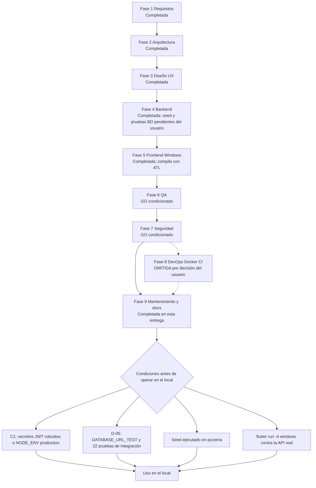
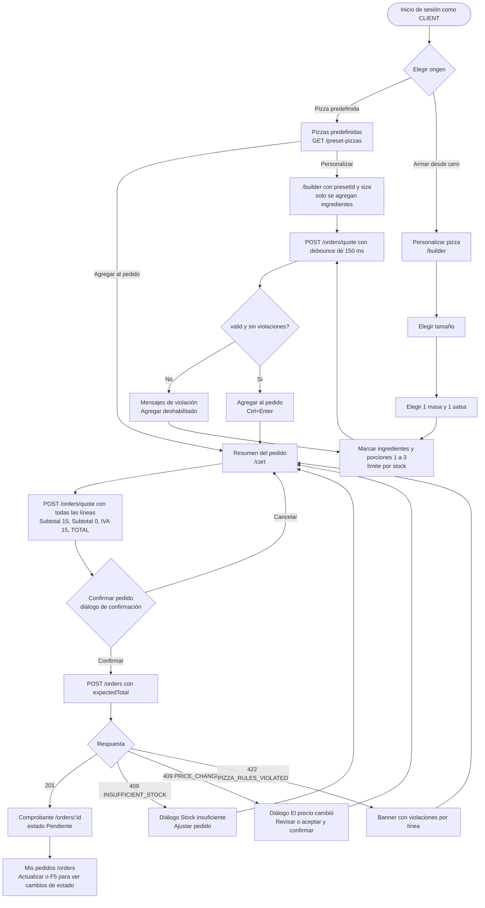
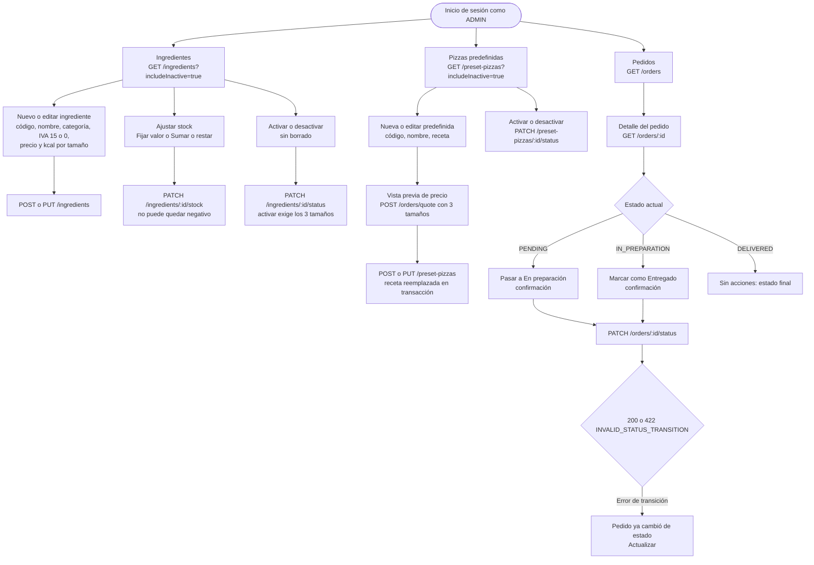
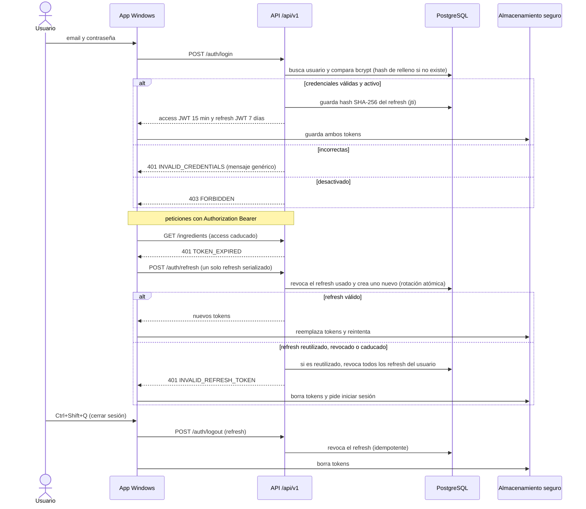
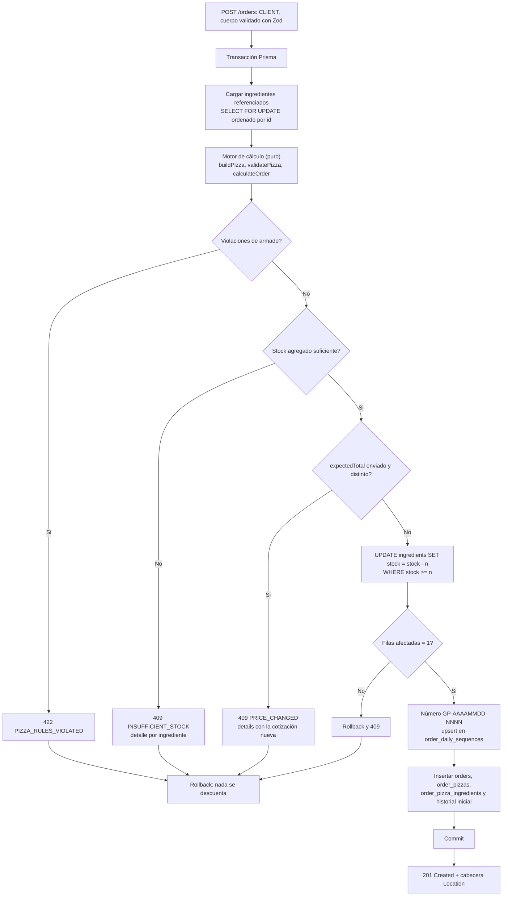
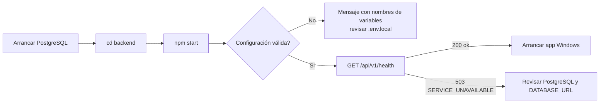
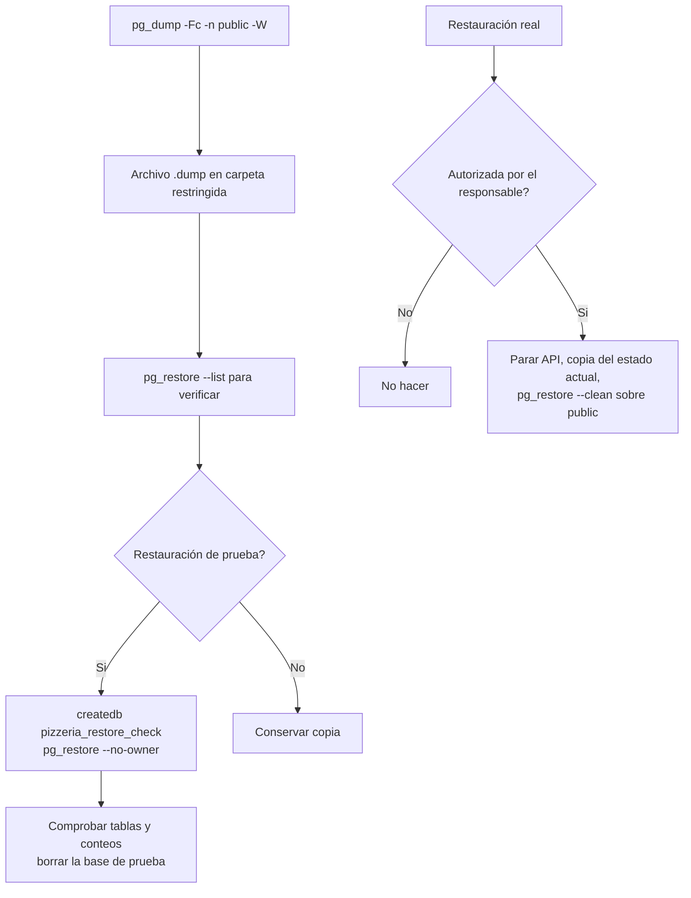
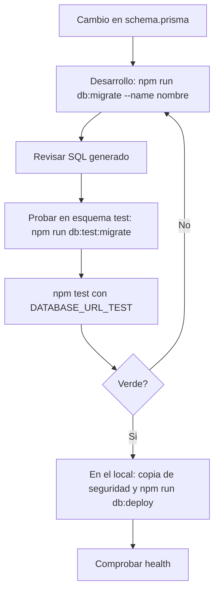
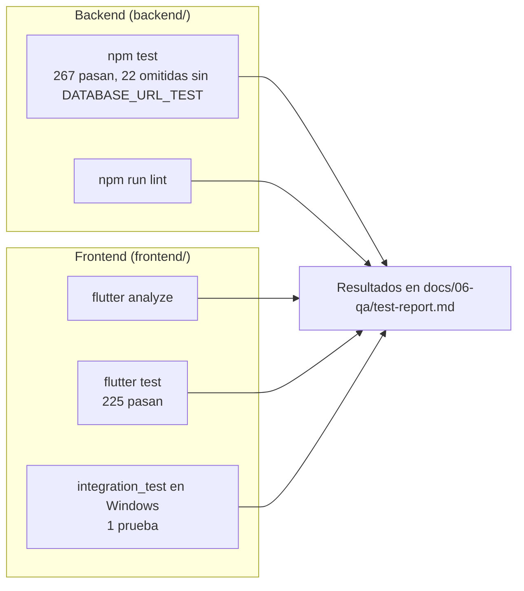
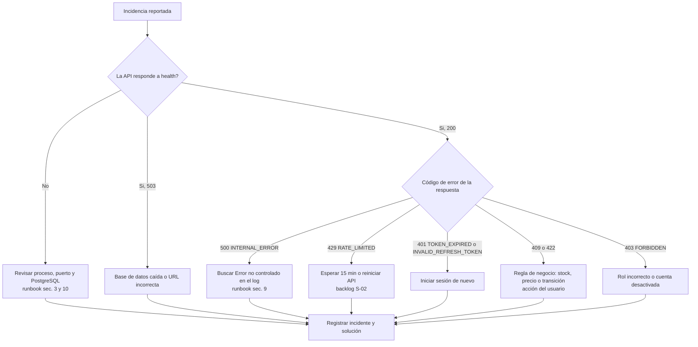

# Flujo — Fase 9 (consolidado del proyecto Good Pizza)

Este documento describe: (1) el proceso SDLC del proyecto con su estado real, (2) los flujos funcionales de cliente y administrador tal como están implementados, (3) el flujo de autenticación, (4) el flujo transaccional de confirmación de pedido, y (5) los flujos operativos de mantenimiento (salud, respaldo, migraciones y pruebas).

## 1. Proceso SDLC del proyecto

Orden de las fases según `docs/prompt-proyecto.md`: requisitos, arquitectura, diseño UX, backend, frontend, QA, seguridad y documentación final. La fase 8 (DevOps/Docker/CI) se omite por decisión del usuario.

En cada fase se produjeron los seis entregables de la skill `phase-deliverables` en `docs/NN-*/`. La fase 8 no tiene entregables (solo `.gitkeep`).

## 2. Flujo funcional del cliente: de la pizza a la orden

Implementado en el frontend (`/presets`, `/builder`, `/cart`, `/orders`, `/orders/:id`) y en el backend (`/orders/quote`, `/orders`).

Reglas aplicadas en el motor del backend (no en la UI): exactamente 1 masa y 1 salsa; toppings de categorías queso, carne, vegetal u otros; máximo 3 porciones por ingrediente; mínimo 3 ingredientes distintos solo en pizzas personalizadas; cantidad por línea de 1 a 20; stock agregado suficiente. Los precios los calcula siempre el servidor.

## 3. Flujo funcional del administrador

Implementado en `/admin/ingredients`, `/admin/presets`, `/admin/orders`.

Las transiciones solo avanzan: PENDING → IN_PREPARATION → DELIVERED. No hay retroceso, cancelación ni devolución de stock.

## 4. Flujo de autenticación y renovación de sesión

Límite de peticiones: 10 intentos de login, registro o refresh cada 15 minutos por IP (valor por defecto); en un PC todos los usuarios comparten la IP (S-02).

## 5. Flujo transaccional de confirmación de pedido

Describe el camino crítico de integridad del stock y del número de orden (ADR-004 y ADR-005).

Notas: el orden de bloqueo es determinista para evitar interbloqueos. El `CHECK (stock >= 0)` es la última defensa. La concurrencia real con PostgreSQL está pendiente de verificación (pruebas de integración omitidas, backlog D-05).

## 6. Flujo operativo de mantenimiento

### 6.1 Arranque y comprobación

### 6.2 Respaldo y restauración de prueba

### 6.3 Migraciones y esquema de pruebas

### 6.4 Pruebas

## 7. Flujo de incidencias

## 8. Estado de los flujos respecto al diseño

| Flujo                                   | Implementado                        | Verificado                                                        | Pendiente                          |
| --------------------------------------- | ----------------------------------- | ----------------------------------------------------------------- | ---------------------------------- |
| Registro, login, logout y renovación    | Sí                                  | Pruebas de API en proceso, pruebas de widget y del interceptor    | Prueba con backend real (G-12)     |
| Armado, cotización y confirmación       | Sí                                  | Motor en casos límite (20 001 subtotales), flujos HTTP en proceso | Concurrencia con PostgreSQL (D-05) |
| Snapshots de pedidos antiguos           | Sí                                  | En proceso con dobles de Prisma                                   | Prueba con BD real (D-05)          |
| Gestión de ingredientes y stock (admin) | Sí                                  | Pruebas de widget y de API                                        | Prueba manual con datos del seed   |
| Gestión de predefinidas (admin)         | Sí                                  | Pruebas de widget y de API                                        | Prueba manual con datos del seed   |
| Cambio de estado del pedido             | Sí                                  | Matriz de permisos y transiciones                                 | Prueba manual con datos del seed   |
| Respaldo y restauración                 | Procedimiento documentado (runbook) | No ejecutado                                                      | Automatización (backlog N-07)      |
