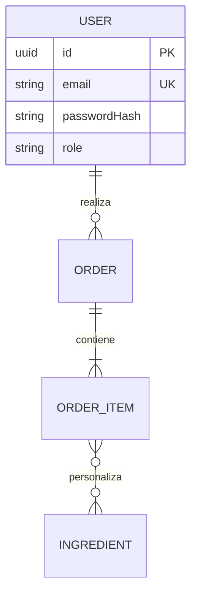

# Diagrama Entidad-Relación — Fase <N>

## Diccionario de datos
| Entidad | Atributo | Tipo | Nulo | Restricciones | Descripción |
|---|---|---|---|---|---|

## Reglas de integridad
- …

## Cambios respecto a la fase anterior
- …
